<div class="portada">


<p class="institucion">Universidad Tecnológica Nacional</p>
<p class="facultad">Facultad Regional Tucumán</p>

<p class="tipo">Informe de Práctica Profesional Supervisada</p>

<p class="titulo">PerliNor ERP</p>

<p class="subtitulo">Sistema de gestión comercial y de inventario<br>para una fábrica de materiales para la construcción</p>

<p class="subtitulo" style="font-style: normal; font-variant: small-caps; letter-spacing: .08em;">Documentación técnica</p>

<div class="datos">
<p><span class="etiqueta">Autor:</span> Mauro Esteban Polizzi</p>
<p><span class="etiqueta">Carrera:</span> Tecnicatura Universitaria en Programación</p>
<p><span class="etiqueta">Asignatura:</span> Práctica Profesional Supervisada</p>
<p><span class="etiqueta">Empresa:</span> PerliNor</p>
</div>

<p class="fecha">Tucumán, 26 de septiembre de 2026</p>

</div>

<div class="indice">

<h1 class="sin-numero">Índice</h1>

<!-- Los números de página se completan tras la conversión a PDF.
     Con Pandoc, reemplazar este archivo por la opción --toc.
     Con la extensión de VS Code, completarlos a mano en la revisión final (bloque B5). -->

**I. Introducción y contexto del proyecto**
&nbsp;&nbsp;&nbsp;&nbsp;A. Contexto de la organización
&nbsp;&nbsp;&nbsp;&nbsp;B. Situación previa y problema detectado
&nbsp;&nbsp;&nbsp;&nbsp;C. Objetivo del sistema
&nbsp;&nbsp;&nbsp;&nbsp;D. Alcance
&nbsp;&nbsp;&nbsp;&nbsp;E. Roles y usuarios
&nbsp;&nbsp;&nbsp;&nbsp;F. Organización del informe

**II. Metodología y proceso de desarrollo**
&nbsp;&nbsp;&nbsp;&nbsp;A. Enfoque
&nbsp;&nbsp;&nbsp;&nbsp;B. Análisis previo a la planificación
&nbsp;&nbsp;&nbsp;&nbsp;C. Cronograma
&nbsp;&nbsp;&nbsp;&nbsp;D. Control de versiones
&nbsp;&nbsp;&nbsp;&nbsp;E. Integración continua
&nbsp;&nbsp;&nbsp;&nbsp;F. Herramientas
&nbsp;&nbsp;&nbsp;&nbsp;G. Documentación del proceso

**III. Requerimientos**
&nbsp;&nbsp;&nbsp;&nbsp;A. Requerimientos funcionales
&nbsp;&nbsp;&nbsp;&nbsp;B. Requerimientos no funcionales
&nbsp;&nbsp;&nbsp;&nbsp;C. Restricciones
&nbsp;&nbsp;&nbsp;&nbsp;D. Supuestos

**IV. Arquitectura del sistema**
&nbsp;&nbsp;&nbsp;&nbsp;A. Visión general
&nbsp;&nbsp;&nbsp;&nbsp;B. Decisiones arquitectónicas
&nbsp;&nbsp;&nbsp;&nbsp;C. Arquitectura del servidor
&nbsp;&nbsp;&nbsp;&nbsp;D. Arquitectura del cliente
&nbsp;&nbsp;&nbsp;&nbsp;E. Comunicación entre cliente y servidor
&nbsp;&nbsp;&nbsp;&nbsp;F. Configuración
&nbsp;&nbsp;&nbsp;&nbsp;G. Observabilidad y manejo de errores

**V. Modelo de datos**
&nbsp;&nbsp;&nbsp;&nbsp;A. Alcance del modelo
&nbsp;&nbsp;&nbsp;&nbsp;B. Convenciones de modelado
&nbsp;&nbsp;&nbsp;&nbsp;C. Diccionario de datos
&nbsp;&nbsp;&nbsp;&nbsp;D. Entidades modeladas sin implementación
&nbsp;&nbsp;&nbsp;&nbsp;E. Versionado del esquema
&nbsp;&nbsp;&nbsp;&nbsp;F. Datos iniciales

**VI. Seguridad**
&nbsp;&nbsp;&nbsp;&nbsp;A. Autenticación
&nbsp;&nbsp;&nbsp;&nbsp;B. Autorización
&nbsp;&nbsp;&nbsp;&nbsp;C. Protección de credenciales
&nbsp;&nbsp;&nbsp;&nbsp;D. Recuperación de contraseña
&nbsp;&nbsp;&nbsp;&nbsp;E. Protección de la capa de transporte
&nbsp;&nbsp;&nbsp;&nbsp;F. Validación de entrada
&nbsp;&nbsp;&nbsp;&nbsp;G. Limitaciones conocidas

**VII. Implementación del servidor**
&nbsp;&nbsp;&nbsp;&nbsp;A. Organización del código
&nbsp;&nbsp;&nbsp;&nbsp;B. Anatomía de un módulo
&nbsp;&nbsp;&nbsp;&nbsp;C. Mecanismos transversales
&nbsp;&nbsp;&nbsp;&nbsp;D. Utilidades compartidas
&nbsp;&nbsp;&nbsp;&nbsp;E. Agregación temporal
&nbsp;&nbsp;&nbsp;&nbsp;F. Apagado ordenado

**VIII. El núcleo transaccional: registro y anulación de ventas**
&nbsp;&nbsp;&nbsp;&nbsp;A. El problema
&nbsp;&nbsp;&nbsp;&nbsp;B. Atomicidad
&nbsp;&nbsp;&nbsp;&nbsp;C. Secuencia de la operación
&nbsp;&nbsp;&nbsp;&nbsp;D. Anulación
&nbsp;&nbsp;&nbsp;&nbsp;E. Verificación empírica
&nbsp;&nbsp;&nbsp;&nbsp;F. Síntesis

**IX. Reportería**
&nbsp;&nbsp;&nbsp;&nbsp;A. El problema de diseño
&nbsp;&nbsp;&nbsp;&nbsp;B. El contrato
&nbsp;&nbsp;&nbsp;&nbsp;C. El reporte de ventas por período
&nbsp;&nbsp;&nbsp;&nbsp;D. Control del volumen
&nbsp;&nbsp;&nbsp;&nbsp;E. Orden de ejecución
&nbsp;&nbsp;&nbsp;&nbsp;F. Generación de la planilla
&nbsp;&nbsp;&nbsp;&nbsp;G. Descarga en el cliente
&nbsp;&nbsp;&nbsp;&nbsp;H. Incorporación de un reporte nuevo

**X. Implementación del cliente**
&nbsp;&nbsp;&nbsp;&nbsp;A. Organización
&nbsp;&nbsp;&nbsp;&nbsp;B. Estado con señales
&nbsp;&nbsp;&nbsp;&nbsp;C. Carga diferida
&nbsp;&nbsp;&nbsp;&nbsp;D. Capa de acceso a datos
&nbsp;&nbsp;&nbsp;&nbsp;E. Interceptores
&nbsp;&nbsp;&nbsp;&nbsp;F. Guardas de ruta
&nbsp;&nbsp;&nbsp;&nbsp;G. Componentes compartidos
&nbsp;&nbsp;&nbsp;&nbsp;H. Sistema de diseño
&nbsp;&nbsp;&nbsp;&nbsp;I. Estructura de la aplicación autenticada

**XI. Interfaz de programación**
&nbsp;&nbsp;&nbsp;&nbsp;A. Convenciones
&nbsp;&nbsp;&nbsp;&nbsp;B. Catálogo de puntos de acceso
&nbsp;&nbsp;&nbsp;&nbsp;C. Detalle de los puntos de acceso centrales
&nbsp;&nbsp;&nbsp;&nbsp;D. Verificación manual

**XII. Calidad y pruebas**
&nbsp;&nbsp;&nbsp;&nbsp;A. Estrategia
&nbsp;&nbsp;&nbsp;&nbsp;B. Pruebas del servidor
&nbsp;&nbsp;&nbsp;&nbsp;C. Pruebas del cliente
&nbsp;&nbsp;&nbsp;&nbsp;D. Integración continua
&nbsp;&nbsp;&nbsp;&nbsp;E. Verificación manual
&nbsp;&nbsp;&nbsp;&nbsp;F. Alcance y limitaciones de la verificación

**XIII. Instalación, configuración y ejecución**
&nbsp;&nbsp;&nbsp;&nbsp;A. Requisitos
&nbsp;&nbsp;&nbsp;&nbsp;B. Puesta en marcha
&nbsp;&nbsp;&nbsp;&nbsp;C. Entorno de pruebas
&nbsp;&nbsp;&nbsp;&nbsp;D. Compilación
&nbsp;&nbsp;&nbsp;&nbsp;E. Operación

**XIV. Limitaciones conocidas y trabajo futuro**
&nbsp;&nbsp;&nbsp;&nbsp;A. Áreas fuera del alcance
&nbsp;&nbsp;&nbsp;&nbsp;B. Limitaciones del diseño
&nbsp;&nbsp;&nbsp;&nbsp;C. Deuda técnica menor
&nbsp;&nbsp;&nbsp;&nbsp;D. Trabajo futuro

**Anexo A — Glosario**
**Anexo B — Roles y permisos**
**Anexo C — Mensajes del sistema**
**Anexo D — Matriz de trazabilidad**

</div>

# Introducción y contexto del proyecto

Este informe documenta el diseño, la implementación y la verificación de **PerliNor ERP**, un
sistema de gestión desarrollado para PerliNor en el marco de la Práctica Profesional Supervisada de
la Tecnicatura Universitaria en Programación.

El capítulo sitúa el trabajo: describe la organización destinataria, el problema que originó el
encargo, el objetivo del sistema y —con particular precisión— el alcance efectivamente entregado y
el que quedó fuera.

## Contexto de la organización

PerliNor es una fábrica de materiales para la construcción del sector industrial. Su actividad
consiste en la elaboración y venta de materiales de obra: elementos de mampostería, premoldeados y
productos derivados del cemento y los áridos.

La empresa cuenta con **diez empleados**, distribuidos en cinco áreas funcionales: Administración,
Ventas, Producción, Stock y Finanzas. Esa división del trabajo resultó determinante para el diseño
del sistema: las cinco áreas se corresponden con los cinco **roles** que estructuran el control de
acceso, tal como se detalla en el Capítulo VI.

Conviene distinguir desde el comienzo dos conceptos que el informe utiliza con sentidos distintos.
Un **empleado** es una persona que trabaja en la empresa; un **usuario** es una cuenta de acceso al
sistema. No toda persona de la organización dispone de una cuenta: el sistema fue dimensionado para
cinco usuarios, uno por área.

## Situación previa y problema detectado

Antes de este desarrollo, la operación diaria de PerliNor se sostenía sobre documentación en papel
y planillas de cálculo elaboradas de manera independiente por cada área. La Fig. 1 muestra un
fragmento de esos registros.

<!-- FIGURA PENDIENTE (bloque B1)
     Fuente: PerliNor-ERP/Documentacion/Trabajo actual Perlinor/
     Capturar un fragmento de PERLINOR 2026.xls o DATOS CLIENTES PERLINOR.xlsm.
     ANONIMIZAR razones sociales y CUIT reales antes de capturar (riesgo R-21).
     Guardar como docs/img/fig01-planillas-actuales.png -->

<figure>
  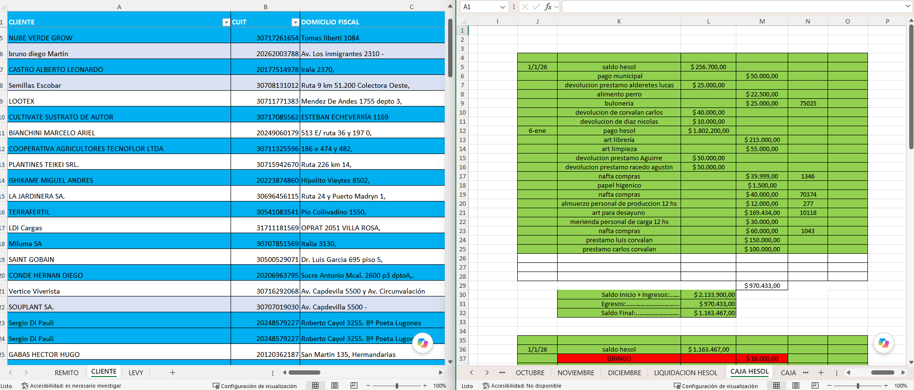
  <figcaption>Fragmento de los registros en planilla de cálculo utilizados por la empresa antes de la implementación. Los datos identificatorios fueron anonimizados.</figcaption>
</figure>

El problema no residía en la falta de información, sino en su **dispersión**. La convivencia de
documentos en papel con archivos que se copian, se renombran y circulan por separado producía
tres consecuencias observables:

- **Desorden operativo.** La misma información —el precio de un material, los datos de un
  cliente, la existencia disponible— se encontraba registrada en más de un lugar, sin que ninguno
  fuera reconocible como la versión válida.
- **Esfuerzo administrativo creciente.** Mantener los registros al día exigía tareas manuales de
  transcripción y cotejo que no aportaban valor y consumían tiempo de las cinco áreas.
- **Dificultad para decidir.** Responder preguntas elementales de gestión —cuánto se vendió este
  mes, qué materiales están por agotarse, quiénes son los principales clientes— requería consolidar
  manualmente varias planillas, de modo que la información llegaba tarde o directamente no se
  consultaba.

Esta última consecuencia es la más relevante, porque explica el sentido del encargo: el objetivo no
era solamente ordenar el registro, sino **volver utilizable la información que la empresa ya
producía**.

Varias decisiones de diseño que este informe desarrolla más adelante responden directamente a este
diagnóstico, y conviene leerlas a la luz de él: la validación de datos en dos capas (Capítulo III),
el control de acceso por rol (Capítulo VI), el registro de auditoría (Capítulo VII), la
integridad transaccional de las operaciones (Capítulo VIII) y el panel de indicadores de gestión
(Capítulo X).

## Objetivo del sistema

PerliNor ERP tiene por objetivo **centralizar el registro de la operación comercial y de inventario
de la empresa en un único sistema web, garantizando la consistencia de los datos y poniendo la
información de gestión a disposición de cada área según su responsabilidad**.

De ese objetivo general se desprenden cuatro objetivos específicos, que el sistema cumple y este
informe verifica:

1. **Unificar el registro.** Una única fuente de datos para materiales, existencias, clientes,
   ventas y movimientos de caja.
2. **Asegurar la consistencia.** Que toda operación que afecte las existencias o la caja las
   modifique de forma completa o no las modifique en absoluto, incluso ante operaciones simultáneas.
3. **Controlar el acceso.** Que cada usuario opere únicamente sobre las funciones que le
   corresponden según su área.
4. **Dar visibilidad.** Que la información de gestión resulte accesible sin tareas manuales de
   consolidación, tanto en pantalla como en archivos exportables.

## Alcance

El sistema se construyó de manera incremental. El alcance entregado responde a una definición
explícita del cliente: **la prioridad principal era contar con el módulo de ventas**. En
consecuencia, el desarrollo cubrió en profundidad el circuito comercial completo, y las áreas
restantes quedaron para etapas posteriores.

Esta delimitación no es una restricción sobrevenida sino una decisión de proyecto, y el informe la
documenta como tal.

### Alcance incluido

El sistema entregado implementa el siguiente circuito operativo, de extremo a extremo:

| Área | Funcionalidad entregada |
|---|---|
| Acceso | Inicio de sesión, renovación automática de la sesión y recuperación de contraseña por correo electrónico |
| Administración | Gestión de usuarios, asignación de roles y consulta del esquema de permisos |
| Inventario | Gestión del catálogo de materiales y de sus categorías; registro de ingresos y ajustes de existencias con su historial |
| Comercial | Gestión de clientes; registro de ventas con múltiples líneas, consulta con filtros, detalle y anulación |
| Finanzas | Consulta de la caja de ventas: saldo acumulado y movimientos |
| Información de gestión | Panel de inicio con indicadores, gráfico de evolución de ventas y reporte de ventas por período exportable a planilla de cálculo |
| Trazabilidad | Registro de auditoría de las operaciones críticas, con consulta filtrable y detalle de los valores modificados |

El circuito central —**alta de cliente, alta de material, carga de existencias, registro de venta,
impacto en caja y consulta del resultado**— funciona de forma completa y verificada. El Capítulo
VIII lo desarrolla en detalle y el Capítulo XII documenta las pruebas que lo respaldan.

### Alcance excluido

Las siguientes áreas **no forman parte del sistema entregado**. Se enumeran aquí de manera
explícita para delimitar con precisión lo que el informe documenta:

- Gestión de materias primas y su costo promedio ponderado.
- Registro de producción y consumo de materias primas.
- Gestión de proveedores y pagos a proveedores.
- Emisión de comprobantes fiscales y factura electrónica.

El modelo de datos fue diseñado desde el inicio previendo estas áreas, de modo que su
incorporación futura no requiera rediseñar la base. El Capítulo V distingue con claridad las
entidades implementadas de aquellas que el modelo prevé sin implementación, y el Capítulo XIV
retoma el tema como trabajo futuro.

Cabe señalar, por completitud, que durante la etapa de fundaciones se implementó también un módulo
de gestión de empleados a nivel de servicios, que no cuenta con interfaz de usuario y no integra el
alcance entregado al cliente.

### Consideraciones de alcance adicionales

Dos definiciones funcionales acordadas con el cliente conviene anticiparlas aquí, porque afectan la
lectura de los capítulos siguientes:

- **Las ventas no discriminan impuestos.** El importe total de una venta coincide con la suma de
  sus líneas. Se trata de una simplificación deliberada, adoptada para validar el circuito
  comercial sin la complejidad del tratamiento impositivo. El modelo conserva el campo
  correspondiente, de modo que la incorporación del IVA no exige modificar la estructura de datos.
- **Toda venta registra su ingreso en la caja de ventas**, cualquiera sea el medio de pago
  utilizado, incluidos cheque y cuenta corriente. Así lo especificó el cliente.

## Roles y usuarios

El sistema define cinco roles, uno por cada área funcional de la empresa. Cada rol agrupa un
conjunto de permisos que determinan tanto las funciones accesibles como las opciones visibles en el
menú de navegación.

| Rol | Alcance funcional |
|---|---|
| Administración | Acceso completo al sistema, incluidas la gestión de usuarios y la auditoría |
| Ventas | Gestión de clientes y de ventas; consulta del catálogo de materiales |
| Stock | Gestión completa del catálogo de materiales y de las existencias |
| Producción | Consulta y carga de existencias de materiales |
| Finanzas | Consulta comercial y de inventario, caja de ventas y reportes |

El Capítulo VI detalla el mecanismo de autorización que implementa este esquema y el Anexo B
presenta la matriz completa de roles y permisos.

## Organización del informe

El informe se estructura en catorce capítulos. Los Capítulos II y III describen el proceso de
trabajo y los requerimientos. Los Capítulos IV a XI constituyen el núcleo técnico: arquitectura,
modelo de datos, seguridad, implementación del servidor y del cliente, y la interfaz de
programación. Dentro de ese bloque, el **Capítulo VIII** desarrolla el registro y la anulación de
ventas, que concentra la mayor complejidad técnica de la solución. Los Capítulos XII a XIV cubren la
verificación, la puesta en marcha y las limitaciones conocidas.

El vocabulario empleado a lo largo del informe se define en el glosario del Anexo A. Se recomienda
su consulta previa: varios conceptos del dominio reciben en la interfaz un nombre distinto del que
utiliza el código, y el glosario fija la equivalencia.

# Metodología y proceso de desarrollo

Este capítulo describe cómo se organizó el trabajo: el enfoque adoptado, la práctica que gobernó
cada etapa, el cronograma efectivamente ejecutado y las herramientas que sostuvieron el proceso.

Las fechas y los hitos que se presentan no constituyen una reconstrucción posterior: provienen del
historial del sistema de control de versiones del proyecto.

## Enfoque

El desarrollo se organizó de manera **incremental**, en etapas que entregan funcionalidad
verificable. Cada etapa parte de un análisis del estado real del código, produce un plan acotado y
concluye con la funcionalidad integrada y probada.

La elección responde a la condición del proyecto: un único desarrollador, un cliente con una
prioridad explícita —el circuito de ventas— y un alcance que excedía el tiempo disponible. Un
enfoque secuencial habría exigido definir la totalidad del sistema antes de escribir código, con el
riesgo de agotar el plazo sin haber entregado el circuito que el cliente necesitaba.

El resultado es el descrito en el Capítulo I: un corredor operativo completo y verificado, y un
conjunto de áreas diferidas cuyo modelo de datos quedó previsto.

## Análisis previo a la planificación

Una práctica gobernó todas las etapas y merece desarrollarse, porque explica varias decisiones del
proyecto: **cada plan se elaboró auditando el código existente, no sobre supuestos**.

El procedimiento, repetido en cada etapa, consistió en:

1. Relevar qué se encontraba efectivamente implementado.
2. Identificar qué componentes resultaban reutilizables.
3. Determinar el trabajo restante real.
4. Recién entonces, planificar.

El resultado fue consistente: el trabajo pendiente resultaba sistemáticamente menor al estimado a
priori, porque la infraestructura previa cubría más de lo supuesto.

Dos ejemplos concretos ilustran el efecto de la práctica:

| Etapa | Hallazgo de la auditoría | Efecto sobre el plan |
|---|---|---|
| Circuito de ventas | La autenticación, el control de acceso, el esquema de datos y el patrón de módulo ya existían y superaban lo planificado | Se eliminaron del plan las fases de fundaciones, autenticación y migración inicial |
| Reportería | Las bibliotecas de planillas y de descarga ya se encontraban instaladas; el módulo estaba montado y autenticado; los permisos, sembrados | Cero dependencias nuevas, cero migraciones y cero cambios en la carga inicial |

Un tercer hallazgo produjo una decisión de sentido inverso. La auditoría detectó que la
infraestructura de colas de trabajos, incorporada previendo la generación asincrónica de reportes,
**no se utilizaba en ninguna parte**. Se retiró del proyecto. El criterio aplicado fue el mismo que
en el resto de la arquitectura: no sostener infraestructura hasta que exista un problema que la
justifique.

## Cronograma

El desarrollo se extendió entre el 30 de mayo y el 29 de agosto de 2026. Se detallan las dos etapas
principales y, a continuación, las intermedias.

### Etapa A — Circuito de ventas

Cuatro semanas. Constituye el alcance prioritario definido por el cliente.

| Fase | Período | Trabajo |
|---|---|---|
| A.1 — Fundaciones | 30/05 – 06/06 | Repositorio, estructura de ambos paquetes, conexión a la base y módulo de autenticación |
| A.2 — Servicios del dominio | 11/06 – 14/06 | Clientes, categorías, materiales con movimientos de existencias y registro de ventas transaccional |
| A.3 — Verificación del circuito | 18/06 | Colección de peticiones reproducible y prueba de extremo a extremo del circuito |
| A.4 — Interfaz | 19/06 – 26/06 | Estructura visual, componentes compartidos, y las pantallas de acceso, clientes, materiales y ventas |

El orden no es casual: el servidor precedió a la interfaz porque concentra las reglas de negocio, y
la prueba del circuito precedió a la interfaz porque permitió validarlo antes de construir las
pantallas que lo consumirían.

### Etapa B — Reportería e información de gestión

Una semana.

| Fase | Período | Trabajo |
|---|---|---|
| B.0 — Planificación | 11/08 | Auditoría del código y especificación |
| B.1 — Implementación | 12/08 – 16/08 | Capa de reportería, reporte de ventas por período, serie temporal e interfaz del gráfico |
| B.2 — Acabado | 18/08 | Incorporación del logotipo institucional a la planilla generada |

### Etapas intermedias

| Etapa | Período | Trabajo |
|---|---|---|
| Pruebas y flujo de trabajo | 30/06 – 23/07 | Suite de pruebas e integración continua |
| Consolidación posterior al circuito | 27/07 – 11/08 | Control de acceso completo, trazabilidad del vendedor, retiro de la infraestructura de colas, anulación de ventas con reversión de existencias y caja, caja de ventas, filtros de listados, consulta de auditoría e indicadores |
| Recuperación de contraseña y búsqueda | 17/08 – 18/08 | Circuito completo de restablecimiento y búsqueda en las grillas |
| Infraestructura de correo | 29/08 | Servidor de correo local para desarrollo |

### Contraste con la estimación inicial

La planificación original preveía dieciséis semanas distribuidas entre siete módulos. El desarrollo
efectivo abarcó trece semanas concentradas en el circuito comercial.

La diferencia no radica en la duración sino en la **distribución**: el tiempo se concentró en la
prioridad definida por el cliente en lugar de repartirse entre los siete módulos planificados. Es la
consecuencia directa de la decisión de alcance descrita en el Capítulo I.

## Control de versiones

El proyecto se versionó desde el primer día, con treinta y ocho confirmaciones distribuidas a lo
largo de las trece semanas.

Se utilizaron dos ramas: una principal, que refleja el estado estable, y una de desarrollo, donde se
integró el trabajo de las etapas posteriores al circuito inicial.

Los mensajes de confirmación identifican la etapa y la fase a la que pertenecen, de modo que el
historial resulta legible como una secuencia de trabajo y no como una sucesión de cambios sueltos.

## Integración continua

A partir de la etapa de pruebas, cada incorporación de cambios dispara automáticamente la
verificación del proyecto. El proceso ejecuta dos trabajos independientes:

| Trabajo | Qué hace |
|---|---|
| Servidor | Levanta una base de datos real, aplica las migraciones, carga los datos iniciales y ejecuta la suite completa |
| Cliente | Ejecuta la suite en un navegador sin interfaz gráfica |

Que el trabajo del servidor levante una base real y no un sustituto es coherente con la estrategia
de pruebas descrita en el Capítulo XII: las garantías que el sistema ofrece —atomicidad y
comportamiento bajo concurrencia— sólo pueden verificarse contra un motor de base de datos
verdadero.

## Herramientas

| Herramienta | Uso |
|---|---|
| Control de versiones distribuido | Historial y ramas |
| Integración continua | Verificación automática ante cada cambio |
| Gestor de paquetes con espacios de trabajo | Instalación única para ambos paquetes, con versiones compartidas |
| Contenedores | Base de datos, administrador web y servidor de correo para desarrollo |
| Entorno de desarrollo con verificación de tipos | Detección de errores antes de la ejecución |

El uso de contenedores para la infraestructura de desarrollo merece mención. Permite que cualquier
colaborador disponga de la base de datos, su administrador web y un servidor de correo de prueba con
una única instrucción, sin instalar nada en su equipo ni ajustar configuraciones propias. Reduce a
minutos la puesta en marcha descrita en el Capítulo XIII.

## Documentación del proceso

Cada etapa produjo un documento de planificación previo a su ejecución, elaborado sobre la auditoría
del código. Esos documentos permanecen en el repositorio como registro del proceso, identificados
con su fecha y marcados como material histórico: describen el estado del proyecto en el momento de
su redacción y no el sistema actual.

No integran esta documentación, pero constituyen la evidencia de que la práctica descrita en la
sección segunda se aplicó efectivamente y no se reconstruyó a posteriori.

# Requerimientos

Este capítulo enuncia los requerimientos que el sistema satisface. Todos ellos se encuentran
implementados y verificados: no se incluyen requerimientos proyectados ni deseables que el alcance
entregado no cubra.

Cada requerimiento funcional indica el módulo que lo implementa y el permiso que lo gobierna, de
modo que resulte trazable hasta el código. La matriz completa de trazabilidad —requerimiento,
implementación, flujo, prueba y documentación— se presenta en el Anexo D.

## Requerimientos funcionales

### Acceso y gestión de la sesión

| ID | Requerimiento | Permiso |
|---|---|---|
| RF-01 | El sistema debe autenticar a un usuario mediante su dirección de correo y contraseña, y rechazar el acceso de usuarios inexistentes o dados de baja | — |
| RF-02 | El sistema debe renovar la sesión de forma automática y transparente mientras el usuario permanezca activo, sin solicitar nuevamente sus credenciales | — |
| RF-03 | El sistema debe permitir que un usuario solicite el restablecimiento de su contraseña mediante un enlace enviado a su dirección de correo | — |
| RF-04 | El enlace de recuperación debe admitir un único uso y vencer transcurrido un plazo configurable | — |
| RF-05 | El sistema no debe revelar si una dirección de correo se encuentra registrada | — |

### Administración

| ID | Requerimiento | Permiso |
|---|---|---|
| RF-06 | El sistema debe permitir el alta, la consulta, la modificación y la baja lógica de usuarios | `users.*` |
| RF-07 | El sistema debe permitir asignar un rol a cada usuario en el momento del alta y modificarlo posteriormente | `users.update` |
| RF-08 | El sistema debe impedir el registro de dos usuarios con la misma dirección de correo | `users.create` |
| RF-09 | El sistema debe permitir consultar los roles definidos y los permisos que cada uno agrupa | `users.read` |

### Inventario

| ID | Requerimiento | Permiso |
|---|---|---|
| RF-10 | El sistema debe permitir el alta, la consulta, la modificación y la baja lógica de materiales | `inventory.*` |
| RF-11 | El sistema debe impedir el registro de dos materiales con el mismo código (SKU) | `inventory.create` |
| RF-12 | El sistema debe permitir clasificar los materiales en categorías y dar de alta categorías nuevas | `inventory.create` |
| RF-13 | El sistema debe permitir registrar ingresos y ajustes de existencias, y debe impedir la modificación directa de la existencia de un material por cualquier otra vía | `inventory.update` |
| RF-14 | El sistema debe conservar el historial de movimientos de existencias de cada material, con su origen | `inventory.read` |

### Comercial

| ID | Requerimiento | Permiso |
|---|---|---|
| RF-15 | El sistema debe permitir el alta, la consulta, la modificación y la baja lógica de clientes | `commercial.*` |
| RF-16 | El sistema debe permitir registrar una venta compuesta por una o más líneas, cada una con su material y cantidad | `commercial.create` |
| RF-17 | El sistema debe tomar el precio de cada línea del precio vigente del material y conservarlo inalterable ante modificaciones posteriores | `commercial.create` |
| RF-18 | El sistema debe rechazar toda venta cuya cantidad solicitada exceda la existencia disponible, sin producir efecto alguno sobre los datos | `commercial.create` |
| RF-19 | El sistema debe descontar las existencias y registrar el ingreso en la caja de ventas como parte indivisible del registro de la venta | `commercial.create` |
| RF-20 | El sistema debe permitir consultar las ventas filtrando por cliente, estado y rango de fechas | `commercial.read` |
| RF-21 | El sistema debe permitir anular una venta confirmada, reponiendo las existencias y revirtiendo el movimiento de caja | `commercial.update` |
| RF-22 | El sistema debe impedir la anulación de una venta que no se encuentre confirmada | `commercial.update` |

### Finanzas e información de gestión

| ID | Requerimiento | Permiso |
|---|---|---|
| RF-23 | El sistema debe exponer el saldo acumulado de la caja de ventas y sus movimientos, filtrables por fecha | `finance.read` |
| RF-24 | El sistema debe presentar indicadores de gestión: ventas del mes y del día, materiales y clientes activos, principales clientes y materiales con menor existencia | — |
| RF-25 | El sistema debe presentar la evolución de las ventas confirmadas agrupadas por día, semana o mes | — |
| RF-26 | El sistema debe generar un reporte de ventas por período, filtrable por cliente, exportable a planilla de cálculo | `reports.read` |
| RF-27 | Los indicadores y los reportes deben computar exclusivamente ventas confirmadas | — |

### Trazabilidad

| ID | Requerimiento | Permiso |
|---|---|---|
| RF-28 | El sistema debe registrar toda creación, modificación y baja de las entidades críticas, identificando el usuario responsable | — |
| RF-29 | El sistema debe permitir consultar el registro de auditoría filtrando por entidad, acción y rango de fechas, y examinar los valores anterior y posterior de cada operación | `audit.read` |

## Requerimientos no funcionales

Los requerimientos no funcionales se enuncian junto con el mecanismo que los implementa, de modo
que cada uno resulte verificable en el código. Los capítulos indicados desarrollan cada mecanismo.

### Integridad

| ID | Requerimiento | Mecanismo | Cap. |
|---|---|---|---|
| RNF-01 | Toda operación que afecte existencias o caja debe aplicarse íntegramente o no aplicarse en absoluto | Transacciones de base de datos | VIII |
| RNF-02 | Dos operaciones simultáneas no deben poder consumir la misma existencia | Decremento atómico condicional | VIII |
| RNF-03 | El sistema no debe eliminar información: las bajas deben preservar el registro y su historial | Baja lógica mediante indicador de estado | V |
| RNF-04 | Los importes no deben sufrir errores de redondeo por representación binaria | Tipo decimal en base de datos y aritmética decimal en la aplicación | V, VIII |

### Seguridad

| ID | Requerimiento | Mecanismo | Cap. |
|---|---|---|---|
| RNF-05 | Las contraseñas no deben almacenarse de forma recuperable | Función de derivación de clave con sal | VI |
| RNF-06 | Toda función debe validar la autorización del solicitante en el servidor, con independencia de lo que muestre la interfaz | Verificación de permiso por ruta | VI |
| RNF-07 | Los datos de entrada deben validarse antes de alcanzar la lógica de negocio | Esquemas de validación declarativos | VI, VII |
| RNF-08 | Los endpoints públicos no deben poder utilizarse para inferir la existencia de cuentas | Respuesta invariable e independiente del resultado | VI |
| RNF-09 | Los endpoints públicos deben resistir el abuso automatizado | Limitación de frecuencia por dirección de origen | VI |

### Rendimiento y escala

| ID | Requerimiento | Mecanismo | Cap. |
|---|---|---|---|
| RNF-10 | Los listados no deben transferir el conjunto completo de registros | Paginación en el servidor, con límite máximo configurable | VII |
| RNF-11 | La generación de un reporte no debe comprometer la memoria del servidor | Tope de filas verificado antes de construir el archivo | IX |
| RNF-12 | Las consultas de agregación temporal deben acotarse a un volumen previsible | Tope de puntos por granularidad | VII |

### Usabilidad y localización

| ID | Requerimiento | Mecanismo | Cap. |
|---|---|---|---|
| RNF-13 | La interfaz debe presentarse íntegramente en español rioplatense | Textos de la aplicación | X |
| RNF-14 | Los importes deben expresarse en pesos argentinos y las fechas en formato local | Formateo localizado en el cliente | X |
| RNF-15 | Los errores deben comunicarse al usuario en lenguaje comprensible, sin exponer detalles técnicos | Catálogo de errores centralizado y notificación uniforme | VII, X |
| RNF-16 | Los listados de uso frecuente deben presentarse acotados a un período razonable en lugar de cargar el histórico completo | Filtro por día en curso como valor inicial | X |

### Mantenibilidad

| ID | Requerimiento | Mecanismo | Cap. |
|---|---|---|---|
| RNF-17 | La incorporación de un módulo nuevo debe seguir una estructura uniforme y previsible | Convención de módulo vertical | VII |
| RNF-18 | La incorporación de un reporte nuevo no debe requerir modificar la capa de transporte ni la de formato | Catálogo de definiciones de reporte | IX |
| RNF-19 | El sistema debe verificarse de forma automatizada ante cada cambio | Suite de pruebas ejecutada en integración continua | XII |
| RNF-20 | La configuración sensible no debe residir en el código ni versionarse | Variables de entorno validadas al arranque | IV |

## Restricciones

Las siguientes restricciones fueron acordadas con el cliente o impuestas por el contexto del
proyecto, y condicionan el diseño:

| ID | Restricción | Origen |
|---|---|---|
| RE-01 | El sistema debe ser una aplicación web accesible desde un navegador, sin instalación en los equipos de los usuarios | Cliente |
| RE-02 | El idioma del sistema es el español rioplatense y la moneda, el peso argentino | Cliente |
| RE-03 | Las ventas no discriminan impuestos en el alcance entregado | Cliente |
| RE-04 | Toda venta registra su ingreso en la caja de ventas, cualquiera sea el medio de pago | Cliente |
| RE-05 | El sistema fue dimensionado para cinco usuarios concurrentes | Contexto de la organización |
| RE-06 | Los roles y los permisos que agrupan son fijos y no se administran desde la aplicación | Decisión de diseño |

## Supuestos

| ID | Supuesto |
|---|---|
| SU-01 | Los usuarios disponen de conexión a la red donde se publica el sistema y de un navegador actualizado |
| SU-02 | La zona horaria del servidor corresponde a la de Argentina. Los cálculos de agregación temporal se apoyan en ella |
| SU-03 | Existe un servidor de correo disponible para el envío de los enlaces de recuperación de contraseña. En su ausencia, el sistema opera pero esa función queda inhabilitada |

# Arquitectura del sistema

Este capítulo describe la estructura del sistema: cómo se divide, qué responsabilidad tiene cada
parte, cómo se comunican entre sí y por qué se adoptó cada decisión estructural.

## Visión general

PerliNor ERP se organiza como un **monolito modular distribuido en dos procesos**: una aplicación
de página única que se ejecuta en el navegador y un servidor de interfaz de programación que
concentra la lógica de negocio y el acceso a los datos. Ambos se comunican exclusivamente mediante
peticiones HTTP con cuerpos en formato JSON, contra una única base de datos relacional.

<figure>
  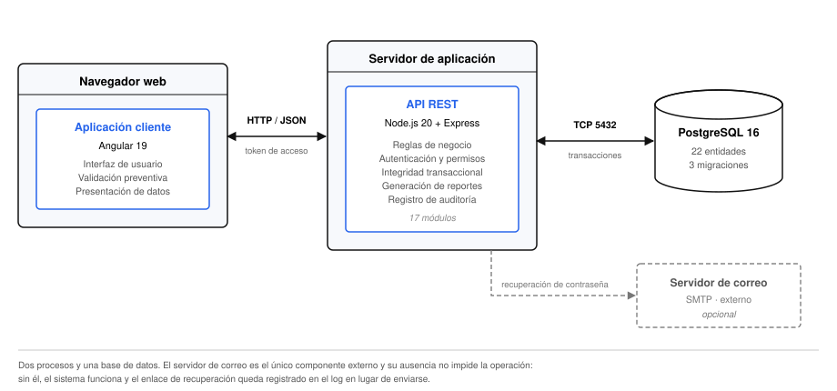
  <figcaption>Arquitectura general. El navegador ejecuta la aplicación cliente, que consume la interfaz de programación del servidor; este accede a la base de datos y, únicamente para la recuperación de contraseñas, a un servidor de correo.</figcaption>
</figure>

El sistema no incorpora servicios intermedios, colas de mensajes, memorias caché ni componentes
distribuidos adicionales. Esta simplicidad es deliberada y se justifica más abajo.

| Componente | Responsabilidad | Tecnología |
|---|---|---|
| Aplicación cliente | Interfaz de usuario, validación preventiva, presentación de datos | Angular 19 |
| Servidor de aplicación | Reglas de negocio, autorización, integridad transaccional, generación de reportes | Node.js 20 + Express |
| Base de datos | Persistencia e integridad referencial | PostgreSQL 16 |
| Servidor de correo | Envío de enlaces de recuperación de contraseña | SMTP (componente externo, opcional) |

### Organización del repositorio

El código reside en un único repositorio que agrupa ambos paquetes, gestionado con espacios de
trabajo de `pnpm`. Una sola instalación de dependencias en la raíz resuelve los dos proyectos y
comparte un único archivo de bloqueo, lo que garantiza que las versiones utilizadas en desarrollo,
en integración continua y en la máquina de cualquier colaborador sean idénticas.

```
erp-fabrica/
├── erp-backend/     servidor de aplicación
├── erp-frontend/    aplicación cliente
└── docs/            documentación
```

## Decisiones arquitectónicas

Las decisiones que siguen condicionan toda la estructura. Se documentan con su alternativa
descartada y el criterio que resolvió la elección.

### Monolito modular en lugar de microservicios

El dominio se organiza en módulos con límites definidos —autenticación, inventario, comercial,
finanzas, reportes, auditoría—, pero todos se despliegan como un único proceso.

Una arquitectura de microservicios habría introducido comunicación entre servicios, consistencia
eventual y una complejidad operativa considerable, sin beneficio alguno para un sistema dimensionado
para cinco usuarios concurrentes. El costo más alto habría recaído justamente sobre la operación
más delicada del sistema: el registro de una venta modifica existencias, ventas y caja de forma
indivisible (Capítulo VIII), algo que una única base de datos resuelve con una transacción y que en
un esquema distribuido exigiría un protocolo de compensación.

La modularidad se conserva en la organización del código, de modo que una eventual extracción
futura resulte posible sin reescritura.

### Cliente y servidor separados

La alternativa —una aplicación con vistas generadas en el servidor— habría simplificado el
despliegue, pero la interfaz requerida es marcadamente interactiva: formularios de venta con líneas
dinámicas y cálculo en vivo, grillas con paginación y búsqueda incremental, diálogos y gráficos. La
separación permite además que la interfaz de programación quede disponible para otros consumidores.

La contrapartida asumida es la necesidad de gestionar la autenticación mediante tokens y de
habilitar el intercambio entre orígenes distintos durante el desarrollo.

### Estado del cliente mediante señales

La aplicación cliente administra su estado con las señales nativas del framework, en lugar de
incorporar una biblioteca de gestión de estado centralizado.

El estado compartido entre pantallas se reduce prácticamente a la sesión del usuario y sus permisos.
El resto es estado local de cada pantalla, con una vigencia que no excede la de su componente. Una
arquitectura de almacén centralizado con acciones y reductores habría multiplicado el código sin
resolver ningún problema real.

### Acceso a datos mediante mapeo objeto-relacional

El acceso a la base de datos se realiza mediante un mapeador con generación de tipos, en lugar de
consultas escritas a mano.

La ventaja determinante es la verificación en tiempo de compilación: el esquema de la base genera
los tipos que consume la aplicación, de modo que un campo renombrado produce un error de compilación
y no un fallo en ejecución. Adicionalmente, el versionado del esquema mediante migraciones queda
integrado en la misma herramienta.

La limitación conocida es la menor expresividad frente a consultas analíticas complejas. El sistema
la encontró una sola vez, en la agregación temporal de ventas, y se resolvió agregando en la
aplicación (Capítulo VII).

### Infraestructura asincrónica descartada

El proyecto contempló inicialmente una cola de trabajos para la generación de reportes. Durante el
desarrollo se comprobó que el único reporte del sistema se resuelve en el ciclo de la petición sin
dificultad, de modo que la dependencia se retiró del proyecto antes de la entrega.

Se documenta esta decisión porque ilustra un criterio aplicado de manera consistente: **no
incorporar infraestructura hasta que exista un problema que la justifique**.

## Arquitectura del servidor

El servidor se estructura en capas con responsabilidades estrictamente delimitadas. Una petición
atraviesa siempre la misma secuencia:

```
Petición HTTP
   │
   ├─ Middlewares globales      seguridad, compresión, análisis del cuerpo, límite de frecuencia
   │
   ├─ Enrutador del módulo      autenticación, verificación de permiso, validación del esquema
   │
   ├─ Controlador               normalización de parámetros, selección del código de respuesta
   │
   ├─ Servicio                  reglas de negocio, transacciones, auditoría
   │
   └─ Acceso a datos            consultas a la base
```

| Capa | Responsabilidad | Lo que nunca hace |
|---|---|---|
| Enrutador | Montar las rutas y aplicar las barreras: autenticación, permiso y validación | Contener lógica |
| Controlador | Traducir entre el protocolo HTTP y el dominio | Consultar la base de datos |
| Servicio | Aplicar las reglas de negocio, abrir transacciones, registrar auditoría | Conocer los objetos de petición y respuesta |
| Compartido | Proveer los mecanismos transversales | Contener reglas de un módulo particular |

La regla que sostiene esta estructura es sencilla y se respeta sin excepciones: **un servicio nunca
invoca al servicio de otro módulo**. Cuando un módulo necesita datos de otro, los consulta a través
de la capa de acceso a datos, que es el punto de integración común.

Los módulos que componen el servidor y su estado se detallan en el Capítulo VII.

## Arquitectura del cliente

La aplicación cliente se organiza en cuatro capas con dependencias dirigidas en un solo sentido:

| Capa | Contenido | Depende de |
|---|---|---|
| `core` | Servicios únicos de la aplicación: acceso HTTP, sesión, notificaciones; interceptores y guardas de ruta | — |
| `shared` | Componentes, transformadores de presentación y utilidades reutilizables | `core` |
| `layout` | Estructura visual de la aplicación autenticada | `core`, `shared` |
| `features` | Las pantallas, agrupadas por área funcional | `core`, `shared` |

Ninguna funcionalidad depende de otra. Las que comparten elementos —el formulario de venta necesita
el catálogo de clientes y de materiales— los obtienen a través del servicio de acceso a datos
correspondiente, nunca importando componentes ajenos.

Cada área funcional se carga **de forma diferida**: su código se descarga la primera vez que el
usuario navega a ella. Un usuario del área de Stock, que sólo accede a materiales, nunca descarga
el código de ventas, reportes ni auditoría.

El detalle de la implementación se presenta en el Capítulo X.

## Comunicación entre cliente y servidor

### Contrato de respuesta

Toda respuesta satisfactoria se entrega envuelta en una estructura uniforme:

```json
{ "data": { ... } }
```

Los listados agregan la información de paginación:

```json
{
  "data": [ ... ],
  "meta": { "page": 1, "limit": 20, "total": 137, "totalPages": 7 }
}
```

La uniformidad permite que el cliente concentre en un único servicio el desenvuelto de la
estructura, de modo que ninguna pantalla manipula la forma de la respuesta.

La única excepción es la descarga de reportes, que entrega un archivo binario y transmite sus metadatos
mediante cabeceras (Capítulo IX).

### Contrato de error

Los errores se entregan con una estructura igualmente uniforme, y el código de estado HTTP comunica
la naturaleza del problema:

```json
{ "error": "Descripción legible", "details": { ... } }
```

| Código | Significado en el sistema |
|---|---|
| 400 | Datos de entrada inválidos, o regla de negocio incumplida de forma detectable a priori |
| 401 | Ausencia de sesión válida |
| 403 | Sesión válida sin el permiso requerido |
| 404 | Recurso inexistente |
| 409 | Conflicto con un registro existente, típicamente por unicidad |
| 422 | Solicitud bien formada que el estado actual del sistema impide satisfacer |
| 500 | Error no previsto |

La distinción entre 400 y 422 es deliberada y relevante: un intento de venta sin existencia
suficiente constituye una solicitud correctamente formulada que el estado del inventario impide
atender, y por lo tanto se responde con 422.

## Configuración

El servidor obtiene su configuración exclusivamente de variables de entorno, **validadas al
arranque** mediante un esquema declarativo. Si falta una variable obligatoria o el valor no
corresponde al tipo esperado, el proceso informa el detalle y termina de inmediato, en lugar de
iniciar en un estado inconsistente y fallar más tarde ante una petición.

| Grupo | Variables |
|---|---|
| Ejecución | Entorno, puerto, origen autorizado del cliente |
| Persistencia | Cadena de conexión a la base de datos |
| Seguridad | Secretos de firma de los tokens de acceso y renovación |
| Paginación | Tamaño de página por omisión y máximo admitido |
| Recuperación de contraseña | Vigencia del enlace, en minutos |
| Correo | Servidor, puerto, credenciales y remitente. Opcionales |

Ningún valor de configuración reside en el código ni se versiona. El repositorio incluye
únicamente plantillas con valores de ejemplo.

La aplicación cliente resuelve su configuración en tiempo de compilación mediante sustitución de
archivos: en desarrollo apunta al servidor local y en producción utiliza una ruta relativa, lo que
supone que ambos se publican bajo el mismo origen.

## Observabilidad y manejo de errores

El servidor emite su registro de actividad por consola mediante un registrador estructurado, con
formato legible en desarrollo y estructurado en JSON en producción.

El manejo de errores se concentra en un único punto, ubicado al final de la cadena de middlewares,
que clasifica lo recibido y produce la respuesta correspondiente. Este diseño garantiza que ningún
error alcance al cliente en formato inesperado y, sobre todo, que **los detalles internos no se
filtren**: un error no contemplado produce siempre un mensaje genérico, mientras el detalle queda en
el registro del servidor.

Un caso merece mención particular. Cuando la respuesta ya comenzó a escribirse —la situación se
presenta al transmitir el archivo de un reporte— resulta imposible reemplazarla por un mensaje de
error. El manejador detecta esa condición y delega, de modo que la conexión se interrumpe en lugar
de entregar un archivo corrupto con un mensaje de error incrustado.

El tratamiento completo se desarrolla en el Capítulo VII.

# Modelo de datos

Este capítulo describe la estructura de persistencia del sistema: sus convenciones, las entidades
que lo componen, las relaciones entre ellas y la estrategia de versionado del esquema.

## Alcance del modelo

El esquema define **veintidós entidades**. De ellas, **quince** cuentan con lógica de aplicación
que las utiliza; las **siete** restantes fueron modeladas previendo la incorporación futura de las
áreas excluidas del alcance entregado (Capítulo I) y no son manipuladas por ningún código.

Esta distinción se mantiene explícita a lo largo del capítulo. El diccionario de datos documenta
únicamente las entidades en uso; las restantes se enumeran al final, con el propósito de que el
lector comprenda la totalidad del diagrama sin atribuirle al sistema funciones que no posee.

<figure>
  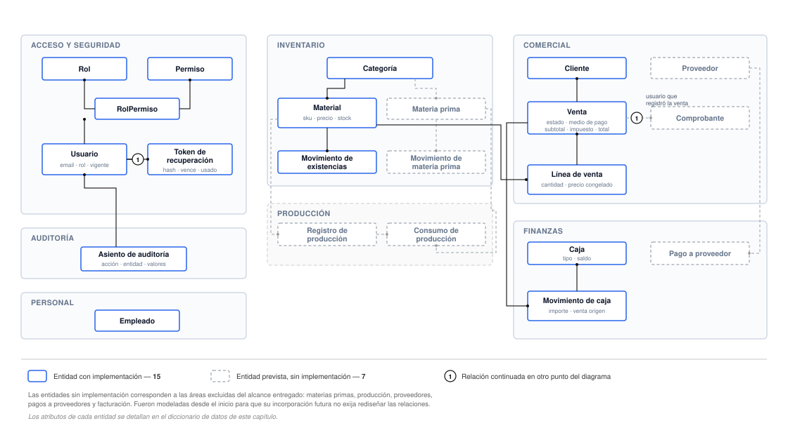
  <figcaption>Modelo de datos completo. Las entidades de trazo continuo cuentan con implementación; las de trazo punteado corresponden al modelo previsto para las áreas no incluidas en el alcance entregado.</figcaption>
</figure>

Modelar desde el inicio las entidades de las áreas diferidas fue una decisión deliberada: permite
que su incorporación posterior no exija rediseñar las relaciones ya existentes ni migrar datos
productivos. El costo asumido es un esquema más amplio que el estrictamente necesario.

## Convenciones de modelado

Las convenciones siguientes se aplican sin excepción en todo el esquema.

| Aspecto | Convención | Motivo |
|---|---|---|
| Clave primaria | Identificador universal único, generado por la base | Permite generar la clave antes de la inserción y no revela volumen de operación |
| Nombres físicos | Tablas y columnas en minúsculas con guion bajo | Convención habitual en el motor utilizado |
| Nombres lógicos | Camel case en el código, mapeados a los físicos | Convención habitual del lenguaje |
| Importes | Decimal de doce dígitos con dos decimales | Evita el error de representación binaria de los tipos de punto flotante |
| Cantidades | Decimal de doce dígitos con tres decimales | Admite unidades fraccionarias, como metros cúbicos |
| Marcas temporales | Fecha de creación y de última modificación, gestionadas por la capa de datos | Trazabilidad uniforme sin intervención de la aplicación |
| Bajas | Indicador booleano de vigencia | El sistema no elimina registros (RNF-03) |

### Sobre la representación de importes

La elección del tipo decimal merece justificación, porque constituye un requerimiento no funcional
(RNF-04) y no una preferencia estilística.

Los tipos de punto flotante no representan exactamente los valores decimales: la suma reiterada de
importes acumula un error que, en un sistema contable, termina produciendo diferencias de centavos
entre el detalle y el total. El tipo decimal almacena el valor con precisión exacta.

La misma precisión se sostiene en la capa de aplicación: los cálculos de totales no se realizan con
el tipo numérico nativo del lenguaje sino con una biblioteca de aritmética decimal (Capítulo VIII).

Una consecuencia visible de esta decisión es que los importes viajan al cliente **como cadenas de
texto** y no como números, precisamente para no perder precisión en la serialización. El cliente los
presenta con formato local y los convierte a número únicamente para previsualizar totales, sin valor
autoritativo.

### Sobre la baja lógica

Ninguna operación del sistema elimina registros. Las bajas se implementan marcando el registro como
no vigente, lo que preserva su historial y las referencias que otras entidades mantengan hacia él.

La consecuencia práctica es que una venta realizada a un cliente dado de baja posteriormente
conserva su integridad: el cliente sigue existiendo, la venta sigue siendo consultable y el reporte
histórico continúa siendo correcto.

En la interfaz de programación esta operación se expresa mediante el verbo `DELETE`, lo que puede
inducir a confusión. El verbo describe la intención del solicitante —dar de baja el recurso—, no la
operación física sobre la base.

## Diccionario de datos

Se documentan las entidades en uso, agrupadas por área. Por concisión se omiten las marcas
temporales, presentes en todas ellas conforme a la convención.

### Acceso y seguridad

#### Usuario

Cuenta de acceso al sistema.

| Campo | Tipo | Restricción | Descripción |
|---|---|---|---|
| `id` | Identificador | Clave primaria | — |
| `email` | Texto | **Único** | Identifica al usuario en el inicio de sesión |
| `passwordHash` | Texto | Obligatorio | Resultado de la función de derivación. Nunca la contraseña |
| `fullName` | Texto | Obligatorio | Nombre para mostrar |
| `roleId` | Identificador | Clave foránea a Rol | Determina los permisos |
| `isActive` | Booleano | Por omisión, verdadero | Vigencia de la cuenta |

Un usuario dado de baja no puede iniciar sesión ni renovar una sesión existente, y tampoco puede
solicitar el restablecimiento de su contraseña.

#### Rol, Permiso y su relación

El control de acceso se modela con tres entidades. Un **Rol** agrupa **Permisos** mediante una
relación de muchos a muchos explícita.

| Entidad | Campos relevantes | Descripción |
|---|---|---|
| Rol | `name` (único), `description`, `isActive` | Área funcional de la empresa |
| Permiso | `code` (único), `description` | Autorización con formato `módulo.acción` |
| RolPermiso | `roleId` + `permissionId` (clave compuesta) | Asignación de un permiso a un rol |

Los códigos de permiso siguen el patrón `módulo.acción`, por ejemplo `inventory.read` o
`commercial.create`. Existe un código comodín, `admin.*`, que concede la totalidad de los permisos y
se asigna exclusivamente al rol de Administración.

Modelar la relación de forma explícita, en lugar de dejar que la herramienta genere una tabla
intermedia implícita, permite consultarla y sembrarla directamente.

#### Token de recuperación de contraseña

Habilita el restablecimiento de la contraseña sin intervención de un administrador.

| Campo | Tipo | Restricción | Descripción |
|---|---|---|---|
| `id` | Identificador | Clave primaria | — |
| `userId` | Identificador | Clave foránea a Usuario, con borrado en cascada | Destinatario |
| `tokenHash` | Texto | **Único** | Resumen criptográfico del token. **Nunca el token en claro** |
| `expiresAt` | Fecha y hora | Obligatorio | Momento de vencimiento |
| `usedAt` | Fecha y hora | Opcional | Momento de consumo. Su ausencia indica token disponible |

El diseño de esta entidad responde a dos requerimientos de seguridad y se desarrolla en el Capítulo
VI. Resumidamente: se persiste el resumen y no el token, de modo que una filtración de la base no
habilite la toma de cuentas; y el campo de consumo garantiza el uso único.

### Inventario

#### Categoría

Clasificación de materiales.

| Campo | Tipo | Restricción | Descripción |
|---|---|---|---|
| `name` | Texto | Único junto con el tipo | Denominación |
| `type` | Enumerado | `RAW_MATERIAL` o `FINISHED_PRODUCT` | Clase de elemento que clasifica |
| `isActive` | Booleano | Por omisión, verdadero | Vigencia |

La unicidad es compuesta: pueden coexistir dos categorías homónimas si clasifican clases distintas.
En el alcance entregado únicamente se utiliza el segundo valor del enumerado.

#### Material

Producto elaborado por la fábrica y disponible para la venta.

| Campo | Tipo | Restricción | Descripción |
|---|---|---|---|
| `sku` | Texto | **Único** | Código de referencia |
| `name` | Texto | Obligatorio | Denominación |
| `categoryId` | Identificador | Clave foránea a Categoría | Clasificación |
| `unit` | Texto | Obligatorio | Unidad de medida: unidad, bolsa, metro cúbico |
| `currentStock` | Decimal (3 dec.) | Por omisión, cero | Existencia disponible |
| `salePrice` | Decimal (2 dec.) | Por omisión, cero | Precio vigente |
| `isActive` | Booleano | Por omisión, verdadero | Vigencia |

La existencia constituye un **valor desnormalizado**: podría derivarse sumando los movimientos, pero
se mantiene calculado para que la consulta de disponibilidad —la operación más frecuente del
sistema— no requiera una agregación. La consistencia entre ambos se garantiza actualizándolos
siempre dentro de la misma transacción.

Este campo no es modificable por la interfaz de programación de materiales: sólo cambia mediante
movimientos de existencias o por efecto de una venta.

#### Movimiento de existencias

Registro de cada variación de la existencia de un material.

| Campo | Tipo | Restricción | Descripción |
|---|---|---|---|
| `finishedProductId` | Identificador | Clave foránea a Material, indexada | Material afectado |
| `type` | Enumerado | `IN`, `OUT` o `ADJUST` | Naturaleza del movimiento |
| `quantity` | Decimal (3 dec.) | Obligatorio | Cantidad involucrada |
| `reference` | Texto | Opcional | Origen: identificador de la venta, motivo del ajuste |

Los tres valores del enumerado poseen semántica distinta y se originan en operaciones distintas:

| Valor | Efecto sobre la existencia | Origen |
|---|---|---|
| `IN` | La incrementa | Carga manual, o reposición por anulación de una venta |
| `OUT` | La decrementa | **Exclusivamente** el registro de una venta |
| `ADJUST` | La fija en el valor indicado | Corrección manual tras un recuento físico |

Que las salidas se originen únicamente en ventas es una restricción sostenida en el esquema de
validación: la interfaz de programación de movimientos no admite el valor `OUT`.

### Comercial

#### Cliente

| Campo | Tipo | Restricción | Descripción |
|---|---|---|---|
| `name` | Texto | Obligatorio | Razón social o nombre |
| `taxId` | Texto | Opcional, **sin unicidad** | Identificación tributaria |
| `email`, `phone`, `address` | Texto | Opcionales | Datos de contacto |
| `isActive` | Booleano | Por omisión, verdadero | Vigencia |

La ausencia de restricción de unicidad sobre la identificación tributaria es una característica del
modelo actual que conviene señalar: el sistema admite dos clientes con idéntico identificador.

#### Venta

Operación comercial. Es la entidad central del sistema.

| Campo | Tipo | Restricción | Descripción |
|---|---|---|---|
| `customerId` | Identificador | Clave foránea a Cliente, indexada | Comprador |
| `createdById` | Identificador | Clave foránea a Usuario, opcional, indexada | Usuario que la registró |
| `status` | Enumerado | `DRAFT`, `CONFIRMED`, `CANCELLED` | Estado |
| `paymentMethod` | Enumerado | Obligatorio | Medio de pago |
| `subtotal`, `tax`, `total` | Decimal (2 dec.) | Por omisión, cero | Importes |
| `soldAt` | Fecha y hora | Por omisión, el instante actual | Momento de la operación |

Dos observaciones sobre los valores efectivamente utilizados:

- El estado `DRAFT` se encuentra previsto en el modelo pero ninguna operación lo produce: toda venta
  nace confirmada. El ciclo de vida real comprende únicamente los otros dos estados.
- El campo de impuesto existe y se persiste, pero conserva el valor cero conforme a la restricción
  RE-03. Su presencia permite incorporar el tratamiento impositivo sin modificar la estructura.

El campo que identifica al usuario responsable admite valor nulo porque se incorporó mediante una
migración posterior al registro de las primeras ventas. Las anteriores a esa migración carecen del
dato, y tanto el reporte como la interfaz lo contemplan.

#### Línea de venta

| Campo | Tipo | Restricción | Descripción |
|---|---|---|---|
| `saleId` | Identificador | Clave foránea a Venta, **con borrado en cascada**, indexada | Venta a la que pertenece |
| `finishedProductId` | Identificador | Clave foránea a Material | Material vendido |
| `quantity` | Decimal (3 dec.) | Obligatorio | Cantidad |
| `unitPrice` | Decimal (2 dec.) | Obligatorio | **Precio congelado** al momento de la venta |
| `lineTotal` | Decimal (2 dec.) | Obligatorio | Importe de la línea |

El precio unitario se copia del precio vigente del material en el instante del registro y no
constituye una referencia a él. Es la implementación del requerimiento RF-17 y la razón por la cual
una modificación posterior del precio no altera las ventas ya registradas.

### Finanzas

#### Caja

| Campo | Tipo | Restricción | Descripción |
|---|---|---|---|
| `name` | Texto | Obligatorio | Denominación |
| `type` | Enumerado | `SALES` o `PAYMENTS` | Clase de caja |
| `balance` | Decimal (2 dec.) | Por omisión, cero | Saldo acumulado |
| `isActive` | Booleano | Por omisión, verdadero | Vigencia |

El sistema opera con una única caja, de tipo ventas, creada durante la carga de datos iniciales. El
segundo valor del enumerado corresponde al área de pagos a proveedores, excluida del alcance.

Al igual que la existencia de un material, el saldo es un valor desnormalizado que se mantiene
actualizado dentro de la misma transacción que genera cada movimiento.

#### Movimiento de caja

| Campo | Tipo | Restricción | Descripción |
|---|---|---|---|
| `cashRegisterId` | Identificador | Clave foránea a Caja, indexada | Caja afectada |
| `amount` | Decimal (2 dec.) | Obligatorio | **Positivo** para ingresos, **negativo** para reversiones |
| `description` | Texto | Opcional | Detalle legible |
| `saleId` | Identificador | Clave foránea a Venta, opcional | Venta que lo originó |

Representar las reversiones como movimientos de signo negativo, en lugar de eliminar el movimiento
original, preserva la trazabilidad: el histórico conserva tanto el ingreso como su posterior
reversión, y la suma de ambos es cero.

### Auditoría

#### Asiento de auditoría

| Campo | Tipo | Restricción | Descripción |
|---|---|---|---|
| `userId` | Identificador | Clave foránea a Usuario, opcional, indexada | Responsable de la operación |
| `action` | Texto | Obligatorio | `CREATE`, `UPDATE` o `DELETE` |
| `entity` | Texto | Obligatorio, indexada junto al identificador | Entidad afectada |
| `entityId` | Identificador | Obligatorio | Registro afectado |
| `oldValues` | Documento JSON | Opcional | Estado anterior |
| `newValues` | Documento JSON | Opcional | Estado posterior |

El uso de un tipo documental para los valores permite auditar entidades de estructura heterogénea
sin definir una tabla por cada una.

La entidad declara tres índices —por entidad y registro, por usuario y por fecha de creación—, que
corresponden exactamente a los tres criterios de consulta que ofrece la interfaz.

Los valores registrados admiten ausencia de forma deliberada. El restablecimiento de contraseña, por
ejemplo, genera un asiento **sin valores**: registrar el estado anterior y posterior implicaría
almacenar resúmenes de contraseña en la auditoría.

## Entidades modeladas sin implementación

Las siete entidades siguientes forman parte del esquema pero ningún código las manipula. Se
corresponden con las áreas excluidas del alcance entregado.

| Entidad | Área prevista |
|---|---|
| Materia prima | Inventario de materias primas |
| Movimiento de materia prima | Inventario de materias primas |
| Registro de producción | Producción |
| Consumo de producción | Producción |
| Proveedor | Comercial |
| Pago a proveedor | Finanzas |
| Comprobante | Facturación |

La entidad de materia prima incluye un campo de costo promedio ponderado, previsto para la
valorización de inventario. Su cálculo no se encuentra implementado.

La entidad de comprobante prevé los campos necesarios para la factura electrónica, incluido el
código de autorización del organismo fiscal. El sistema no integra con dicho organismo.

El Capítulo XIV retoma estas áreas como trabajo futuro.

## Versionado del esquema

El esquema se versiona mediante migraciones incrementales, almacenadas en el repositorio y aplicadas
en orden. Cada una registra su aplicación en la base, de modo que la herramienta puede determinar el
estado de cualquier entorno y aplicar únicamente lo pendiente.

| Migración | Contenido |
|---|---|
| Inicial | Las veintidós entidades, sus relaciones, índices y enumerados |
| Responsable de venta | Incorporación del usuario que registra cada venta |
| Recuperación de contraseña | Incorporación de la entidad de tokens de restablecimiento |

La escasez de migraciones posteriores a la inicial refleja la decisión de modelar desde el comienzo
el alcance completo: las dos incorporaciones posteriores obedecen a funcionalidades no contempladas
en el relevamiento original.

## Datos iniciales

Un procedimiento de carga inicial establece los datos mínimos para que el sistema resulte operable.
Es **idempotente**: puede ejecutarse repetidamente sin duplicar registros.

| Dato | Contenido |
|---|---|
| Permisos | Cuarenta y un códigos: diez módulos por cuatro acciones, más el comodín de administración |
| Roles | Los cinco roles de la organización |
| Asignaciones | Los permisos correspondientes a cada rol |
| Usuarios | Una cuenta por rol, para verificación del control de acceso |
| Categorías | Dos categorías iniciales de materiales |
| Caja | La caja de ventas, requerida para registrar operaciones |

La caja merece una nota: el registro de una venta **exige** su existencia y la rechaza con un error
explícito si no la encuentra. La carga inicial no es, por lo tanto, un conjunto de datos de ejemplo
sino un requisito de operación.

El catálogo de permisos incluye deliberadamente los códigos de los módulos no implementados. De este
modo, su incorporación futura no requerirá modificar la carga inicial ni ejecutar una migración de
datos.

# Seguridad

Este capítulo describe los mecanismos de seguridad del sistema: cómo se identifica a los usuarios,
cómo se decide qué puede hacer cada uno, cómo se protegen las credenciales y qué medidas resguardan
los puntos de acceso públicos. Se incluyen también, de forma explícita, las limitaciones conocidas
del diseño adoptado.

## Autenticación

### Esquema de tokens

La autenticación se resuelve mediante **dos tokens firmados de vigencia asimétrica**:

| Token | Vigencia | Contenido | Uso |
|---|---|---|---|
| Acceso | 15 minutos | Identificador del usuario, correo y rol | Acompaña cada petición a un recurso protegido |
| Renovación | 7 días | Identificador del usuario | Obtiene un par de tokens nuevo, sin credenciales |

Ambos se firman con **secretos distintos**, de modo que la exposición del secreto de acceso no
habilita la emisión de tokens de renovación.

La asimetría es el fundamento del esquema. Un token de acceso de vigencia breve acota la ventana de
aprovechamiento en caso de intercepción, mientras que el de renovación evita que el usuario deba
autenticarse cada quince minutos.

### Ausencia de estado de sesión

El sistema **no persiste sesiones**: no existe una tabla de tokens emitidos ni un almacén de
sesiones activas. La validez de un token se determina verificando su firma y su vencimiento.

Esta decisión simplifica considerablemente la arquitectura —no requiere almacenamiento adicional ni
su limpieza periódica— y tiene una consecuencia que se documenta en la sección de limitaciones: un
token emitido **no puede revocarse** antes de su vencimiento.

### Resolución de permisos

Al recibir una petición protegida, el middleware de autenticación verifica la firma del token de
acceso y, a continuación, **consulta la base de datos** para resolver los permisos del rol.

Esta consulta por petición podría evitarse incorporando los permisos al propio token. No se hizo, y
el motivo constituye una ventaja concreta: **una modificación de los permisos de un rol surte
efecto en la petición inmediatamente siguiente**. Si los permisos viajaran dentro del token, un
usuario conservaría los suyos hasta que su token de acceso venciera.

Dado el volumen de operación del sistema, el costo de la consulta resulta irrelevante frente al
beneficio.

### Renovación automática

El cliente implementa la renovación de forma transparente. Un interceptor de peticiones detecta la
respuesta de sesión inválida, solicita un par de tokens nuevo y **reintenta la petición original una
única vez**. Si la renovación fracasa, cierra la sesión y redirige al inicio.

El límite de un reintento es deliberado: evita el ciclo infinito que se produciría si el servidor
respondiera de forma persistente con sesión inválida.

Los puntos de acceso públicos de autenticación quedan excluidos de este mecanismo. Sin esa
exclusión, un intento de inicio de sesión con credenciales incorrectas —que responde con sesión
inválida— dispararía una renovación carente de sentido.

### Almacenamiento en el cliente

Los tokens se conservan en el almacenamiento local del navegador. Esto permite que la sesión
sobreviva al cierre de la pestaña y a la recarga de la página; al iniciarse, la aplicación recupera
el perfil del usuario antes del primer dibujado, de modo que el menú se presenta ya filtrado por sus
permisos.

La alternativa —cookies con marca de inaccesibilidad desde el guion— ofrece mayor resistencia y se
analiza en la sección de limitaciones.

## Autorización

### Modelo de control de acceso

La autorización se basa en roles. Un usuario posee exactamente un rol; un rol agrupa un conjunto de
permisos; cada permiso habilita una acción sobre un módulo.

```
Usuario  →  Rol  →  Permisos  →  Acciones habilitadas
```

Los códigos de permiso siguen el patrón `módulo.acción`, con cuatro acciones por módulo: consulta,
creación, modificación y baja. El sistema define diez módulos, lo que produce cuarenta códigos, más
el comodín de administración.

Los roles y sus permisos **se definen durante la carga inicial y no se administran desde la
aplicación** (restricción RE-06). La organización posee cinco áreas estables y la complejidad de una
interfaz de administración de permisos no se justificaba. La aplicación ofrece una vista de consulta
de los roles y sus permisos.

### Verificación en dos capas

La autorización se verifica en dos lugares, con propósitos distintos que conviene no confundir:

| Capa | Mecanismo | Propósito |
|---|---|---|
| Cliente | Guarda de ruta y filtrado del menú | **Usabilidad.** Evitar que el usuario acceda a pantallas donde no podría operar |
| Servidor | Verificación de permiso en cada ruta | **Seguridad.** Es la única verificación con valor real |

**La verificación del cliente no constituye una medida de seguridad.** El código de la aplicación se
ejecuta en el navegador del usuario y puede modificarse. Un usuario que construyera manualmente una
petición hacia un recurso no autorizado obtendría una respuesta de acceso denegado del servidor,
porque toda ruta protegida verifica el permiso con independencia de lo que la interfaz permita.

Se explicita este punto porque la duplicación podría interpretarse como redundancia. No lo es: son
dos mecanismos con finalidades diferentes, y la eliminación de cualquiera de los dos degradaría el
sistema —el del cliente, en experiencia de uso; el del servidor, en seguridad.

### Correspondencia entre permisos y rutas

Cada ruta del servidor declara el permiso que exige junto a su definición, de modo que la relación
entre una función y su autorización resulta legible en un único lugar:

```ts
usersRoutes.get('/',      requirePermission('users.read'),   usersController.list);
usersRoutes.post('/',     requirePermission('users.create'), validate(schema), usersController.create);
usersRoutes.delete('/:id', requirePermission('users.delete'), usersController.deactivate);
```

En el cliente, cada ruta declara el permiso requerido como dato asociado, que la guarda lee. La
correspondencia entre ambos es directa y se verifica en el Anexo B.

Una única ruta protegida escapa a este esquema: el panel de indicadores exige sesión válida pero
ningún permiso particular. La decisión es deliberada —constituye la pantalla inicial de todos los
roles— y quedó documentada en el código para que no se interprete como una omisión.

## Protección de credenciales

### Contraseñas

Las contraseñas se almacenan mediante una función de derivación de clave con sal incorporada,
configurada con un factor de coste de diez. La función es deliberadamente lenta, lo que encarece el
ataque por fuerza bruta sobre una base filtrada.

El sistema **nunca almacena ni transmite la contraseña en claro**. La verificación se realiza
comparando el resultado de la derivación, no el valor original.

La política mínima exige ocho caracteres y se aplica de manera uniforme en el alta de usuario y en
el restablecimiento, de modo que ninguna de las dos vías permita establecer una contraseña más débil
que la otra.

### Respuestas de autenticación

El inicio de sesión responde con un **mensaje idéntico** en tres situaciones distintas: correo
inexistente, contraseña incorrecta y usuario dado de baja. Un mensaje diferenciado permitiría
determinar qué direcciones se encuentran registradas.

## Recuperación de contraseña

Este flujo concentra las decisiones de seguridad más elaboradas del sistema, por tratarse de puntos
de acceso **públicos** que pueden emitir credenciales.

### Diseño del token

El token es una cadena aleatoria de **256 bits** generada con el generador criptográfico del
entorno. De él se persiste **exclusivamente su resumen SHA-256**; el valor en claro viaja únicamente
en el correo.

La consecuencia es que **una filtración de la base de datos no habilita la toma de cuentas**: los
resúmenes almacenados no permiten reconstruir los tokens.

La alternativa considerada fue emitir un token firmado autocontenido, sin persistencia. Se descartó
por una razón concreta: no admite uso único ni revocación. Un token firmado permanece válido hasta
su vencimiento, de modo que quien lo interceptara podría reutilizarlo. La tabla resuelve ambos
problemas con un costo de una entidad y una migración.

### Uso único

El consumo del token se realiza con una **actualización condicional dentro de una transacción**: la
condición de no haber sido consumido viaja en la propia sentencia de actualización.

Ante dos peticiones simultáneas con el mismo token, únicamente una obtiene resultado afirmativo; la
otra encuentra cero registros afectados y revierte. Es el mismo criterio aplicado al descuento de
existencias (Capítulo VIII), y la razón es idéntica: verificar una condición y actuar en dos pasos
separados abre una ventana que la concurrencia puede aprovechar.

Al consumirse un token, **los restantes tokens del usuario se eliminan**. De este modo, si alguien
hubiera solicitado varios enlaces, ninguno permanece utilizable.

### Prevención de enumeración de cuentas

La solicitud de recuperación responde **siempre con el mismo mensaje**, con independencia de que la
dirección exista, no exista o pertenezca a un usuario dado de baja:

> «Si el email está registrado, vas a recibir un mensaje con las instrucciones para restablecer tu
> contraseña.»

El servicio interrumpe su ejecución en silencio cuando no encuentra un usuario válido, y el
controlador responde de manera incondicional. El punto de acceso no resulta, por lo tanto, utilizable
para determinar qué direcciones se encuentran registradas.

Por el mismo motivo, la función de envío de correo **nunca propaga una excepción**: un fallo del
servidor de correo produciría una respuesta distinta y revelaría, por diferencia, que la dirección
existía.

### Limitación de frecuencia

Los tres puntos de acceso del flujo aplican un límite propio de **cinco peticiones por origen cada
quince minutos**, considerablemente más estricto que el límite global de la aplicación.

La justificación es directa: se trata de puntos públicos que generan tokens y envían correos. El
límite global, dimensionado para el uso normal de la aplicación, no acota el abuso de un punto de
acceso con esas características.

### Auditoría

El restablecimiento genera un asiento de auditoría **deliberadamente sin valores**. Registrar el
estado anterior y posterior implicaría almacenar resúmenes de contraseña en la tabla de auditoría,
que posee criterios de acceso distintos de los de la tabla de usuarios.

## Protección de la capa de transporte

El servidor aplica las siguientes medidas sobre la totalidad de las peticiones:

| Medida | Función |
|---|---|
| Cabeceras de seguridad | Establece cabeceras que mitigan vectores conocidos del navegador |
| Restricción de origen | Únicamente el origen del cliente, definido por configuración, puede consumir la interfaz |
| Límite de frecuencia global | Mil peticiones por origen cada quince minutos |
| Compresión | Reduce el volumen transferido |

La restricción de origen requiere una precisión. Además de limitar quién puede consumir la interfaz,
declara explícitamente qué cabeceras de respuesta resultan legibles para el cliente. Sin esa
declaración, la descarga de reportes no podría obtener el nombre del archivo ni la cantidad de filas,
que el servidor transmite precisamente por cabecera (Capítulo IX).

## Validación de entrada

La totalidad de los datos de entrada se valida mediante esquemas declarativos **antes de alcanzar la
lógica de negocio**. La validación se aplica como middleware sobre la ruta, de modo que un
controlador nunca recibe datos sin validar.

Los esquemas no sólo verifican: **transforman y reemplazan** el contenido de la petición por el
valor ya normalizado, con sus tipos convertidos. Un identificador que debe ser universal único se
rechaza si no lo es, y una cantidad textual llega al servicio ya convertida a número.

El tratamiento se extiende a la configuración: las variables de entorno se validan con el mismo
mecanismo al arrancar el proceso, que termina de inmediato si alguna resulta inválida (Capítulo IV).

## Limitaciones conocidas

Se enumeran las limitaciones del diseño adoptado. Ninguna compromete la operación en el contexto de
uso previsto, pero corresponde documentarlas.

### El restablecimiento de contraseña no cierra las sesiones abiertas

Es la consecuencia directa de la ausencia de estado de sesión. Un token de renovación emitido antes
del cambio de contraseña **continúa siendo válido hasta siete días después**.

En un escenario de compromiso de credenciales, el usuario que cambia su contraseña no expulsa al
intruso de las sesiones ya establecidas.

La solución requiere abandonar el esquema sin estado: persistir los tokens de renovación e
invalidarlos ante un restablecimiento. Constituye trabajo futuro (Capítulo XIV).

### Los tokens residen en almacenamiento accesible desde el guion

El almacenamiento local del navegador resulta accesible para cualquier código que se ejecute en la
página. Ante una vulnerabilidad de inyección de guiones, un atacante podría extraer los tokens.

La mitigación estándar consiste en utilizar cookies inaccesibles desde el guion, lo que traslada el
problema al ámbito de la falsificación de peticiones entre sitios y exige un mecanismo adicional. Se
optó por el esquema más simple, acotando el riesgo mediante la vigencia breve del token de acceso.

### Ausencia de verificación de contraseñas comprometidas

La política se limita a una longitud mínima. No se verifica la contraseña contra listados de
credenciales filtradas ni se exige composición de caracteres.

### Registro de auditoría sin protección de integridad

Los asientos de auditoría se almacenan en una tabla ordinaria. Quien poseyera acceso directo a la
base podría modificarlos sin dejar rastro. Una auditoría con garantías de inalterabilidad requeriría
encadenamiento criptográfico o almacenamiento externo de sólo anexado.

### Los asientos de auditoría pueden perderse en silencio

La función que registra la auditoría **captura sus propios errores y no los propaga**. La decisión
es intencional: un fallo al registrar la auditoría no debe impedir la operación de negocio que la
originó.

El efecto secundario es que un problema persistente en la escritura de auditoría degradaría la
trazabilidad de forma silenciosa, visible únicamente en el registro de actividad del servidor.

# Implementación del servidor

Este capítulo describe la organización interna del servidor de aplicación: su estructura de
directorios, la anatomía de un módulo, los mecanismos transversales y las utilidades compartidas.

No se documenta cada archivo del proyecto. Se explica en profundidad **un módulo de referencia** y
se describen los mecanismos que todos comparten, de modo que la lectura de cualquier otro módulo
resulte previsible.

## Organización del código

```
erp-backend/
├── prisma/            esquema, migraciones y carga de datos iniciales
└── src/
    ├── config/        entorno, conexión a la base, restricción de origen
    ├── modules/       un directorio por módulo del dominio
    ├── shared/        middlewares y utilidades transversales
    ├── app.ts         composición de la aplicación
    └── server.ts      punto de entrada
```

La separación entre la composición de la aplicación y el punto de entrada responde a una necesidad
concreta de las pruebas. El primero construye la aplicación y la devuelve sin ponerla a escuchar; el
segundo establece la conexión con la base, la pone a escuchar y gestiona el apagado ordenado. Gracias
a esa separación, la suite de pruebas construye la aplicación y le envía peticiones **sin levantar un
servidor real ni ocupar un puerto** (Capítulo XII).

### Módulos

| Módulo | Ruta base | Estado |
|---|---|---|
| Autenticación | `/api/auth` | Implementado |
| Usuarios | `/api/users` | Implementado |
| Roles | `/api/roles` | Implementado, sólo consulta |
| Categorías | `/api/categories` | Implementado |
| Materiales | `/api/inventory/finished-products` | Implementado |
| Clientes | `/api/commercial/customers` | Implementado |
| Ventas | `/api/commercial/sales` | Implementado |
| Caja de ventas | `/api/finance/sales-cash` | Implementado, sólo consulta |
| Reportes | `/api/reports` | Implementado |
| Auditoría | `/api/audit` | Implementado, sólo consulta |
| Indicadores | `/api/dashboard` | Implementado |

El enrutador reserva además los prefijos correspondientes a las áreas excluidas del alcance. Esos
prefijos se encuentran montados y autenticados, pero no exponen ningún punto de acceso: cualquier
ruta bajo ellos responde recurso inexistente.

## Anatomía de un módulo

Todos los módulos implementados presentan la misma estructura de cuatro archivos. Se toma el módulo
de clientes como referencia por ser el más representativo.

```
modules/commercial/customers/
├── customers.routes.ts       montaje y barreras
├── customers.controller.ts   traducción HTTP ↔ dominio
├── customers.service.ts      reglas de negocio
└── customers.dto.ts          esquemas de validación
```

### Rutas

El archivo de rutas monta los puntos de acceso y aplica las tres barreras que atraviesa toda
petición antes de alcanzar la lógica:

```ts
customersRoutes.use(authenticate);

customersRoutes.get('/',    requirePermission('commercial.read'),   customersController.list);
customersRoutes.post('/',   requirePermission('commercial.create'),
                            validate(createCustomerSchema),         customersController.create);
customersRoutes.patch('/:id', requirePermission('commercial.update'),
                            validate(updateCustomerSchema),         customersController.update);
customersRoutes.delete('/:id', requirePermission('commercial.delete'), customersController.deactivate);
```

El archivo no contiene lógica alguna. Su valor reside precisamente en eso: permite verificar de un
vistazo qué permiso exige cada operación y qué esquema valida cada cuerpo.

### Esquemas de validación

Declaran la forma esperada de los datos de entrada. Se definen dos esquemas por entidad, uno para el
alta y otro para la modificación, en el que todos los campos resultan opcionales:

```ts
export const createCustomerSchema = z.object({
  name:    z.string().min(2),
  taxId:   z.string().optional(),
  email:   z.string().email().optional(),
  phone:   z.string().optional(),
  address: z.string().optional(),
});
```

Los esquemas cumplen además una función de tipado: los tipos de los objetos de transferencia se
**derivan** del esquema en lugar de declararse por separado, de modo que validación y tipo no pueden
divergir.

### Controlador

Traduce entre el protocolo y el dominio. Normaliza los parámetros de consulta, invoca al servicio y
selecciona el código de respuesta:

```ts
async create(req: Request, res: Response, next: NextFunction) {
  try {
    const customer = await customersService.create(req.body, req.user?.id);
    res.status(201).json(ok(customer));
  } catch (err) {
    next(err);
  }
}
```

Dos elementos merecen atención. El controlador **no consulta la base de datos**: toda su
interacción con los datos ocurre a través del servicio. Y **no maneja los errores**: los deriva al
manejador centralizado, que decide la respuesta según la naturaleza de lo recibido.

El identificador del usuario responsable se obtiene del contexto de la petición, donde lo dejó el
middleware de autenticación, y se transmite al servicio para la auditoría.

### Servicio

Concentra las reglas de negocio. En un módulo de administración de datos maestros, su contenido es
directo:

```ts
async create(dto: CreateCustomerDto, actorId?: string) {
  const customer = await prisma.customer.create({ data: { ... }, select: publicSelect });
  await writeAuditLog({ userId: actorId, action: 'CREATE',
                        entity: 'Customer', entityId: customer.id, newValues: customer });
  return customer;
}
```

Los servicios **no conocen los objetos de petición y respuesta**. Reciben datos ya validados y
devuelven datos o lanzan errores de aplicación. Esta independencia permite invocarlos desde
contextos ajenos a una petición HTTP.

Tres patrones se repiten en todos ellos:

1. **Proyección explícita.** Cada servicio define qué campos expone. En el módulo de usuarios esto
   resulta determinante: el resumen de la contraseña jamás integra la proyección, de modo que no
   puede filtrarse por olvido.
2. **Auditoría de toda operación de escritura.** Creación, modificación y baja generan su asiento.
3. **Baja lógica.** La operación de baja marca el registro como no vigente.

## Mecanismos transversales

### Validación

El middleware de validación aplica un esquema sobre una sección de la petición —cuerpo, parámetros
de consulta o de ruta— y **reemplaza esa sección con el valor ya procesado**:

```ts
export function validate(schema: ZodTypeAny, source: Source = 'body') {
  return (req, _res, next) => {
    const result = schema.safeParse(req[source]);
    if (!result.success) return next(result.error);
    req[source] = result.data;
    return next();
  };
}
```

El reemplazo es lo que distingue este middleware de una verificación. El controlador no recibe la
entrada original sino la ya normalizada, con sus conversiones de tipo aplicadas.

Ante un fallo, el error se deriva al manejador centralizado en lugar de construir una respuesta, de
modo que el formato del error de validación se define en un único lugar.

### Verificación de permisos

```ts
export function requirePermission(permission: string) {
  return (req, _res, next) => {
    if (!req.user) return next(AppError.unauthorized());
    const granted = req.user.permissions.includes('admin.*')
                 || req.user.permissions.includes(permission);
    if (!granted) return next(AppError.forbidden(`Falta el permiso: ${permission}`));
    return next();
  };
}
```

La distinción entre ausencia de sesión y ausencia de permiso es relevante: la primera produce una
respuesta que el cliente interpreta como orden de renovar la sesión; la segunda, una denegación que
no debe disparar renovación alguna.

### Auditoría

```ts
export async function writeAuditLog(input: AuditInput): Promise<void> {
  try {
    await prisma.auditLog.create({ data: { ... } });
  } catch (err) {
    logger.error('No se pudo escribir AuditLog', { err, entity: input.entity });
  }
}
```

La función **captura sus errores y no los propaga**. Se trata de una decisión explícita: un fallo al
registrar la auditoría no debe impedir la operación de negocio que la originó. Una venta correcta no
debe fracasar porque la auditoría no pudo escribirse.

La contrapartida se documenta como limitación en el Capítulo VI.

Se invoca desde los servicios y no desde los controladores, porque es el servicio quien conoce el
estado anterior y posterior de la entidad. En las operaciones transaccionales se ejecuta **fuera de
la transacción**, una vez confirmada: auditar dentro implicaría que una reversión eliminase también
el asiento.

### Manejo centralizado de errores

Un único manejador, situado al final de la cadena, clasifica lo recibido:

| Origen | Respuesta |
|---|---|
| Respuesta ya iniciada | Delega en el manejador por omisión e interrumpe la conexión |
| Error de validación | 400, con el detalle por campo |
| Error de aplicación | El código que declara, con su mensaje |
| Violación de unicidad de la base | 409, indicando el campo en conflicto |
| Registro inexistente en la base | 404 |
| Cualquier otro | 500 genérico, con el detalle en el registro del servidor |

El primer caso corresponde a una situación específica que conviene explicar. Durante la transmisión
del archivo de un reporte, las cabeceras ya fueron enviadas y el cuerpo comenzó a escribirse: resulta
imposible reemplazar esa respuesta por un mensaje de error. El manejador detecta la condición y
delega, de modo que la conexión se interrumpe. El cliente recibe una descarga incompleta —que puede
detectar— en lugar de un archivo con un mensaje de error incrustado.

El último caso protege la información interna: los errores no contemplados producen siempre un
mensaje genérico, mientras el detalle queda registrado del lado del servidor.

Los errores de aplicación se construyen mediante métodos de fábrica que asocian cada situación a su
código:

```ts
AppError.badRequest(mensaje)     // 400
AppError.unauthorized(mensaje)   // 401
AppError.forbidden(mensaje)      // 403
AppError.notFound(mensaje)       // 404
AppError.conflict(mensaje)       // 409
AppError.unprocessable(mensaje)  // 422
```

## Utilidades compartidas

### Paginación

Normaliza los parámetros de paginación respetando los límites de configuración:

```ts
export function getPagination(query) {
  const page = Math.max(1, Number(query.page) || 1);
  const requested = Number(query.limit) || env.DEFAULT_PAGINATION_LIMIT;
  const limit = Math.min(Math.max(1, requested), env.MAX_PAGINATION_LIMIT);
  return { page, limit, skip: (page - 1) * limit };
}
```

Un valor ausente, no numérico o negativo produce el valor por omisión en lugar de un error, y un
valor excesivo se acota al máximo configurado. Este último detalle implementa el requerimiento
RNF-10: **ningún cliente puede solicitar el conjunto completo de registros** aumentando el tamaño de
página.

Todos los listados obtienen la página y el total en paralelo, y construyen la información de
paginación con la misma función, de modo que la estructura resulte idéntica en todos ellos.

### Manejo de fechas

Los filtros por rango de fechas de tres pantallas distintas —ventas, auditoría y caja— comparten un
único analizador:

```ts
export function parseDay(value: unknown, edge: 'start' | 'end'): Date | undefined
```

La unificación no es una cuestión de estilo. Si cada pantalla interpretara los límites del rango de
manera propia, dos consultas sobre el mismo período podrían arrojar resultados distintos. La función
normaliza al inicio o al fin del día según corresponda y **devuelve valor indefinido ante una fecha
inválida**, de modo que el filtro se ignore en lugar de producir un error.

Una segunda función resuelve el rango completo, aplicando un valor por omisión cuando falta el
límite inicial.

### Registro de actividad

El registrador emite por consola con formato legible en desarrollo y estructurado en JSON en
producción. El nivel de detalle también depende del entorno.

### Envío de correo

El servidor de correo es **opcional**. En su ausencia, la función de envío registra el contenido del
mensaje en el registro de actividad y devuelve un valor que indica que no hubo envío:

```ts
if (!isMailConfigured()) {
  logger.warn('SMTP no configurado: el mail no se envía, se registra en el log', { ... });
  return false;
}
```

Esto permite completar el flujo de recuperación de contraseña en desarrollo sin servidor de correo,
copiando el enlace desde la consola. Para que el modo no pase inadvertido en producción, el arranque
emite una advertencia explícita cuando detecta esa combinación.

La función **nunca propaga una excepción**: un fallo de envío produciría una respuesta distinta y
revelaría, por diferencia, que la dirección existía (Capítulo VI).

## Agregación temporal

El módulo de indicadores presenta el único caso del sistema en que la agregación **no se delega en la
base de datos**, decisión que conviene justificar por apartarse del criterio general.

La serie temporal de ventas agrupa por día, semana o mes. La solución natural sería truncar la fecha
en la consulta. No se hizo: la marca temporal se almacena sin zona horaria, expresada en tiempo
universal, de modo que agrupar en la base desplazaría al día siguiente toda venta posterior a
determinada hora de la tarde.

La agregación se realiza entonces en la aplicación, utilizando la hora del servidor —el mismo
criterio que aplican los indicadores— de modo que el total del día en el gráfico **coincide con el
indicador de ventas del día**. Dos pantallas que muestran el mismo dato no pueden diferir.

El volumen de operación del sistema vuelve irrelevante el costo de traer las ventas del período. Si
alguna vez dejara de serlo, la consulta puede reemplazarse por una versión que convierta la zona
horaria en la base sin alterar el contrato de la respuesta.

Dos decisiones complementarias completan el diseño:

- Se emiten **todos los intervalos del rango, incluidos los vacíos**. Omitirlos haría que el gráfico
  uniera dos días con ventas y aparentara una continuidad inexistente.
- Se aplica un **tope de intervalos por granularidad**, verificado antes de consultar. Un rango
  excesivo se rechaza con un mensaje que indica reducirlo.

## Apagado ordenado

El punto de entrada atiende las señales de interrupción y terminación. Al recibir cualquiera de
ellas, deja de aceptar conexiones nuevas, aguarda la finalización de las peticiones en curso, cierra
la conexión con la base y finaliza.

Sin este manejo, una interrupción durante una operación transaccional dejaría la conexión sin
liberar.

# El núcleo transaccional: registro y anulación de ventas

El registro de una venta es la operación más compleja del sistema y la que concentra sus garantías
de integridad. Modifica tres áreas de datos de forma indivisible —existencias, información comercial
y caja— y debe comportarse correctamente aunque dos operaciones concurran sobre el mismo material.

Este capítulo la desarrolla en detalle, junto con su operación inversa. Es el único que documenta
una función línea por línea, y la razón es que en ella se concentran las decisiones de diseño que
distinguen a un registro correcto de uno que funciona hasta que dos usuarios operan a la vez.

## El problema

Registrar una venta no consiste en insertar una fila. Una venta correcta implica, de forma
simultánea:

1. Verificar que el cliente se encuentre vigente.
2. Verificar que cada material exista, esté vigente y disponga de existencia suficiente.
3. Descontar la existencia de cada material.
4. Registrar la venta y sus líneas, con los precios vigentes.
5. Registrar un movimiento de egreso por cada línea.
6. Registrar el ingreso en la caja y actualizar su saldo.
7. Dejar constancia en la auditoría.

Si cualquiera de estos pasos se completara sin los demás, el sistema quedaría inconsistente: una
venta sin descuento de existencias, un descuento sin venta, o un ingreso de caja que no corresponde a
ninguna operación.

A esto se suma un problema que no se manifiesta en el uso individual pero sí en el real: **dos
usuarios pueden vender el mismo material al mismo tiempo**.

## Atomicidad

La totalidad de la operación se ejecuta dentro de una **transacción de base de datos**. O se
completa íntegramente, o no deja rastro alguno.

```ts
async create(dto: CreateSaleDto, actorId?: string) {
  const sale = await prisma.$transaction(async (tx) => {
    // … validaciones, descuento, creación, movimientos y caja
    return created;
  });

  await writeAuditLog({ userId: actorId, action: 'CREATE', ... });
  return sale;
}
```

Obsérvese que el registro de auditoría queda **fuera** de la transacción, ejecutándose una vez
confirmada. La razón es doble: si estuviera dentro, una reversión eliminaría también el asiento; y,
por diseño, un fallo de auditoría no debe impedir la operación de negocio (Capítulo VII).

Todas las operaciones internas utilizan el contexto transaccional, no el cliente de base de datos
global. Una sola que lo omitiera quedaría fuera del alcance de la reversión.

## Secuencia de la operación

<figure>
  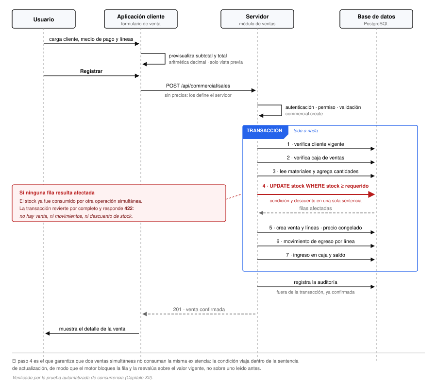
  <figcaption>Secuencia del registro de una venta. Los siete pasos del recuadro ocurren dentro de una única transacción; el cuarto es el que impide que dos operaciones simultáneas consuman la misma existencia.</figcaption>
</figure>

Los apartados siguientes desarrollan cada paso en el orden en que se ejecuta.

### Paso 1 — Verificación del cliente

```ts
const customer = await tx.customer.findUnique({ where: { id: dto.customerId } });
if (!customer || !customer.isActive) {
  throw AppError.badRequest('El cliente no existe o está inactivo');
}
```

Dado que las bajas son lógicas, un cliente dado de baja continúa existiendo en la base. La
verificación comprende ambas condiciones.

### Paso 2 — Verificación de la caja

```ts
const salesRegister = await tx.cashRegister.findFirst({ where: { type: 'SALES', isActive: true } });
if (!salesRegister) {
  throw AppError.badRequest('No hay una caja de ventas configurada. Ejecutá el seed.');
}
```

La caja se verifica **antes** de tocar las existencias. El orden importa: si se comprobara al final,
una instalación sin datos iniciales descontaría existencias y recién entonces fallaría. La
transacción revertiría el descuento, ciertamente, pero el trabajo se habría realizado en vano y el
diagnóstico resultaría menos evidente.

### Paso 3 — Agregación de cantidades por material

```ts
const requiredByProduct = new Map<string, Decimal>();
for (const item of dto.items) {
  const prev = requiredByProduct.get(item.finishedProductId) ?? new Decimal(0);
  requiredByProduct.set(item.finishedProductId, prev.plus(item.quantity));
}
```

Nada impide que una venta incluya el mismo material en dos líneas distintas. Verificar cada línea de
manera independiente contra la existencia disponible permitiría que dos líneas de sesenta unidades
superaran conjuntamente una existencia de cien, habiendo pasado ambas la verificación individual.

La agregación previa elimina el problema: la verificación y el descuento operan sobre la **cantidad
total requerida por material**, no por línea.

### Paso 4 — Verificación previa

```ts
for (const [productId, required] of requiredByProduct) {
  const product = productById.get(productId);
  if (!product || !product.isActive) {
    throw AppError.badRequest(`Producto inexistente o inactivo: ${productId}`);
  }
  if (new Decimal(product.currentStock.toString()).lessThan(required)) {
    throw AppError.unprocessable(
      `Stock insuficiente para ${product.name} (disponible ${product.currentStock}, requerido ${required})`,
    );
  }
}
```

Esta verificación cumple una función de **diagnóstico, no de garantía**. Su propósito es producir un
mensaje útil —con el nombre del material, la cantidad disponible y la requerida— antes de intentar el
descuento.

La existencia que aquí se consulta es meramente indicativa. La garantía real se encuentra en el paso
siguiente, y el motivo se desarrolla a continuación.

### Paso 5 — Descuento atómico y condicional

Es el núcleo de la operación.

```ts
for (const [productId, required] of requiredByProduct) {
  const product = productById.get(productId)!;
  const { count } = await tx.finishedProduct.updateMany({
    where: { id: productId, currentStock: { gte: required.toFixed(3) } },
    data:  { currentStock: { decrement: required.toFixed(3) } },
  });
  if (count === 0) {
    throw AppError.unprocessable(`Stock insuficiente para ${product.name}`);
  }
}
```

La sentencia resultante es, en esencia:

```sql
UPDATE finished_products
   SET current_stock = current_stock - :requerido
 WHERE id = :id AND current_stock >= :requerido;
```

**La condición viaja dentro de la sentencia de actualización.** La verificación y la modificación
constituyen una operación única e indivisible para el motor de base de datos, que bloquea la fila
mientras la ejecuta. Si la condición no se satisface, ninguna fila resulta afectada, el contador
devuelve cero y la operación se rechaza.

#### Por qué no basta con verificar y luego descontar

La alternativa evidente —consultar la existencia, compararla y descontarla si alcanza— presenta un
defecto que sólo se manifiesta bajo concurrencia, conocido como *actualización perdida*.

Considérese un material con cien unidades disponibles y dos ventas simultáneas de sesenta cada una:

| Momento | Operación A | Operación B | Existencia |
|---|---|---|---|
| t₁ | Lee: 100 | | 100 |
| t₂ | | Lee: 100 | 100 |
| t₃ | Compara: 100 ≥ 60 ✓ | | 100 |
| t₄ | | Compara: 100 ≥ 60 ✓ | 100 |
| t₅ | Escribe: 100 − 60 = 40 | | 40 |
| t₆ | | Escribe: 100 − 60 = 40 | **40** |

Ambas operaciones se confirman. Se vendieron ciento veinte unidades de una existencia de cien, y la
base registra cuarenta restantes cuando debería registrar menos veinte. **El sistema vendió mercadería
que no existe.**

El defecto no reside en la lógica sino en la separación temporal entre la lectura y la escritura.
Entre ambas, el valor leído dejó de ser válido.

Con el descuento condicional, la misma secuencia se comporta así:

| Momento | Operación A | Operación B | Existencia |
|---|---|---|---|
| t₁ | `UPDATE … WHERE stock ≥ 60` → 1 fila | | 40 |
| t₂ | | `UPDATE … WHERE stock ≥ 60` → **0 filas** | 40 |
| t₃ | Continúa | **Rechaza con 422 y revierte** | 40 |

La operación B encuentra la condición incumplida, obtiene cero filas afectadas y revierte por
completo. La existencia final es correcta y únicamente una de las dos ventas se confirmó.

#### Sobre el bloqueo

El motor de base de datos bloquea la fila mientras ejecuta la actualización. Si dos transacciones
intentan modificar el mismo registro, la segunda aguarda a que la primera concluya y **reevalúa la
condición sobre el valor actualizado**. De ahí que la comprobación resulte confiable: no se evalúa
sobre un valor leído previamente sino sobre el vigente en el instante de la modificación.

El alcance del bloqueo se limita a las filas afectadas. Dos ventas de materiales distintos no se
interfieren.

### Paso 6 — Construcción de las líneas y congelamiento del precio

```ts
let subtotal = new Decimal(0);
const detailRows = dto.items.map((item) => {
  const product = productById.get(item.finishedProductId)!;
  const unitPrice = new Decimal(product.salePrice.toString());
  const lineTotal = unitPrice.times(item.quantity);
  subtotal = subtotal.plus(lineTotal);
  return {
    finishedProductId: item.finishedProductId,
    quantity: item.quantity,
    unitPrice: unitPrice.toFixed(2),
    lineTotal: lineTotal.toFixed(2),
  };
});
```

Dos decisiones convergen en este fragmento.

**El precio se toma del material, nunca del cliente.** El cuerpo de la petición no incluye precios:
el esquema de validación admite únicamente el identificador del material y la cantidad. Aunque un
cliente manipulado los enviara, serían ignorados. El precio es autoridad exclusiva del servidor.

**El precio se copia, no se referencia.** El valor queda persistido en la línea de venta. Una
modificación posterior del precio del material no altera las ventas ya registradas. Sin este
congelamiento, un cambio de lista reescribiría retroactivamente el historial comercial y los
reportes de períodos cerrados arrojarían resultados distintos en cada consulta.

### Paso 7 — Precisión de los importes

Los cálculos no se realizan con el tipo numérico nativo del lenguaje sino con una biblioteca de
aritmética decimal.

El tipo nativo representa los valores en punto flotante binario, incapaz de expresar exactamente
ciertos decimales. La consecuencia es conocida: la suma de `0,1` y `0,2` no produce exactamente
`0,3`. Sobre un importe aislado el error resulta imperceptible; acumulado sobre las líneas de miles
de ventas, produce diferencias de centavos entre el detalle y el total.

La biblioteca opera con precisión decimal exacta y los valores se persisten en columnas de tipo
decimal (Capítulo V), de modo que la precisión se mantiene en todo el trayecto.

Conforme a la restricción RE-03, el importe total coincide con el subtotal y el impuesto se persiste
en cero. El campo existe, de modo que su incorporación futura no requiera alterar la estructura.

### Paso 8 — Persistencia y efectos

La venta se crea junto con sus líneas en una única operación:

```ts
const created = await tx.sale.create({
  data: {
    customerId: dto.customerId,
    createdById: actorId ?? null,
    status: 'CONFIRMED',
    paymentMethod: dto.paymentMethod,
    subtotal: subtotal.toFixed(2),
    tax: '0',
    total: total.toFixed(2),
    details: { create: detailRows },
  },
  include: saleInclude,
});
```

A continuación se registran los dos efectos colaterales.

**Movimiento de egreso por línea**, referenciando la venta que lo originó. Esto permite que el
historial de un material responda por qué varió su existencia en cada momento.

**Ingreso en la caja y actualización del saldo**, dentro de la misma transacción:

```ts
await tx.cashMovement.create({
  data: { cashRegisterId: salesRegister.id, amount: total.toFixed(2),
          description: `Venta a ${customer.name}`, saleId: created.id },
});
await tx.cashRegister.update({
  where: { id: salesRegister.id },
  data:  { balance: { increment: total.toFixed(2) } },
});
```

El saldo constituye un valor desnormalizado (Capítulo V). Que el movimiento y la actualización del
saldo ocurran en la misma transacción es lo que garantiza su correspondencia.

Conforme a la restricción RE-04, el ingreso se registra **cualquiera sea el medio de pago**, incluidos
cheque y cuenta corriente. Así lo especificó el cliente.

## Anulación

La anulación revierte una venta confirmada. Su diseño es el inverso exacto del registro y presenta la
misma estructura de garantías.

### Protección del estado

```ts
const { count } = await tx.sale.updateMany({
  where: { id, status: 'CONFIRMED' },
  data:  { status: 'CANCELLED' },
});
if (count === 0) throw AppError.unprocessable('La venta ya no está confirmada');
```

Es el mismo mecanismo del descuento de existencias aplicado a una transición de estado. La condición
viaja dentro de la actualización, de modo que **ante dos anulaciones simultáneas únicamente una
prospera**. La segunda encuentra cero filas afectadas y revierte.

Sin esta protección, dos anulaciones concurrentes repondrían las existencias dos veces y revertirían
la caja dos veces, a partir de una única venta.

### Reposición y reversión

La reposición genera un movimiento de ingreso por cada línea, con una referencia que identifica su
origen, e incrementa la existencia agregada por material.

La reversión de caja genera un movimiento **de importe negativo** por cada ingreso de la venta y
decrementa el saldo:

```ts
for (const mov of current.cashMovements) {
  const amount = new Decimal(mov.amount.toString());
  await tx.cashMovement.create({
    data: { cashRegisterId: mov.cashRegisterId, amount: amount.negated().toFixed(2),
            description: `Anulación de venta a ${current.customer.name}`, saleId: id },
  });
  await tx.cashRegister.update({
    where: { id: mov.cashRegisterId },
    data:  { balance: { decrement: amount.toFixed(2) } },
  });
}
```

Registrar la reversión como un movimiento adicional, en lugar de eliminar el original, preserva la
trazabilidad: el histórico conserva ambos y su suma es cero.

La reversión itera sobre los movimientos efectivamente registrados por la venta, y no sobre su
importe. Esto permite anular correctamente las ventas registradas antes de que la caja se
incorporara al sistema: al no poseer movimientos asociados, se anulan sin afectar el saldo.

### Independencia del estado del cliente

La anulación **no verifica que el cliente continúe vigente**. Es una decisión deliberada,
documentada en el código: se trata de una operación correctiva, y la baja del cliente no debe
impedir la corrección de un error.

## Verificación empírica

Las garantías descritas no se afirman: se verifican. La suite de pruebas incluye tres casos que las
comprueban contra una base de datos real (Capítulo XII).

### Reversión completa ante existencia insuficiente

Intenta una venta que excede la existencia disponible y comprueba, tras el rechazo, que **no se creó
la venta, no se generaron movimientos y la existencia permanece inalterada**. Verifica que la
reversión sea efectivamente total y no parcial.

### Concurrencia

> *«Ante dos ventas simultáneas que exceden el stock, sólo una se confirma.»*

Es la prueba decisiva del capítulo. Dispara dos peticiones de venta en paralelo sobre un material
cuya existencia alcanza para una sola, y verifica que exactamente una se confirme, que la otra sea
rechazada y que la existencia final resulte correcta.

Sin esta prueba, la corrección del descuento condicional sería una afirmación de diseño. Con ella, es
un resultado verificado y reproducible.

### Ciclo completo de anulación

Registra una venta, comprueba el descuento de existencias y el incremento del saldo, la anula, y
comprueba que ambos valores regresen exactamente a su estado previo. Verifica a continuación que un
segundo intento de anulación sea rechazado.

## Síntesis

La operación aplica cuatro garantías, cada una respondiendo a un riesgo concreto:

| Garantía | Mecanismo | Riesgo que evita |
|---|---|---|
| Atomicidad | Transacción de base de datos | Estados intermedios inconsistentes |
| Aislamiento bajo concurrencia | Actualización condicional con bloqueo de fila | Venta de existencia inexistente |
| Estabilidad histórica | Copia del precio en la línea | Reescritura retroactiva del historial comercial |
| Exactitud monetaria | Aritmética y almacenamiento decimales | Diferencias acumuladas por redondeo |

El costo de estas garantías es una función considerablemente más extensa que una inserción simple.
Se trata de una inversión deliberada: es la operación que sostiene la actividad comercial del cliente
y la única cuyo fallo produciría discrepancias entre el sistema y el inventario físico.

# Reportería

Este capítulo describe la capa de generación de reportes. El sistema entrega un único reporte, pero
la capa se diseñó de modo que la incorporación de otros no requiera modificar ni el transporte ni el
formato de salida.

## El problema de diseño

Un reporte combina cuatro responsabilidades que tienden a mezclarse: obtener los datos, decidir cómo
se presentan las columnas, producir el archivo y entregarlo por la red.

Resolverlas juntas conduce a un resultado predecible: el segundo reporte duplica la mecánica del
primero, el tercero duplica la del segundo, y la lógica de formato queda dispersa en tantos lugares
como reportes existan.

La capa separa esas responsabilidades en tres piezas con límites definidos:

| Pieza | Responsabilidad | Conoce |
|---|---|---|
| **Definición** | Qué datos trae y cómo se presentan sus columnas | El dominio |
| **Generador de planilla** | Cómo se vuelca un reporte resuelto a un archivo | El formato de salida |
| **Controlador** | Cómo se entrega el archivo por la red | El protocolo HTTP |

Una definición ignora que la salida es una planilla de cálculo. El generador ignora qué representan
los datos. El controlador ignora ambas cosas.

## El contrato

Una definición de reporte declara qué necesita el sistema para resolverlo:

```ts
export interface ReportDefinition<F, R extends ReportRow> {
  key: string;                         // segmento de URL
  title: string;                       // título de la hoja y base del nombre de archivo
  filtersSchema: ZodTypeAny;           // valida y normaliza los filtros
  columns: ReportColumn[];             // encabezado, clave de origen, ancho y formato
  fetch(filters: F, options: { limit: number }): Promise<R[]>;
  header?(filters: F): string[] | Promise<string[]>;   // líneas de contexto
  totals?(rows: R[], filters: F): ReportTotal[];       // bloque de totales
  filename?(filters: F): string;
}
```

Las tres últimas propiedades son opcionales, de modo que un reporte elemental se define declarando
su clave, su título, el esquema de filtros, las columnas y la consulta.

Cada columna declara su formato de presentación, tomado de un conjunto acotado: texto, número,
cantidad, importe o fecha. La definición **no conoce el código de formato concreto**: expresa una
intención que el generador traduce al formato del archivo.

### Registro de reportes

Las definiciones se registran en un catálogo indexado por clave:

```ts
const REPORTS: RegisteredReport[] = [salesByPeriodReport];
const REPORT_BY_KEY = new Map(REPORTS.map((report) => [report.key, report]));
```

La ruta recibe la clave como parámetro y la resuelve contra el catálogo, de modo que **agregar un
reporte no modifica el archivo de rutas**:

```ts
reportsRoutes.get('/:key/excel', requirePermission('reports.read'), reportsController.excel);
```

## El reporte de ventas por período

Es el único reporte del sistema. Produce **una fila por línea de venta**, con doce columnas.

| Columna | Formato | Origen |
|---|---|---|
| Fecha | Fecha y hora | Momento de la venta |
| Venta | Texto | Identificador abreviado |
| Cliente | Texto | Razón social |
| CUIT/Doc | Texto | Identificación tributaria |
| SKU | Texto | Código del material |
| Material | Texto | Denominación |
| Cantidad | Cantidad | Unidades de la línea |
| Unidad | Texto | Unidad de medida |
| Precio unitario | Importe | Precio congelado |
| Total línea | Importe | Importe de la línea |
| Medio de pago | Texto | Traducido al español |
| Vendedor | Texto | Usuario que registró la venta |

### Por qué el grano es la línea y no la venta

Un reporte agregado por venta, por cliente o por mes responde una pregunta concreta y obliga a crear
un reporte nuevo ante cada pregunta distinta.

El grano de línea es el más fino disponible, y desde él el usuario obtiene cualquier agregación con
una tabla dinámica de su planilla de cálculo: por cliente, por material, por mes o por vendedor. Un
reporte cubre así lo que de otro modo requeriría varios.

Para que esa agregación resulte posible, el generador escribe los valores numéricos **como números y
no como texto**, y deja la tabla con filtro automático y encabezado fijo.

### Filtros

```ts
const filtersSchema = z.object({
    from: z.string().regex(DATE_PATTERN, 'Formato de fecha esperado: YYYY-MM-DD').optional(),
    to:   z.string().regex(DATE_PATTERN, 'Formato de fecha esperado: YYYY-MM-DD').optional(),
    customerId: z.string().uuid('Cliente inválido').optional(),
  })
  .refine((f) => !f.from || !f.to || f.from <= f.to, {
    message: 'La fecha "desde" no puede ser posterior a "hasta"', path: ['from'],
  })
  .transform((f) => ({ ...parseDateRange(f.from, f.to, { defaultCount: 30 }), customerId: f.customerId }));
```

El esquema realiza tres tareas: **valida** el formato, **verifica** la coherencia del rango y
**transforma** los filtros en el rango normalizado que la consulta utilizará. Sin rango explícito
reporta los últimos treinta días, de modo que la pantalla resulte útil sin configuración previa.

### Alcance de los datos

La consulta incluye **exclusivamente ventas confirmadas**. Las anuladas revirtieron existencias y
caja, y computarlas contradiría al resto del sistema. Es el mismo criterio de los indicadores y de la
caja (requerimiento RF-27), y el encabezado del archivo lo declara de forma explícita para que el
lector de la planilla no deba suponerlo.

### Cálculo de totales

El bloque de totales presenta tres valores, y uno de ellos merece atención:

```ts
// "Total vendido" se suma sobre VENTAS distintas usando sale.total, nunca sumando
// lineTotal: hoy coinciden porque tax = 0, pero al incorporar IVA/descuentos la suma
// de líneas dejaría de ser el total de la venta y el reporte quedaría mal en silencio.
const totalBySale = new Map<string, string>();
for (const row of rows) totalBySale.set(row.saleId, row.saleTotal);

let sold = new Decimal(0);
for (const total of totalBySale.values()) sold = sold.plus(total);
```

El total vendido se obtiene sumando los importes de **ventas distintas**, no los importes de las
líneas. Con el alcance actual ambos coinciden, porque el impuesto es cero. En cuanto se incorpore el
tratamiento impositivo o cualquier descuento por venta, dejarán de coincidir, y una suma de líneas
produciría un total incorrecto **sin manifestar error alguno**.

Para hacerlo posible, la consulta arrastra dos campos auxiliares —el identificador y el total de la
venta— que no poseen columna en la planilla. El generador escribe únicamente las claves declaradas en
las columnas, de modo que los auxiliares no aparecen en la salida.

## Control del volumen

El generador construye el archivo **completo en memoria** antes de transmitirlo. Un rango de fechas
desmedido podría comprometer la memoria del servidor.

La capa aplica un tope de veinte mil filas, verificado con un mecanismo que evita cargar el resultado
completo para comprobarlo: la definición solicita **una fila más que el tope**.

```ts
take: options.limit + 1,
```

```ts
if (rows.length > MAX_REPORT_ROWS) {
  throw AppError.unprocessable(
    `El reporte supera las ${MAX_REPORT_ROWS.toLocaleString('es-AR')} filas. Achicá el rango de fechas.`,
  );
}
```

Si la consulta devuelve la fila adicional, el rango excede el tope y se rechaza con una indicación
concreta. La consulta nunca trae más de veinte mil una filas, con independencia del volumen
existente.

## Orden de ejecución

El controlador respeta un orden que constituye el aporte técnico principal de esta capa:

```ts
async excel(req, res, next) {
  try {
    const payload = await reportsService.build(String(req.params.key), req.query);

    res.setHeader('Content-Type', XLSX_MIME);
    res.setHeader('Content-Disposition', `attachment; filename="${safeFilename(payload.filename)}"`);
    res.setHeader('X-Report-Rows', String(payload.rows.length));

    await writeReportWorkbook(res, payload);
    if (!res.writableEnded) res.end();
  } catch (err) {
    next(err);
  }
}
```

**Todo lo que puede fallar ocurre antes de escribir el primer byte.** La validación de filtros, la
consulta y la verificación del tope se resuelven primero; sólo entonces se establecen las cabeceras y
se transmite el archivo.

El orden inverso —establecer cabeceras y luego consultar— tendría una consecuencia concreta: ante un
fallo posterior, las cabeceras ya enviadas impedirían responder con un mensaje de error, y el usuario
recibiría un archivo corrupto en lugar de una explicación. Es la situación que el manejador
centralizado de errores detecta y que se describe en el Capítulo VII.

### Metadatos por cabecera

Dos datos viajan fuera del cuerpo, porque el cuerpo es el archivo:

| Cabecera | Contenido | Uso en el cliente |
|---|---|---|
| `Content-Disposition` | Nombre del archivo | Guardarlo con el nombre que el servidor definió |
| `X-Report-Rows` | Cantidad de filas | Informar «no hay datos en el período» sin abrir el archivo |

Ambas requieren declaración explícita en la configuración de origen cruzado: sin ella, el navegador
las oculta al cliente por encontrarse en un origen distinto (Capítulo VI).

El nombre del archivo se depura antes de incorporarlo a la cabecera, eliminando todo carácter ajeno
al conjunto seguro.

## Generación de la planilla

El generador es el único componente que conoce la biblioteca de planillas de cálculo. Produce cuatro
bloques:

1. **Banda con el logotipo**, sobre el título.
2. **Título y líneas de contexto** —período, filtros aplicados, aclaración de alcance, momento de
   generación—, fusionadas a lo ancho de la tabla.
3. **Tabla**, con encabezado destacado, fijo y con filtro automático.
4. **Bloque de totales**, al pie.

Tres detalles de implementación merecen mención.

### Coherencia visual con la aplicación

El generador reutiliza los colores del sistema de diseño de la interfaz —el azul primario del
encabezado y el gris del texto secundario—, declarados como constantes con referencia a su origen. La
planilla no desentona con la aplicación que la produjo.

### Corrección de la zona horaria

Las planillas de cálculo almacenan fechas sin zona horaria, y la biblioteca las serializa desde el
tiempo universal. Una venta registrada a las veinte horas se abriría mostrando las veintitrés.

```ts
function toExcelWallClock(date: Date): Date | null {
  if (Number.isNaN(date.getTime())) return null;
  return new Date(date.getTime() - date.getTimezoneOffset() * 60_000);
}
```

Se compensa el desplazamiento local para que el archivo muestre la misma hora que la aplicación.

### Tolerancia ante la ausencia del logotipo

El logotipo se lee una única vez, al cargar el módulo. Si el archivo no se encuentra disponible, el
generador registra una advertencia y produce la planilla sin él.

La decisión responde a un criterio: el logotipo es ornamental y su ausencia no debe impedir una
descarga. La situación es además previsible, porque la compilación del servidor emite únicamente
código y no copia los recursos, de modo que un despliegue que omitiera copiarlos produciría reportes
sin logotipo pero funcionales. El Capítulo XIII lo advierte.

## Descarga en el cliente

El cliente extiende su capa de acceso a datos con un método de descarga binaria que, a diferencia del
resto, **no desenvuelve la estructura de respuesta** y observa la respuesta completa para leer sus
cabeceras.

```ts
private downloadExcel(key: string, params: Record<string, string>): Observable<ReportDownload> {
  return this.api.getBlob(`${this.base}/${key}/excel`, params).pipe(
    map((res) => {
      const filename = filenameFrom(res, key);
      saveAs(res.body ?? new Blob(), filename);
      return { rows: Number(res.headers.get('X-Report-Rows') ?? 0), filename };
    }),
  );
}
```

Si la cabecera del nombre no llegara —por ejemplo, tras un intermediario que no la exponga—, el
cliente construye un nombre con la fecha del día en lugar de fallar.

El manejo de errores requirió una adaptación específica. En una descarga, el cuerpo del error también
llega en formato binario, de modo que el interceptor debe leerlo como texto antes de presentarlo; sin
ese tratamiento, el usuario recibiría una notificación ininteligible en lugar del mensaje del
servidor (Capítulo X).

## Incorporación de un reporte nuevo

La separación de responsabilidades produce un resultado concreto: **agregar un reporte consiste en
escribir una definición y sumarla al catálogo**.

```ts
export const nuevoReporte = defineReport({
  key: 'clave-en-la-url',
  title: 'Título del reporte',
  filtersSchema,
  columns: [ /* … */ ],
  fetch: obtenerFilas,
  header: construirEncabezado,   // opcional
  totals: construirTotales,      // opcional
});
```

No se modifica el archivo de rutas, ni el controlador, ni el generador de planillas. Es la
implementación del requerimiento RNF-18.

La separación habilita además una extensión distinta: **un formato de salida nuevo** requiere
únicamente un generador que consuma la misma estructura resuelta. Las definiciones existentes no se
modifican. Ésta fue la razón de separar el generador del controlador, y no la de disponer de varios
reportes.

# Implementación del cliente

Este capítulo describe la aplicación que se ejecuta en el navegador: su organización, el manejo del
estado, los mecanismos transversales y los componentes reutilizables que sostienen la interfaz.

## Organización

La aplicación se compone de **componentes autónomos**, sin módulos declarativos. Cada componente
declara explícitamente sus dependencias, lo que vuelve legible qué necesita cada pantalla y permite
que la carga diferida opere a nivel de componente.

```
src/app/
├── core/        servicios únicos, interceptores, guardas y modelos
├── shared/      componentes, transformadores y utilidades reutilizables
├── layout/      estructura visual de la aplicación autenticada
└── features/    las pantallas, agrupadas por área funcional
```

Las dependencias fluyen en un solo sentido: las funcionalidades dependen de `shared` y de `core`, y
nunca entre sí. Cuando una pantalla necesita datos de otra área —el formulario de venta requiere el
catálogo de clientes y de materiales— los obtiene mediante el servicio de acceso correspondiente,
sin importar componentes ajenos.

### Composición de la aplicación

La raíz monta únicamente tres elementos:

```html
<p-toast position="top-right" />
<app-confirm-dialog />
<router-outlet />
```

Los dos primeros son los anfitriones globales de las notificaciones y de los diálogos de
confirmación. Al montarse una sola vez en la raíz, cualquier pantalla puede emitir una notificación o
solicitar una confirmación sin declarar el componente correspondiente.

La configuración de la aplicación registra el enrutador, el cliente HTTP con sus interceptores y las
animaciones. Incluye además un inicializador que resuelve un problema concreto:

```ts
provideAppInitializer(() => {
  const auth = inject(AuthService);
  if (!auth.accessToken) return;
  return firstValueFrom(auth.loadProfile()).catch(() => undefined);
}),
```

Al recargar la página, los tokens persisten en el almacenamiento local pero el perfil del usuario —y
con él sus permisos— se pierde. El inicializador lo recupera **antes del primer dibujado**, de modo
que el menú se presenta ya filtrado. Sin este mecanismo, el usuario vería por un instante un menú
vacío que luego se completaría.

El manejo del fallo es deliberado: si la recuperación no prospera, la aplicación arranca igualmente y
la guarda de ruta redirige al inicio de sesión. Un error aquí no debe impedir el arranque.

## Estado con señales

El estado se administra con las señales nativas del framework. Un componente típico declara su estado
local como señales y deriva de ellas los valores calculados:

```ts
readonly saving = signal(false);
readonly customers = signal<Customer[]>([]);
readonly products = signal<FinishedProduct[]>([]);

readonly noCustomers = computed(() => this.customersLoaded() && this.customers().length === 0);
```

Los valores derivados se recalculan automáticamente cuando cambia alguna de sus dependencias, y
únicamente entonces.

El estado compartido entre pantallas se reduce a la sesión, que reside en el servicio de
autenticación:

```ts
private readonly _currentUser = signal<AuthUser | null>(null);
readonly currentUser = this._currentUser.asReadonly();
readonly isAuthenticated = computed(() => this._currentUser() !== null);
```

La señal se expone **en modo de sólo lectura**: ningún componente puede modificar el usuario actual.
Únicamente el servicio lo hace, a través de sus propios métodos.

Todos los componentes utilizan la estrategia de detección de cambios optimizada, que las señales
habilitan de forma natural: el framework redibuja cuando una señal leída por la plantilla cambia, sin
recorrer el árbol completo.

### Vista previa de totales en el formulario de venta

El ejemplo más elaborado de estado derivado se encuentra en el registro de una venta, donde el
importe debe actualizarse a medida que el usuario agrega líneas:

```ts
readonly summary = computed(() => {
  const value = this.formValue();
  const map = this.productMap();
  let subtotal = new Decimal(0);
  const lines = (value.items ?? []).map((it) => {
    const product = it?.finishedProductId ? map.get(it.finishedProductId) : undefined;
    const unitPrice = product ? new Decimal(product.salePrice) : new Decimal(0);
    const quantity = new Decimal(Number(it?.quantity) || 0);
    const lineTotal = unitPrice.times(quantity);
    subtotal = subtotal.plus(lineTotal);
    return { unitPrice: unitPrice.toFixed(2), lineTotal: lineTotal.toFixed(2) };
  });
  return { lines, subtotal: subtotal.toFixed(2), total: subtotal.toFixed(2) };
});
```

Dos aclaraciones sobre este cálculo. Utiliza la misma biblioteca de aritmética decimal que el
servidor, de modo que la previsualización coincida con el importe definitivo. Y constituye
**exclusivamente una vista previa**: el importe que se persiste lo calcula el servidor, que es la
única autoridad (Capítulo VIII). El cliente no envía precios ni totales.

## Carga diferida

Cada área funcional se carga la primera vez que el usuario navega a ella:

```ts
{
  path: 'commercial/sales',
  loadChildren: () => import('./features/commercial/sales/sales.routes').then((m) => m.SALES_ROUTES),
},
```

Un usuario del área de Stock, que sólo accede a materiales, nunca descarga el código de ventas,
reportes ni auditoría.

La estructura de rutas separa la zona pública de la protegida:

```
/login, /forgot-password, /reset-password     públicas
'' + authGuard → MainLayout
    ├── /dashboard
    ├── /commercial/customers, /commercial/sales
    ├── /inventory/finished-products
    ├── /finance/sales-cash
    ├── /users, /roles, /audit, /reports
    └── redirección a /dashboard
```

La guarda de sesión se aplica una sola vez, sobre el grupo protegido. Las guardas de permiso se
aplican en cada ruta hija, junto al permiso que declaran como dato asociado.

En el listado de ventas, la ruta de creación se declara **antes** de la ruta paramétrica de detalle;
en caso contrario, esta última capturaría aquélla interpretándola como un identificador.

## Capa de acceso a datos

Un único servicio concentra el acceso HTTP: prefija la dirección base, desenvuelve la estructura de
respuesta y descarta los parámetros vacíos.

```ts
get<T>(path: string, params?: Record<string, string | number | boolean>): Observable<T> {
  return this.http.get<ApiResponse<T>>(`${this.base}${path}`, { params: this.toParams(params) })
                  .pipe(map((res) => res.data));
}
```

El descarte de parámetros vacíos simplifica a quien lo consume: un filtro sin valor sencillamente no
se envía, sin que cada pantalla deba construir el conjunto de parámetros de forma condicional.

Sobre este servicio, cada área declara el suyo, que traduce operaciones de dominio a rutas:

```ts
@Injectable({ providedIn: 'root' })
export class CustomerService {
  private readonly api = inject(ApiService);
  private readonly base = '/commercial/customers';

  list(page: number, limit: number, search?: string) { … }
  create(dto: CustomerInput) { … }
  update(id: string, dto: CustomerInput) { … }
  deactivate(id: string) { … }
}
```

Los componentes consumen estos servicios y **nunca el cliente HTTP directamente**. La consecuencia
práctica es que un cambio en la estructura de respuesta del servidor se absorbe en un único lugar.

### Tipado de importes

Los modelos del cliente declaran los importes **como cadenas de texto**:

```ts
export interface FinishedProduct {
  salePrice: string;     // decimal serializado
  currentStock: string;  // decimal serializado
}
```

Es la contrapartida de la decisión de precisión decimal descrita en el Capítulo V. Los valores se
convierten a número únicamente para previsualizar totales, y se presentan mediante el transformador
de moneda.

## Interceptores

### Sesión

```ts
export const jwtInterceptor: HttpInterceptorFn = (req, next) => {
  const auth = inject(AuthService);
  const isAuthEndpoint = AUTH_ENDPOINTS.some((url) => req.url.includes(url));
  const token = auth.accessToken;

  const authReq = !isAuthEndpoint && token
    ? req.clone({ setHeaders: { Authorization: `Bearer ${token}` } })
    : req;

  return next(authReq).pipe(
    catchError((err: HttpErrorResponse) => {
      if (err.status === 401 && !isAuthEndpoint && auth.refreshToken) {
        return auth.refresh().pipe(
          switchMap((tokens) => next(req.clone({ setHeaders: { Authorization: `Bearer ${tokens.accessToken}` } }))),
          catchError((refreshErr) => { auth.logout(); return throwError(() => refreshErr); }),
        );
      }
      return throwError(() => err);
    }),
  );
};
```

Adjunta la credencial a cada petición y gestiona la renovación de forma transparente: ante una
respuesta de sesión inválida solicita un par de tokens nuevo y **reintenta la petición original una
única vez**. Si la renovación fracasa, cierra la sesión.

Los puntos de acceso públicos de autenticación quedan excluidos. Sin esa exclusión, un intento de
inicio de sesión con credenciales incorrectas dispararía una renovación carente de sentido.

### Errores

```ts
export const errorInterceptor: HttpInterceptorFn = (req, next) => {
  const notify = inject(NotificationService);

  return next(req).pipe(
    catchError((err: HttpErrorResponse) => {
      if (err.status !== 401) {
        if (err.error instanceof Blob) {
          err.error.text()
            .then((text) => notify.error(parseErrorText(text) ?? err.message ?? FALLBACK_MESSAGE))
            .catch(() => notify.error(err.message ?? FALLBACK_MESSAGE));
        } else {
          notify.error(err.error?.error ?? err.message ?? FALLBACK_MESSAGE);
        }
      }
      return throwError(() => err);
    }),
  );
};
```

Presenta una notificación ante cualquier error, con el mensaje que el servidor produjo. Gracias a la
uniformidad del contrato de error (Capítulo IV), la extracción del mensaje es idéntica en todos los
casos.

Dos particularidades. Las respuestas de sesión inválida se ignoran, porque las gestiona el
interceptor anterior; notificarlas presentaría un error al usuario justo antes de una renovación
exitosa e invisible. Y el cuerpo del error se examina por si llegara en formato binario, situación
que se produce al fallar la descarga de un reporte: sin ese tratamiento, la notificación resultaría
ininteligible.

La consecuencia de tener este interceptor es que **los componentes no manejan la presentación de
errores**. Su bloque de error se limita a restablecer el estado de la interfaz:

```ts
this.service.create(dto).subscribe({
  next: (sale) => { this.saving.set(false); this.router.navigate(['/commercial/sales', sale.id]); },
  error: () => this.saving.set(false),
});
```

Las pantallas de autenticación constituyen la excepción: presentan además un mensaje en línea, porque
en ellas el error forma parte del flujo y no de una operación en segundo plano.

## Guardas de ruta

```ts
export const authGuard: CanActivateFn = (_route, state) => {
  const auth = inject(AuthService);
  const router = inject(Router);
  if (auth.accessToken) return true;
  return router.createUrlTree(['/login'], { queryParams: { returnUrl: state.url } });
};
```

La guarda de sesión conserva la dirección solicitada, de modo que tras autenticarse el usuario
llegue a donde pretendía ir y no a la pantalla inicial.

La guarda de permiso lee el permiso declarado en la ruta y aplica la misma regla que el servidor,
incluido el comodín de administración. Ante la ausencia del permiso redirige a la raíz.

Conforme a lo expuesto en el Capítulo VI, ambas guardas constituyen medidas de usabilidad. La
verificación con valor de seguridad es la del servidor.

## Componentes compartidos

### Grilla de datos

Es la pieza reutilizada de mayor alcance: **seis pantallas** la utilizan. Ofrece paginación en el
servidor, búsqueda con retardo y formateo por tipo de columna.

```ts
constructor() {
  this.search$.pipe(debounceTime(300), takeUntilDestroyed()).subscribe(() => this.emit());
}
```

El retardo de trescientos milisegundos evita una petición por cada pulsación. La cancelación
automática al destruirse el componente previene la fuga de suscripciones.

El aspecto más interesante es el modo que **exige una búsqueda previa**:

```ts
readonly awaitingSearch = computed(
  () => this.searchRequired() && this.search().length < this.minSearchLength(),
);

readonly displayRows = computed<T[]>(() => (this.awaitingSearch() ? [] : this.rows()));
```

En ese modo, la grilla no consulta al servidor hasta contar con al menos dos caracteres. Resuelve un
problema concreto: al ingresar a un listado de clientes, el comportamiento natural sería traer la
primera página del catálogo completo, operación inútil cuando el usuario busca un cliente
determinado.

La derivación de las filas presentadas merece atención. En estado inicial devuelve un conjunto vacío
**sin modificar los datos recibidos**, de modo que al borrar el campo de búsqueda no permanezcan
visibles los resultados anteriores aunque el componente contenedor aún los conserve.

La emisión hacia el contenedor se interrumpe en ese estado, lo que neutraliza la carga inicial que la
tabla dispara automáticamente al montarse.

Tres pantallas exigen búsqueda —clientes, materiales y usuarios— y tres no: ventas, auditoría y caja
presentan el día en curso, porque la operación diaria requiere ver lo del día al ingresar.

### Transformadores de presentación

```ts
@Pipe({ name: 'currencyArs', standalone: true })
export class CurrencyArsPipe implements PipeTransform {
  private static readonly formatter = new Intl.NumberFormat('es-AR', {
    style: 'currency', currency: 'ARS',
    minimumFractionDigits: 2, maximumFractionDigits: 2,
  });
  …
}
```

El formateador se declara como miembro estático: construirlo es costoso y la alternativa implicaría
rehacerlo en cada celda de cada tabla.

Ambos transformadores —moneda y fecha— devuelven un guion ante valores ausentes o inválidos, en lugar
de producir un error o presentar una fecha inválida.

### Diálogo de confirmación

Se monta una única vez en la raíz y se invoca desde cualquier pantalla:

```ts
this.confirm.confirm({
  header: 'Anular venta',
  message: '¿Anular esta venta? Se repondrá el stock de los materiales vendidos.',
  accept: () => { … },
});
```

Toda operación irreversible o de baja lo utiliza. El mensaje describe la consecuencia, no la acción:
la anulación no anuncia que anulará sino que repondrá las existencias.

## Sistema de diseño

Los valores de diseño se definen **una sola vez** como variables de hoja de estilos y se consumen
desde el marco de utilidades:

```css
:root {
  --color-primary-600: #2563eb;
  --color-accent-500:  #f59e0b;
  --color-surface-50:  #f8fafc;
  --color-text-muted:  #64748b;
  --radius-md: 0.5rem;
  --sidebar-width: 16rem;
  --header-height: 3.5rem;
}
```

El color primario se mantiene en la familia del tema de la biblioteca de componentes, de modo que sus
elementos y las utilidades no produzcan combinaciones discordantes.

Estos valores trascienden el cliente: el generador de planillas del servidor reutiliza el azul
primario y el gris del texto secundario para el encabezado de los reportes (Capítulo IX), de modo que
el archivo descargado no desentone con la aplicación que lo produjo.

## Estructura de la aplicación autenticada

La estructura visual se compone de una barra lateral contraíble, una barra superior y el área de
contenido. La barra lateral filtra sus elementos según los permisos del usuario:

```ts
readonly items = computed(() =>
  this.allItems.filter((item) => !item.permission || this.auth.hasPermission(item.permission)),
);
```

El filtrado es una señal derivada del usuario actual, de modo que el menú se recalcula solo al
iniciarse la sesión sin requerir intervención alguna.

La correspondencia entre cada elemento del menú, su ruta y su permiso se presenta en el Anexo B.

# Interfaz de programación

Este capítulo documenta el contrato que el servidor expone. Comienza por las convenciones comunes,
presenta el catálogo completo de puntos de acceso y detalla los seis centrales.

## Convenciones

### Dirección base y autenticación

Todos los puntos de acceso se publican bajo el prefijo `/api`. La única excepción es la verificación
de estado, deliberadamente situada fuera de él para que un supervisor externo pueda consultarla sin
conocer la estructura de la interfaz.

Salvo los puntos de acceso públicos de autenticación, todos exigen la credencial en la cabecera
correspondiente:

```http
Authorization: Bearer <token de acceso>
```

### Estructura de respuesta

Toda respuesta satisfactoria se entrega envuelta:

```json
{ "data": { … } }
```

Los listados incorporan la información de paginación:

```json
{
  "data": [ … ],
  "meta": { "page": 1, "limit": 20, "total": 137, "totalPages": 7 }
}
```

La descarga de reportes constituye la única excepción: entrega el archivo como cuerpo y transmite sus
metadatos por cabecera.

### Estructura de error

```json
{ "error": "Descripción legible", "details": { … } }
```

El campo de detalle acompaña a los errores de validación, indicando el problema por cada campo
rechazado.

### Códigos de estado

| Código | Uso |
|---|---|
| 200 | Operación satisfactoria |
| 201 | Recurso creado |
| 400 | Datos de entrada inválidos o regla de negocio incumplida |
| 401 | Ausencia de credencial válida |
| 403 | Credencial válida sin el permiso requerido |
| 404 | Recurso inexistente |
| 409 | Conflicto con un registro existente |
| 422 | Solicitud correcta que el estado del sistema impide satisfacer |
| 429 | Límite de frecuencia excedido |
| 500 | Error no previsto |

### Paginación, búsqueda y filtros

Los listados aceptan un conjunto uniforme de parámetros:

| Parámetro | Tipo | Comportamiento |
|---|---|---|
| `page` | Entero | Página solicitada. Por omisión, la primera |
| `limit` | Entero | Tamaño de página. Por omisión veinte, con un máximo de cien |
| `search` | Texto | Búsqueda parcial, sin distinción de mayúsculas. Los campos considerados dependen del recurso |
| `from`, `to` | `AAAA-MM-DD` | Rango de fechas, normalizado al inicio y al fin del día. Una fecha inválida se ignora |

Un valor de tamaño de página superior al máximo se acota en lugar de rechazarse.

### Tipos de datos

| Concepto | Representación | Ejemplo |
|---|---|---|
| Identificador | Identificador universal único, como texto | `"3f2b8c10-…"` |
| Importe | **Cadena de texto**, para preservar la precisión decimal | `"42500.00"` |
| Cantidad | Cadena de texto, con hasta tres decimales | `"12.500"` |
| Fecha y hora | Formato ISO 8601 | `"2026-09-13T17:42:00.000Z"` |

Que los importes viajen como texto y no como número es consecuencia de la decisión de precisión
descrita en el Capítulo V.

## Catálogo de puntos de acceso

El servidor expone **cuarenta puntos de acceso**.

### Verificación de estado

| Método | Ruta | Autorización |
|---|---|---|
| GET | `/health` | Pública |

### Autenticación

| Método | Ruta | Autorización |
|---|---|---|
| POST | `/api/auth/login` | Pública |
| POST | `/api/auth/refresh` | Pública |
| GET | `/api/auth/me` | Sesión |
| POST | `/api/auth/forgot-password` | Pública, con límite de frecuencia |
| GET | `/api/auth/reset-password/:token/validate` | Pública, con límite de frecuencia |
| POST | `/api/auth/reset-password` | Pública, con límite de frecuencia |

### Usuarios y roles

| Método | Ruta | Permiso |
|---|---|---|
| GET | `/api/users` | `users.read` |
| GET | `/api/users/:id` | `users.read` |
| POST | `/api/users` | `users.create` |
| PATCH | `/api/users/:id` | `users.update` |
| DELETE | `/api/users/:id` | `users.delete` |
| GET | `/api/roles` | `users.read` |
| GET | `/api/roles/:id` | `users.read` |

### Inventario

| Método | Ruta | Permiso |
|---|---|---|
| GET | `/api/categories` | `inventory.read` |
| POST | `/api/categories` | `inventory.create` |
| GET | `/api/inventory/finished-products` | `inventory.read` |
| GET | `/api/inventory/finished-products/:id` | `inventory.read` |
| POST | `/api/inventory/finished-products` | `inventory.create` |
| PATCH | `/api/inventory/finished-products/:id` | `inventory.update` |
| DELETE | `/api/inventory/finished-products/:id` | `inventory.delete` |
| GET | `/api/inventory/finished-products/:id/movements` | `inventory.read` |
| POST | `/api/inventory/finished-products/:id/movements` | `inventory.update` |

### Comercial

| Método | Ruta | Permiso |
|---|---|---|
| GET | `/api/commercial/customers` | `commercial.read` |
| GET | `/api/commercial/customers/:id` | `commercial.read` |
| POST | `/api/commercial/customers` | `commercial.create` |
| PATCH | `/api/commercial/customers/:id` | `commercial.update` |
| DELETE | `/api/commercial/customers/:id` | `commercial.delete` |
| GET | `/api/commercial/sales` | `commercial.read` |
| GET | `/api/commercial/sales/:id` | `commercial.read` |
| POST | `/api/commercial/sales` | `commercial.create` |
| PATCH | `/api/commercial/sales/:id/cancel` | `commercial.update` |

### Finanzas, reportes, auditoría e indicadores

| Método | Ruta | Permiso |
|---|---|---|
| GET | `/api/finance/sales-cash` | `finance.read` |
| GET | `/api/finance/sales-cash/movements` | `finance.read` |
| GET | `/api/reports/:key/excel` | `reports.read` |
| GET | `/api/audit` | `audit.read` |
| GET | `/api/audit/entities` | `audit.read` |
| GET | `/api/audit/:id` | `audit.read` |
| GET | `/api/dashboard` | Sesión |
| GET | `/api/dashboard/sales-series` | Sesión |

> El enrutador reserva además los prefijos de las áreas excluidas del alcance —materias primas,
> producción, proveedores, pagos y facturación—. Se encuentran montados y autenticados pero no
> exponen ningún punto de acceso.

## Detalle de los puntos de acceso centrales

### Inicio de sesión

```http
POST /api/auth/login
Content-Type: application/json

{ "email": "usuario@perlinor.local", "password": "…" }
```

**200**

```json
{ "data": { "accessToken": "eyJhbGciOi…", "refreshToken": "eyJhbGciOi…" } }
```

| Error | Situación |
|---|---|
| 400 | Correo con formato inválido o contraseña ausente |
| 401 | Credenciales incorrectas, usuario inexistente o dado de baja |

El mensaje de la respuesta de credenciales inválidas es idéntico en las tres situaciones, de modo que
no permita determinar cuál se produjo.

El par de tokens no incluye el perfil del usuario: el cliente lo obtiene a continuación mediante el
punto de acceso de sesión actual.

### Registro de venta

```http
POST /api/commercial/sales
Authorization: Bearer <token>
Content-Type: application/json

{
  "customerId": "3f2b8c10-…",
  "paymentMethod": "TRANSFER",
  "items": [
    { "finishedProductId": "a1c4…", "quantity": 250 },
    { "finishedProductId": "b7e2…", "quantity": 40 }
  ]
}
```

| Campo | Tipo | Obligatorio | Restricción |
|---|---|---|---|
| `customerId` | Identificador | Sí | Debe corresponder a un cliente vigente |
| `paymentMethod` | Enumerado | Sí | `CASH`, `TRANSFER`, `CARD`, `CHECK` o `ACCOUNT` |
| `items` | Lista | Sí | Al menos un elemento |
| `items[].finishedProductId` | Identificador | Sí | Debe corresponder a un material vigente |
| `items[].quantity` | Número | Sí | Mayor que cero |

**El cuerpo no admite precios ni importes.** Los precios son autoridad del servidor, que los toma del
material y los congela en la línea (Capítulo VIII).

**201**

```json
{
  "data": {
    "id": "9d1f…",
    "status": "CONFIRMED",
    "paymentMethod": "TRANSFER",
    "subtotal": "291500.00",
    "tax": "0",
    "total": "291500.00",
    "soldAt": "2026-09-13T17:42:00.000Z",
    "customer": { "id": "3f2b…", "name": "Corralón del Norte S.R.L.", "taxId": "30-71204558-3" },
    "createdBy": { "id": "5a8c…", "fullName": "Usuario Ventas" },
    "details": [
      { "id": "…", "finishedProductId": "a1c4…", "quantity": "250", "unitPrice": "850.00", "lineTotal": "212500.00" },
      { "id": "…", "finishedProductId": "b7e2…", "quantity": "40",  "unitPrice": "1975.00", "lineTotal": "79000.00" }
    ]
  }
}
```

| Error | Situación |
|---|---|
| 400 | Cuerpo inválido; cliente inexistente o dado de baja; material inexistente o dado de baja; caja de ventas no configurada |
| **422** | **Existencia insuficiente.** El mensaje indica el material, la cantidad disponible y la requerida |

La distinción es relevante: la existencia insuficiente no constituye un error de la solicitud, que es
correcta, sino una condición del estado del sistema que impide atenderla.

Un rechazo **no produce efecto alguno**: no se crea la venta, no se generan movimientos, no se
descuentan existencias y la caja permanece inalterada.

### Anulación de venta

```http
PATCH /api/commercial/sales/:id/cancel
Authorization: Bearer <token>
```

Sin cuerpo. Responde **200** con la venta actualizada, en estado anulado.

| Error | Situación |
|---|---|
| 404 | La venta no existe |
| 422 | La venta no se encuentra confirmada: ya fue anulada, o una anulación simultánea se adelantó |

La operación repone las existencias, genera los movimientos de ingreso correspondientes y revierte el
movimiento de caja.

### Movimiento de existencias

```http
POST /api/inventory/finished-products/:id/movements
Authorization: Bearer <token>
Content-Type: application/json

{ "type": "IN", "quantity": 500, "reference": "Recepción de producción" }
```

| Campo | Tipo | Obligatorio | Restricción |
|---|---|---|---|
| `type` | Enumerado | Sí | **Únicamente `IN` o `ADJUST`** |
| `quantity` | Número | Sí | Mayor que cero |
| `reference` | Texto | No | Origen del movimiento |

El esquema **no admite el valor de egreso**: las salidas se originan exclusivamente en el registro de
una venta. Es la restricción que impide alterar las existencias por una vía distinta de la prevista.

**201**

```json
{ "data": { "movement": { "id": "…", "type": "IN", "quantity": "500" }, "currentStock": "4500.000" } }
```

La respuesta incluye la existencia resultante, de modo que el cliente actualice su vista sin una
consulta adicional.

Ambos tipos poseen semántica distinta: el ingreso **suma** a la existencia actual, mientras que el
ajuste la **fija** en el valor indicado.

### Serie temporal de ventas

```http
GET /api/dashboard/sales-series?groupBy=week&from=2026-07-01&to=2026-09-13
Authorization: Bearer <token>
```

| Parámetro | Valores | Por omisión |
|---|---|---|
| `groupBy` | `day`, `week`, `month` | `day` |
| `from`, `to` | `AAAA-MM-DD` | Últimos 30 días, 12 semanas o 12 meses, según la agrupación |

**200**

```json
{
  "data": {
    "groupBy": "week",
    "from": "2026-07-01",
    "to": "2026-09-13",
    "points": [
      { "label": "2026-06-29", "total": "1284500.00", "count": 7 },
      { "label": "2026-07-06", "total": "0.00", "count": 0 }
    ]
  }
}
```

| Error | Situación |
|---|---|
| 400 | Formato de fecha inválido, o fecha inicial posterior a la final |
| 422 | El rango excede el tope de puntos: 366 diarios, 120 semanales o 60 mensuales |

La respuesta incluye **todos los intervalos del rango, también los vacíos**. Omitirlos haría que el
gráfico uniera dos períodos con ventas y aparentara una continuidad inexistente.

Computa exclusivamente ventas confirmadas y agrupa según la hora del servidor, criterio compartido
con los indicadores para que ambas pantallas coincidan (Capítulo VII).

### Descarga de reporte

```http
GET /api/reports/sales-by-period/excel?from=2026-09-01&to=2026-09-13&customerId=3f2b…
Authorization: Bearer <token>
```

**200**

```http
Content-Type: application/vnd.openxmlformats-officedocument.spreadsheetml.sheet
Content-Disposition: attachment; filename="ventas-por-periodo_2026-09-01_2026-09-13.xlsx"
X-Report-Rows: 184

<contenido binario>
```

| Error | Situación |
|---|---|
| 400 | Filtros inválidos, o fecha inicial posterior a la final |
| 404 | La clave de reporte no existe en el catálogo |
| 422 | El resultado excede las veinte mil filas |

La cantidad de filas se transmite por cabecera para que el cliente pueda informar la ausencia de datos
en el período sin abrir el archivo. Ambas cabeceras requieren declaración explícita en la
configuración de origen cruzado (Capítulo VI).

Un resultado vacío **no constituye un error**: el archivo se genera igualmente, con su encabezado y
sin filas.

## Verificación manual

El repositorio incluye una colección de peticiones que reproduce el circuito completo —inicio de
sesión, alta de cliente, alta de material, carga de existencias, registro de venta y consulta del
resultado— con las variables encadenadas entre sí. Permite verificar el contrato sin la interfaz y
constituye la referencia ejecutable de este capítulo.

# Calidad y pruebas

Este capítulo describe cómo se verifica el sistema: la estrategia adoptada, lo que cada suite cubre,
el mecanismo de integración continua y —explícitamente— lo que las pruebas no alcanzan.

## Estrategia

El sistema se verifica con **sesenta y cuatro casos de prueba automatizados**: treinta y ocho en el
servidor y veintiséis en el cliente.

La estrategia es deliberadamente distinta en cada uno, porque la naturaleza del riesgo también lo es.

| Ámbito | Tipo de prueba dominante | Fundamento |
|---|---|---|
| Servidor | **Integración contra una base de datos real** | Las garantías del sistema son transaccionales. Un sustituto de la base no puede verificarlas |
| Cliente | **Componente con las peticiones simuladas** | El riesgo reside en el comportamiento de la interfaz, no en la comunicación |

### Por qué el servidor se prueba contra una base real

Es la decisión metodológica central del capítulo y conviene fundamentarla.

Las garantías más relevantes del sistema —que una venta se aplique íntegramente o no deje rastro, y
que dos operaciones simultáneas no consuman la misma existencia— **son propiedades del motor de base
de datos**, no de la lógica de la aplicación (Capítulo VIII).

Una prueba con un sustituto verificaría que el código invoca las operaciones esperadas, lo cual no
demuestra nada sobre la propiedad que interesa. El descuento condicional funciona porque el motor
bloquea la fila y reevalúa la condición; un sustituto simplemente devolvería lo que se le indicara.

El costo asumido es una suite más lenta y con un requisito de infraestructura. Se consideró
justificado: verificar que el sistema no vende existencias inexistentes vale más que una suite veloz
que no lo verifica.

### Por qué el cliente se prueba con peticiones simuladas

El razonamiento inverso. El cliente no contiene reglas de negocio: el servidor es la autoridad
(Capítulo X). Lo que puede fallar es la interfaz —que una grilla consulte cuando no debe, que un
filtro no se aplique, que un estado no se restablezca—, y eso se verifica sin servidor.

La ventaja práctica es que la suite del cliente **se ejecuta sin infraestructura alguna**.

## Pruebas del servidor

Cuatro archivos, treinta y ocho casos, ejecutados contra la aplicación real sin levantar un servidor
ni ocupar un puerto. Esto último es posible gracias a la separación entre la composición de la
aplicación y su punto de entrada (Capítulo VII).

| Archivo | Casos | Cobertura |
|---|---|---|
| Verificación de estado | 1 | Comprobación mínima de que la aplicación responde |
| Circuito de ventas | 16 | Autenticación, alta de cliente y material, carga de existencias, venta, rechazo por existencia insuficiente, concurrencia, anulación, filtros, auditoría e indicadores |
| Recuperación de contraseña | 13 | Emisión, validación, consumo, vencimiento, reutilización, usuario dado de baja y prevención de enumeración |
| Filtros de fecha en caja | 8 | Rangos sobre caja, ventas y auditoría, e independencia del saldo respecto del filtro |

### Casos que verifican garantías no triviales

Tres casos merecen mención por verificar propiedades que serían fáciles de afirmar sin demostrar.

**Reversión completa.** Intenta una venta que excede la existencia disponible y comprueba, tras el
rechazo, que no se creó la venta, que no se generaron movimientos y que la existencia permanece
inalterada. Verifica que la reversión sea total y no parcial.

**Concurrencia.** Dispara dos peticiones de venta en paralelo sobre un material cuya existencia
alcanza para una sola, y comprueba que exactamente una se confirme. Es la prueba que convierte la
corrección del descuento condicional de afirmación de diseño en resultado verificado.

**Independencia del saldo respecto del filtro.** Comprueba que el saldo de la caja no varíe al
acotar el listado de movimientos por fecha. Verifica una distinción que la interfaz debe comunicar y
que, de invertirse, produciría un dato incorrecto con apariencia de corrección.

### Protección de la base de datos de desarrollo

La suite exige una base de datos dedicada. El archivo de configuración inicial implementa **dos
guardas** que impiden ejecutarla accidentalmente contra la base de desarrollo:

```ts
const result = config({ path: resolve(process.cwd(), '.env.test'), override: true });

if (result.error) {
  throw new Error('No se encontró erp-backend/.env.test. Copiá .env.test.example a .env.test y …');
}

if (process.env.NODE_ENV !== 'test') {
  throw new Error('NODE_ENV debe ser "test" para correr la suite (definilo en .env.test).');
}
```

La configuración se carga **antes** que la del servidor, y con precedencia sobre las variables ya
presentes. Si el archivo no existe o el entorno no corresponde, la suite falla de inmediato con una
indicación concreta, en lugar de operar sobre datos de desarrollo.

La necesidad de estas guardas es real: las pruebas crean y eliminan registros. Sin ellas, una
ejecución distraída destruiría el trabajo de desarrollo.

La configuración de pruebas deja además deliberadamente vacío el servidor de correo, de modo que la
suite no dependa de que se encuentre disponible y no envíe mensajes reales.

### Aislamiento entre casos

Cada archivo crea sus propios datos con identificadores únicos derivados del momento de ejecución, y
los elimina al finalizar en orden de dependencias. Ningún caso depende del orden ni de datos
producidos por otro, con la única excepción de los datos iniciales.

Los archivos se ejecutan **en serie** y no en paralelo, porque comparten la misma base.

## Pruebas del cliente

Seis archivos, veintiséis casos, con las peticiones simuladas mediante el controlador de pruebas del
cliente HTTP.

| Archivo | Casos | Cobertura |
|---|---|---|
| Raíz de la aplicación | 2 | Creación del componente |
| Grilla de datos | 6 | Paginación, búsqueda con retardo, modo que exige búsqueda previa |
| Búsqueda en las grillas | 2 | Comportamiento uniforme entre pantallas |
| Listado de ventas | 6 | Filtros por estado y fecha, restablecimiento, valor inicial |
| Listado de auditoría | 5 | Filtros por entidad, acción y fecha |
| Caja de ventas | 5 | Saldo, movimientos y filtro de fechas |

La concentración en la grilla compartida y en los listados no es casual: la grilla la utilizan seis
pantallas, de modo que un defecto en ella se propaga a todas. Es el componente con mayor
apalancamiento del cliente.

## Integración continua

Cada incorporación de cambios dispara la verificación automática. El proceso ejecuta dos trabajos
independientes:

| Trabajo | Pasos |
|---|---|
| Servidor | Levanta una base de datos real, instala dependencias con versiones fijas, genera el cliente de acceso a datos, prepara la configuración de pruebas, aplica migraciones, carga los datos iniciales y ejecuta la suite |
| Cliente | Instala dependencias y ejecuta la suite en un navegador sin interfaz gráfica |

Dos detalles de la configuración merecen mención.

La instalación utiliza versiones **exactamente fijadas** por el archivo de bloqueo. Una instalación
que resolviera versiones nuevas podría producir un resultado distinto del obtenido localmente, lo
que anularía el valor de la verificación.

El navegador sin interfaz se declara con la opción que deshabilita el aislamiento del proceso,
necesaria para ejecutar dentro de un contenedor. En el equipo del desarrollador se utiliza el
navegador ordinario.

## Verificación manual

Dos elementos complementan la verificación automática.

La **colección de peticiones** del repositorio reproduce el circuito completo con las variables
encadenadas entre sí. Permite recorrer el contrato sin la interfaz y sirve de referencia ejecutable
del Capítulo XI.

Determinadas condiciones se verifican manualmente porque no resultan automatizables de forma
razonable. El caso característico es el **límite de frecuencia** de los puntos de acceso de
recuperación de contraseña: la suite los consulta muchas veces desde el mismo origen, de modo que el
límite se eleva durante las pruebas y el comportamiento real se comprueba a mano.

## Alcance y limitaciones de la verificación

Corresponde declarar con precisión qué no cubren las pruebas.

**No se publica una medición de cobertura.** La infraestructura para producirla se encuentra
instalada en ambos paquetes, pero no se generó un informe. Se prefiere describir qué se verifica
antes que ofrecer un porcentaje que no fue medido.

**No hay pruebas de extremo a extremo con navegador automatizado.** El circuito se verifica en el
servidor, y la interfaz, por componente. La integración entre ambos se comprueba manualmente.

**No hay pruebas de carga ni de rendimiento.** El sistema fue dimensionado para cinco usuarios
concurrentes (restricción RE-05) y no se midió su comportamiento bajo volumen. Los requerimientos de
rendimiento del Capítulo III se enuncian con su mecanismo, no con una medición.

**La cobertura de los módulos de administración de datos maestros es indirecta.** Clientes,
materiales y usuarios se ejercitan como parte del circuito de ventas, pero no poseen un archivo de
pruebas propio que recorra sus casos límite. Comparten el patrón de módulo verificado en el
circuito, lo que acota el riesgo sin eliminarlo.

**No se verifica la generación de la planilla de reportes.** La capa de reportería carece de
pruebas automatizadas: su correcta generación se comprobó manualmente abriendo los archivos
producidos.

Estas ausencias se retoman en el Capítulo XIV como trabajo futuro.

# Instalación, configuración y ejecución

Este capítulo permite poner el sistema en funcionamiento desde el repositorio. Describe el entorno
local, que es donde el sistema se ejecuta y se demuestra.

## Requisitos

| Componente | Versión | Uso |
|---|---|---|
| Entorno de ejecución de JavaScript | 20.11.0 o superior | Servidor y herramientas |
| Gestor de paquetes con espacios de trabajo | 9.x | Instalación de dependencias |
| Plataforma de contenedores | Cualquier versión reciente | Base de datos, administrador web y servidor de correo |
| Navegador web | Actualizado | Acceso a la aplicación |

No se requiere instalar la base de datos: la provee un contenedor.

## Puesta en marcha

### Obtención del código e instalación

```bash
git clone <repositorio> erp-fabrica
cd erp-fabrica
pnpm install
```

Una única instalación en la raíz resuelve ambos paquetes. El repositorio utiliza espacios de trabajo
con un archivo de bloqueo compartido, de modo que las versiones instaladas son idénticas a las
verificadas en integración continua.

### Infraestructura local

```bash
docker compose up -d
```

Levanta tres servicios:

| Servicio | Puerto | Uso |
|---|---|---|
| Base de datos | 5432 | Persistencia |
| Administrador web de la base | 8080 | Inspección de datos durante el desarrollo |
| Servidor de correo de prueba | 1025 (correo) · 8025 (bandeja web) | Recepción de los mensajes que la aplicación envía |

El servidor de correo de prueba **retiene los mensajes en lugar de entregarlos**. El enlace de
recuperación de contraseña se abre desde su bandeja web, sin que nada salga hacia la red ni alcance
una casilla real. Acepta conexiones sin autenticación.

Para detener los servicios conservando los datos:

```bash
docker compose down
```

### Configuración del servidor

```bash
cp erp-backend/.env.example erp-backend/.env
```

El archivo de ejemplo trae valores operativos para el entorno local. Las variables son:

| Variable | Descripción | Obligatoria |
|---|---|---|
| `NODE_ENV` | Entorno de ejecución | No, por omisión desarrollo |
| `PORT` | Puerto del servidor | No, por omisión 3000 |
| `FRONTEND_URL` | Origen autorizado del cliente | No, por omisión el puerto 4200 local |
| `DATABASE_URL` | Cadena de conexión a la base de datos | **Sí** |
| `JWT_ACCESS_SECRET` | Secreto de firma del token de acceso | **Sí** |
| `JWT_REFRESH_SECRET` | Secreto de firma del token de renovación | **Sí** |
| `DEFAULT_PAGINATION_LIMIT` | Tamaño de página por omisión | No, por omisión 20 |
| `MAX_PAGINATION_LIMIT` | Tamaño de página máximo | No, por omisión 100 |
| `PASSWORD_RESET_TTL_MINUTES` | Vigencia del enlace de recuperación | No, por omisión 30 |
| `SMTP_HOST` | Servidor de correo | No |
| `SMTP_PORT`, `SMTP_SECURE`, `SMTP_USER`, `SMTP_PASS` | Parámetros del servidor de correo | No |
| `MAIL_FROM` | Remitente de los mensajes | No |

Tres observaciones importantes:

**La configuración se valida al arrancar.** Si falta una variable obligatoria o el valor no
corresponde al tipo esperado, el proceso informa el detalle y termina, en lugar de iniciar en un
estado inconsistente.

**El archivo de configuración no se versiona.** El repositorio contiene únicamente plantillas. Cada
entorno debe generar sus propios secretos.

**El servidor de correo es opcional.** Sin él, la aplicación funciona y el enlace de recuperación se
escribe en el registro de actividad de la consola, de modo que el circuito puede completarse
copiándolo desde allí.

### Preparación de la base de datos

```bash
pnpm --filter erp-backend exec prisma generate
pnpm --filter erp-backend exec prisma migrate dev
pnpm --filter erp-backend db:seed
```

| Instrucción | Efecto |
|---|---|
| Generación del cliente | Produce el cliente de acceso a datos tipado a partir del esquema |
| Migración | Crea las tablas, relaciones e índices |
| Carga inicial | Siembra permisos, roles, usuarios, categorías y **la caja de ventas** |

La carga inicial **no es opcional**. Además de los permisos y roles sin los cuales nadie podría
acceder, crea la caja de ventas, cuya ausencia impide registrar operaciones: el sistema rechaza la
venta con un mensaje explícito (Capítulo VIII).

El procedimiento es idempotente y puede repetirse sin duplicar registros.

Crea una cuenta por rol. **Las credenciales iniciales deben modificarse antes de cualquier uso que
exceda la demostración local.**

### Ejecución

En dos terminales separadas:

```bash
pnpm --filter erp-backend dev      # servidor en el puerto 3000
pnpm --filter erp-frontend start   # cliente en el puerto 4200
```

Ambos se ejecutan en modo de recarga automática ante cambios en el código.

| Servicio | Dirección |
|---|---|
| Aplicación | `http://localhost:4200` |
| Interfaz de programación | `http://localhost:3000/api` |
| Verificación de estado | `http://localhost:3000/health` |
| Administrador de la base | `http://localhost:8080` |
| Bandeja de correo | `http://localhost:8025` |

### Verificación

```bash
curl http://localhost:3000/health
# {"status":"ok"}
```

A continuación, acceder a la aplicación e iniciar sesión con una de las cuentas creadas por la carga
inicial. Un inicio de sesión satisfactorio que presenta el panel con su menú confirma que los tres
componentes —cliente, servidor y base de datos— se comunican correctamente.

## Entorno de pruebas

La suite de pruebas exige una base de datos **dedicada**, distinta de la de desarrollo.

```bash
cp erp-backend/.env.test.example erp-backend/.env.test
```

La plantilla apunta a una base separada dentro del mismo motor. Debe crearse previamente.

```bash
pnpm --filter erp-backend db:test:setup   # migra y siembra la base de pruebas
pnpm --filter erp-backend test            # suite del servidor
pnpm --filter erp-frontend test           # suite del cliente
```

La suite del servidor verifica la presencia del archivo de configuración de pruebas y que el entorno
corresponda, y falla de inmediato en caso contrario. Es una protección deliberada: las pruebas crean
y eliminan registros, y una ejecución distraída contra la base de desarrollo destruiría el trabajo en
curso (Capítulo XII).

La suite del cliente no requiere infraestructura alguna.

## Compilación

```bash
pnpm --filter erp-backend build     # produce dist/
pnpm --filter erp-frontend build    # produce dist/erp-frontend
```

> **Advertencia sobre los recursos del servidor.** La compilación del servidor emite **únicamente
> código**: no copia archivos que no sean código fuente. El logotipo que incorpora la planilla de
> reportes reside fuera del directorio de salida.
>
> Al desplegar el resultado de la compilación **es necesario copiar el directorio de recursos junto
> a él**. Si se omite, los reportes se generan igualmente pero sin logotipo, dejando una advertencia
> en el registro de actividad. La descarga no falla (Capítulo IX).

La compilación del cliente sustituye el archivo de configuración por el de producción, que utiliza
una ruta relativa para alcanzar la interfaz de programación. Esto supone que el cliente y el servidor
se publican **bajo el mismo origen**, lo que requiere un intermediario inverso. El sistema se
presenta en entorno local, donde esa condición no se aplica.

## Operación

### Apagado

El servidor atiende las señales de interrupción y terminación: deja de aceptar conexiones nuevas,
aguarda la finalización de las peticiones en curso, cierra la conexión con la base y finaliza.

Una interrupción abrupta durante una operación transaccional dejaría la conexión sin liberar.

### Registro de actividad

El servidor emite por consola. En desarrollo, con formato legible y detalle amplio; en producción,
con formato estructurado y detalle acotado.

### Modificaciones del esquema

Toda modificación del esquema de datos requiere una migración:

```bash
pnpm --filter erp-backend exec prisma migrate dev --name descripcion_del_cambio
```

Las migraciones se versionan y se aplican en orden. La herramienta determina el estado de cualquier
entorno y aplica únicamente lo pendiente.

### Inspección de datos

El administrador web de la base, disponible en el puerto 8080, permite consultar y modificar datos
durante el desarrollo. Las credenciales de acceso son las definidas en la configuración de los
contenedores.

Alternativamente, el explorador de datos del mapeador ofrece una vista navegable del modelo:

```bash
pnpm --filter erp-backend exec prisma studio
```

# Limitaciones conocidas y trabajo futuro

Este capítulo declara con precisión los límites del sistema entregado: qué áreas quedaron fuera del
alcance, qué limitaciones presenta el diseño adoptado y qué trabajo permitiría superarlas.

Se incluye por una razón concreta: un sistema cuyos límites no están documentados obliga a
descubrirlos durante su uso. Documentarlos es parte de la entrega.

## Áreas fuera del alcance

Las cinco áreas siguientes fueron relevadas y modeladas, pero no implementadas. La justificación es
la expuesta en el Capítulo I: el cliente priorizó el circuito de ventas y el tiempo disponible se
concentró en él.

| Área | Estado | Entidades previstas |
|---|---|---|
| Inventario de materias primas | Modelo definido, sin implementación | Materia prima, movimiento de materia prima |
| Producción | Modelo definido, sin implementación | Registro de producción, consumo de producción |
| Proveedores | Modelo definido, sin implementación | Proveedor |
| Pagos a proveedores | Modelo definido, sin implementación | Pago a proveedor |
| Facturación | Modelo definido, sin implementación | Comprobante |

En el servidor, cada una de estas áreas cuenta con su espacio de rutas montado y autenticado, sin
puntos de acceso. Constituye una reserva de superficie: su incorporación no requerirá modificar la
composición de la aplicación.

### Consecuencias funcionales

Corresponde señalar qué implica la ausencia de estas áreas, más allá de la enumeración:

**El inventario sólo contempla materiales terminados.** El sistema registra lo que la fábrica vende,
no lo que consume para producirlo. La entidad de materia prima prevé un campo de costo promedio
ponderado cuyo cálculo no se encuentra implementado.

**La producción no alimenta el inventario.** El ingreso de existencias se registra manualmente. En
el alcance completo, el registro de una producción descontaría materias primas e incrementaría
materiales terminados de forma automática.

**No existe circuito de compras.** Los proveedores y sus pagos quedan fuera, de modo que el sistema
refleja el ingreso de dinero por ventas pero no su egreso.

**Las ventas no generan comprobantes fiscales.** La entidad de comprobante prevé los campos
necesarios para la factura electrónica, incluido el código de autorización del organismo fiscal,
pero el sistema no integra con dicho organismo.

### Un módulo implementado fuera del alcance entregado

Durante la etapa de fundaciones se implementó un módulo de gestión de personal a nivel de servicios,
que no cuenta con interfaz de usuario y no integra el alcance entregado al cliente. Su incorporación
requeriría únicamente construir las pantallas, replicando el patrón de cualquier otro módulo de
datos maestros.

## Limitaciones del diseño

### Seguridad

Las siguientes se desarrollan en el Capítulo VI y se resumen aquí.

**El restablecimiento de contraseña no cierra las sesiones abiertas.** Es consecuencia directa del
esquema sin estado: un token de renovación emitido antes del cambio permanece válido hasta siete días
después. En un escenario de credenciales comprometidas, el cambio de contraseña no expulsa al intruso
de las sesiones ya establecidas.

Su resolución requiere persistir los tokens de renovación e invalidarlos ante un restablecimiento. Es
el trabajo de mayor prioridad del apartado de seguridad.

**Los tokens residen en almacenamiento accesible desde el guion**, lo que los expone ante una
vulnerabilidad de inyección. El riesgo se acota mediante la vigencia breve del token de acceso.

**La política de contraseñas se limita a una longitud mínima.** No se verifican contra listados de
credenciales filtradas ni se exige composición de caracteres.

**El registro de auditoría carece de garantías de inalterabilidad.** Quien poseyera acceso directo a
la base podría modificarlo sin dejar rastro.

**Los asientos de auditoría pueden perderse en silencio**, porque la función que los registra captura
sus errores para no interrumpir la operación de negocio que los originó.

### Funcionales

**Las ventas no discriminan impuestos.** Conforme a la restricción RE-03, el importe total coincide
con el subtotal. El campo correspondiente existe y se persiste en cero, de modo que la incorporación
del tratamiento impositivo no requiera modificar la estructura de datos ni las migraciones.

**Toda venta registra su ingreso en caja, cualquiera sea el medio de pago.** Conforme a la
restricción RE-04, así lo especificó el cliente. La consecuencia es que el saldo de la caja refleja
el total facturado y no el efectivamente cobrado: una venta en cuenta corriente incrementa el saldo
aunque el dinero no haya ingresado. Un circuito de cobranzas permitiría distinguir ambos conceptos.

**No existe registro de cuenta corriente de clientes.** El medio de pago correspondiente se registra
pero no genera saldo deudor ni admite seguimiento.

**El estado de borrador de una venta no se utiliza.** El modelo lo prevé pero ninguna operación lo
produce: toda venta nace confirmada. No existe la posibilidad de preparar una venta y confirmarla
posteriormente.

**La identificación tributaria de los clientes no es única.** El sistema admite dos clientes con
idéntico identificador.

**Los materiales carecen de existencia mínima configurable.** El panel presenta los cinco materiales
con menor existencia, sin comparar contra un umbral propio de cada uno. La entidad de materia prima
prevé ese campo; la de material terminado, no.

**Los roles y sus permisos no se administran desde la aplicación.** Se definen durante la carga
inicial. Modificarlos requiere intervención sobre la base de datos.

### Técnicas

**El sistema depende de la zona horaria del servidor.** Los cálculos de agregación temporal utilizan
la hora local del servidor, decisión deliberada para que el gráfico y los indicadores coincidan
(Capítulo VII). Un servidor configurado en otra zona produciría agrupaciones desplazadas.

**Los selectores de las pantallas de venta y de reportes solicitan hasta doscientos registros.** Con
un catálogo mayor, las opciones excedentes no se presentarían. El límite es holgado para el volumen
actual pero constituye un tope implícito.

**Los listados de categorías y de roles no se paginan.** Ambos conjuntos son pequeños y estables.

**La verificación automatizada presenta las ausencias declaradas en el Capítulo XII**: no hay
medición de cobertura publicada, ni pruebas de extremo a extremo con navegador, ni pruebas de la
generación de la planilla de reportes, ni pruebas de carga.

### De despliegue

El repositorio **no contiene artefactos de despliegue**. El sistema se ejecuta y se demuestra en
entorno local, conforme al Capítulo XIII.

La configuración de producción del cliente supone que ambos componentes se publican bajo el mismo
origen, lo que requiere un intermediario inverso que no forma parte de la entrega. La infraestructura
prevista —servidor privado virtual, intermediario inverso con cifrado y copias de respaldo
periódicas— fue definida como decisión de proyecto pero no se materializó.

## Deuda técnica menor

Se registran tres cuestiones detectadas que no afectan el funcionamiento.

**La instrucción de análisis estático del servidor no es ejecutable.** La herramienta se encuentra
instalada y la instrucción declarada, pero falta su archivo de configuración.

**Dos dependencias del servidor no se utilizan.** Una biblioteca de generación de documentos
portables y una de generación de identificadores, ambas incorporadas en previsión de necesidades que
se resolvieron de otro modo. La primera es relevante porque el sistema genera reportes en un único
formato: planilla de cálculo.

**Existe una inconsistencia de estilo** en un archivo del módulo de personal, que utiliza una
convención de indentación y comillas distinta del resto del proyecto.

## Trabajo futuro

Se propone el siguiente orden, fundado en la dependencia entre áreas y en el valor que cada una
aporta al cliente.

### Prioridad alta

| # | Trabajo | Fundamento |
|---|---|---|
| 1 | **Persistencia de tokens de renovación** | Cierra la limitación de seguridad más relevante. Acotado: una entidad, una migración y modificaciones en un único módulo |
| 2 | **Interfaz de gestión de personal** | El servicio existe y funciona. Sólo requiere construir las pantallas replicando el patrón vigente |
| 3 | **Incorporación del tratamiento impositivo** | El modelo ya lo contempla. Es la diferencia entre un registro comercial y uno con validez contable |

### Prioridad media

| # | Trabajo | Fundamento |
|---|---|---|
| 4 | **Inventario de materias primas** | Requisito previo del módulo de producción |
| 5 | **Registro de producción** | Cierra el circuito interno: consume materias primas y genera materiales terminados |
| 6 | **Proveedores y pagos** | Completa el flujo de dinero, hoy limitado a los ingresos |
| 7 | **Cobranzas y cuenta corriente** | Permite distinguir lo facturado de lo efectivamente cobrado |

### Prioridad baja

| # | Trabajo | Fundamento |
|---|---|---|
| 8 | **Facturación electrónica** | Exige integración con el organismo fiscal y su homologación. Es el trabajo de mayor complejidad externa |
| 9 | **Administración de roles y permisos** | Sólo se justifica si la estructura de la organización se vuelve variable |
| 10 | **Reportes adicionales** | La capa está preparada: cada reporte nuevo es una definición (Capítulo IX) |
| 11 | **Artefactos de despliegue** | Necesario cuando el sistema deba publicarse fuera del entorno local |

### Sobre la extensibilidad del sistema

Tres decisiones de diseño facilitan específicamente este trabajo futuro, y conviene señalarlo:

- **El modelo de datos ya contempla las áreas diferidas**, de modo que su incorporación no requiere
  rediseñar relaciones ni migrar datos productivos.
- **El catálogo de permisos incluye los módulos no implementados**, por lo que habilitarlos no exige
  modificar la carga inicial.
- **La capa de reportería admite formatos de salida nuevos** sin alterar las definiciones existentes.

El costo asumido a cambio es un esquema más amplio que el estrictamente necesario y un catálogo de
permisos con códigos que hoy no gobiernan ninguna ruta.

<h1 class="sin-numero">Anexo A — Glosario</h1>

El vocabulario del sistema se define en el documento `GLOSARIO.md` del repositorio, que fija para
cada concepto su término de dominio, su denominación en el código y el nombre con que aparece en la
interfaz.

Se reproducen aquí las equivalencias cuya confusión resulta más probable durante la lectura.

| Dominio *(este informe)* | Código | Interfaz *(manual de usuario)* |
|---|---|---|
| Material | `FinishedProduct` · `/inventory/finished-products` | Material |
| Existencia | `currentStock` | Stock |
| Movimiento de existencias | `FinishedProductMovement` | Movimiento de stock |
| Ingreso de existencias | `MovementType.IN` | Ingreso |
| Ajuste de existencias | `MovementType.ADJUST` | Ajuste |
| Egreso de existencias | `MovementType.OUT` | *(no se carga manualmente)* |
| Línea de venta | `SaleDetail` | Línea · Detalle |
| Caja de ventas | `CashRegister` con `type = SALES` | Caja de ventas |
| Baja lógica | `isActive = false` · `deactivate()` · verbo `DELETE` | Dar de baja |
| Asiento de auditoría | `AuditLog` | Registro |
| Panel de indicadores | `/dashboard` | Inicio |

## Distinciones relevantes

| Par | Distinción |
|---|---|
| **Empleado** ≠ **Usuario** | El empleado es una persona de la empresa; el usuario, una cuenta del sistema. No toda persona posee cuenta |
| **Ingreso** ≠ **Ajuste** | El ingreso suma a la existencia; el ajuste la reemplaza por el valor indicado |
| **Dar de baja** ≠ **Anular** | La baja desactiva una ficha; la anulación revierte una venta y sus efectos |
| **Venta confirmada** ≠ **venta anulada** | Sólo las confirmadas computan en indicadores, caja y reportes |
| **Precio del material** ≠ **precio de la venta** | La venta congela el precio vigente al registrarse |
| **Saldo de caja** ≠ **suma de los movimientos listados** | El saldo es acumulado total; el filtro de fechas afecta únicamente al listado |

---

<h1 class="sin-numero">Anexo B — Roles y permisos</h1>

## Catálogo de permisos

El sistema define **cuarenta y un permisos**: diez módulos por cuatro acciones, más el comodín de
administración.

| Módulos | Acciones |
|---|---|
| `users`, `employees`, `inventory`, `production`, `commercial`, `sales`, `finance`, `invoicing`, `reports`, `audit` | `read`, `create`, `update`, `delete` |

El comodín `admin.*` concede la totalidad de los permisos.

El catálogo incluye deliberadamente los códigos de los módulos no implementados, de modo que su
incorporación futura no requiera modificar la carga inicial (Capítulo XIV).

## Matriz de roles y permisos

| Permiso | Administración | Ventas | Stock | Producción | Finanzas |
|---|:---:|:---:|:---:|:---:|:---:|
| `admin.*` | ● | | | | |
| `commercial.read` | ● | ● | | | ● |
| `commercial.create` | ● | ● | | | |
| `commercial.update` | ● | ● | | | |
| `commercial.delete` | ● | ● | | | |
| `inventory.read` | ● | ● | ● | ● | ● |
| `inventory.create` | ● | | ● | ● | |
| `inventory.update` | ● | | ● | ● | |
| `inventory.delete` | ● | | ● | | |
| `production.read` | ● | | | ● | |
| `production.create` | ● | | | ● | |
| `production.update` | ● | | | ● | |
| `production.delete` | ● | | | ● | |
| `finance.read` | ● | | | | ● |
| `finance.create` | ● | | | | ● |
| `finance.update` | ● | | | | ● |
| `finance.delete` | ● | | | | ● |
| `invoicing.*` | ● | | | | ● |
| `reports.read` | ● | | | | ● |
| `users.*` | ● | | | | |
| `audit.read` | ● | | | | |

El rol de Administración accede a la totalidad mediante el comodín, sin requerir permisos
individuales.

Los permisos de producción y facturación se encuentran asignados pero no gobiernan ninguna ruta,
por corresponder a áreas no implementadas.

## Correspondencia entre permisos, rutas y menú

| Opción del menú | Ruta del cliente | Permiso | Rutas del servidor |
|---|---|---|---|
| Inicio | `/dashboard` | *(sólo sesión)* | `/api/dashboard` |
| Clientes | `/commercial/customers` | `commercial.read` | `/api/commercial/customers` |
| Materiales | `/inventory/finished-products` | `inventory.read` | `/api/inventory/finished-products`, `/api/categories` |
| Ventas | `/commercial/sales` | `commercial.read` | `/api/commercial/sales` |
| Caja de ventas | `/finance/sales-cash` | `finance.read` | `/api/finance/sales-cash` |
| Usuarios | `/users` | `users.read` | `/api/users` |
| Roles | `/roles` | `users.read` | `/api/roles` |
| Auditoría | `/audit` | `audit.read` | `/api/audit` |
| Reportes | `/reports` | `reports.read` | `/api/reports` |

Las rutas de creación y modificación exigen los permisos correspondientes de creación y
modificación, con la misma correspondencia.

## Alcance efectivo por rol

| Rol | Opciones visibles |
|---|---|
| Administración | Las nueve |
| Ventas | Inicio, Clientes, Materiales, Ventas |
| Stock | Inicio, Materiales |
| Producción | Inicio, Materiales |
| Finanzas | Inicio, Clientes, Materiales, Ventas, Caja de ventas, Reportes |

El rol de Producción posee los permisos de su área, pero al no encontrarse implementado el módulo
correspondiente su alcance efectivo se limita a la consulta y carga de existencias.

---

<h1 class="sin-numero">Anexo C — Mensajes del sistema</h1>

Se reproducen textualmente los mensajes que el sistema presenta al usuario, organizados por
situación. Constituyen la referencia para el manual de usuario, que debe citarlos sin alterarlos.

## Confirmaciones

| Mensaje | Situación |
|---|---|
| «Cliente creado.» · «Cliente actualizado.» · «Cliente dado de baja.» | Operaciones sobre clientes |
| «Material creado.» · «Material actualizado.» · «Material dado de baja.» | Operaciones sobre materiales |
| «Categoría creada.» | Alta de categoría |
| «Movimiento de stock registrado.» | Ingreso o ajuste de existencias |
| «Usuario creado.» · «Usuario actualizado.» · «Usuario dado de baja.» | Operaciones sobre usuarios |
| «Venta anulada. Stock repuesto.» | Anulación de una venta |
| «Reporte generado con N línea(s) de venta.» | Descarga satisfactoria |
| «Tu contraseña fue actualizada. Ya podés iniciar sesión.» | Restablecimiento completado |

## Solicitudes de confirmación

| Mensaje | Situación |
|---|---|
| «¿Dar de baja al cliente "…"?» | Baja de cliente |
| «¿Dar de baja el material "…"?» | Baja de material |
| «¿Dar de baja al usuario "…"?» | Baja de usuario |
| «¿Anular esta venta? Se repondrá el stock de los materiales vendidos.» | Anulación |

## Acceso

| Mensaje | Situación |
|---|---|
| «Email o contraseña incorrectos.» | Credenciales inválidas, usuario inexistente o dado de baja |
| «No se pudo iniciar sesión. Intentá nuevamente.» | Fallo no atribuible a las credenciales |
| «Si el email está registrado, vas a recibir un mensaje con las instrucciones para restablecer tu contraseña.» | Solicitud de recuperación, **con independencia del resultado** |
| «El enlace de recuperación es inválido o expiró» | Enlace vencido, ya utilizado o inexistente |
| «Hiciste demasiados intentos. Esperá unos minutos y volvé a probar.» | Límite de frecuencia excedido |

## Conflictos y validaciones

| Mensaje | Situación |
|---|---|
| «El email ya está registrado» | Alta de usuario con correo existente |
| «El SKU ya fue registrado» | Alta o modificación de material con código existente |
| «Ya existe una categoría con ese nombre y tipo» | Alta de categoría duplicada |
| «La categoría indicada no existe» | Categoría inválida en el alta de material |
| «La venta debe tener al menos un ítem» | Venta sin líneas |
| «Formato de fecha esperado: YYYY-MM-DD» | Fecha con formato inválido |
| «La fecha "desde" no puede ser posterior a "hasta"» | Rango invertido |
| «Datos inválidos» | Error de validación, acompañado del detalle por campo |

## Reglas de negocio

| Mensaje | Situación |
|---|---|
| «Stock insuficiente para *material* (disponible X, requerido Y)» | Venta que excede la existencia |
| «El cliente no existe o está inactivo» | Venta con cliente dado de baja |
| «Producto inexistente o inactivo: …» | Venta con material dado de baja |
| «No hay una caja de ventas configurada. Ejecutá el seed.» | Venta sin caja creada |
| «Solo se pueden anular ventas confirmadas» | Anulación de una venta ya anulada |
| «La venta ya no está confirmada» | Anulación simultánea |
| «El reporte supera las 20.000 filas. Achicá el rango de fechas.» | Rango excesivo |
| «El rango supera los N puntos para esta agrupación. Achicá el período.» | Serie temporal excesiva |

## Ausencia de resultados

| Mensaje | Pantalla |
|---|---|
| «Ingresá al menos 2 caracteres para buscar.» | Clientes, Materiales, Usuarios |
| «No se encontraron clientes para esa búsqueda.» | Clientes |
| «No se encontraron materiales para esa búsqueda.» | Materiales |
| «No se encontraron usuarios para esa búsqueda.» | Usuarios |
| «No hay ventas para el período y los filtros seleccionados.» | Ventas |
| «No hubo movimientos de caja en el período seleccionado.» | Caja de ventas |
| «No hay registros de auditoría para los filtros aplicados.» | Auditoría |
| «Sin ventas confirmadas en el período.» | Gráfico de evolución |
| «No hay ventas confirmadas en el período. El archivo se descargó sin datos.» | Reportes |

## Errores técnicos

| Mensaje | Situación |
|---|---|
| «No autenticado» · «Token inválido o expirado» | Ausencia o invalidez de la credencial |
| «Falta el permiso: …» | Credencial válida sin autorización |
| «Recurso no encontrado» · «Ruta no encontrada» | Recurso o ruta inexistentes |
| «Violación de unicidad» | Conflicto detectado por la base de datos |
| «Error interno del servidor» | Error no previsto. El detalle queda en el registro del servidor |
| «Ocurrió un error inesperado» | Mensaje de reserva del cliente |

---

<h1 class="sin-numero">Anexo D — Matriz de trazabilidad</h1>

Relaciona cada funcionalidad entregada con su requerimiento, su implementación, su verificación y su
documentación.

| ID | Funcionalidad | RF | Permiso | Implementación (servidor) | Implementación (cliente) | Prueba | Cap. técnico | Cap. manual |
|---|---|---|---|---|---|---|:---:|:---:|
| F01 | Inicio de sesión | RF-01 | — | `auth.service.ts` | `login.component.ts` | Circuito de ventas | VI | 2 |
| F02 | Solicitud de recuperación | RF-03, RF-05 | — | `auth.service.ts` | `forgot-password.component.ts` | Recuperación | VI | 3 |
| F03 | Restablecimiento | RF-04 | — | `auth.service.ts` | `reset-password.component.ts` | Recuperación | VI | 3 |
| F04 | Renovación de sesión | RF-02 | — | `auth.service.ts` | `jwt.interceptor.ts` | — | VI, X | — |
| F05 | Indicadores de gestión | RF-24, RF-27 | Sesión | `dashboard.service.ts` | `dashboard.component.ts` | Circuito de ventas | VII | 5 |
| F06 | Evolución de ventas | RF-25 | Sesión | `dashboard.service.ts` | `sales-chart.component.ts` | — | VII | 5 |
| F07 | Gestión de clientes | RF-15 | `commercial.*` | `customers.service.ts` | `customer-list` · `customer-form` | Circuito de ventas | VII | 6 |
| F08 | Gestión de materiales | RF-10, RF-11 | `inventory.*` | `finished-products.service.ts` | `product-list` · `product-form` | Circuito de ventas | VII | 7 |
| F09 | Alta de categoría | RF-12 | `inventory.create` | `categories.service.ts` | `category-form.component.ts` | — | VII | 7 |
| F10 | Movimientos de existencias | RF-13, RF-14 | `inventory.update` | `finished-products.service.ts` | `stock-movement-dialog` | Circuito de ventas | VII | 7 |
| **F11** | **Registro de venta** | RF-16 a RF-19 | `commercial.create` | `sales.service.ts` → `create()` | `sale-form.component.ts` | **Circuito de ventas: caso feliz, rechazo y concurrencia** | **VIII** | **8** |
| F12 | Consulta de ventas | RF-20 | `commercial.read` | `sales.controller.ts` | `sale-list.component.ts` | Circuito · Listado de ventas | VII, XI | 8 |
| F13 | Detalle de venta | RF-20 | `commercial.read` | `sales.service.ts` → `getById()` | `sale-detail.component.ts` | Circuito de ventas | XI | 8 |
| **F14** | **Anulación de venta** | RF-21, RF-22 | `commercial.update` | `sales.service.ts` → `cancel()` | `sale-detail.component.ts` | Circuito de ventas | **VIII** | 8 |
| F15 | Caja de ventas | RF-23 | `finance.read` | `sales-cash.service.ts` | `cash-register.component.ts` | Filtros de fecha · Caja | VII | 9 |
| F16 | Reporte de ventas | RF-26, RF-27 | `reports.read` | `sales-by-period.ts` · `excel-writer.ts` | `sales-report.component.ts` | — | **IX** | 10 |
| F17 | Consulta de auditoría | RF-29 | `audit.read` | `audit.service.ts` | `audit-list.component.ts` | Circuito · Auditoría | VII | 11 |
| F18 | Gestión de usuarios | RF-06 a RF-08 | `users.*` | `users.service.ts` | `user-list` · `user-form` | — | VI, VII | 11 |
| F19 | Consulta de roles | RF-09 | `users.read` | `roles.service.ts` | `role-list.component.ts` | — | VI | 11 |

## Trazabilidad de los requerimientos no funcionales

| RNF | Mecanismo | Verificación | Cap. |
|---|---|---|:---:|
| RNF-01 | Transacción de base de datos | Reversión completa ante existencia insuficiente | VIII |
| RNF-02 | Decremento atómico condicional | **Prueba de concurrencia** | VIII |
| RNF-03 | Baja lógica | Circuito de ventas | V |
| RNF-04 | Tipo y aritmética decimales | Circuito de ventas | V, VIII |
| RNF-05 | Derivación de clave con sal | Recuperación de contraseña | VI |
| RNF-06 | Verificación de permiso por ruta | — | VI |
| RNF-07 | Esquemas de validación | Recuperación · Circuito | VI, VII |
| RNF-08 | Respuesta invariable | **Recuperación: correo inexistente y usuario dado de baja** | VI |
| RNF-09 | Límite de frecuencia | Verificación manual | VI |
| RNF-10 | Paginación con tope | — | VII |
| RNF-11 | Tope de filas del reporte | — | IX |
| RNF-12 | Tope de puntos de la serie | — | VII |
| RNF-13 a RNF-16 | Textos, formateo local, catálogo de errores, filtros iniciales | Listados de ventas, auditoría y caja | X |
| RNF-17 | Convención de módulo vertical | — | VII |
| RNF-18 | Catálogo de definiciones de reporte | — | IX |
| RNF-19 | Integración continua | La suite completa | XII |
| RNF-20 | Variables de entorno validadas | — | IV |

Los requerimientos sin prueba automatizada asociada se verificaron de forma manual o resultan
observables por inspección del código. El Capítulo XII declara el alcance y las limitaciones de la
verificación.

<div class="nueva-parte"></div>

<div class="portada">


<p class="institucion">Universidad Tecnológica Nacional</p>
<p class="facultad">Facultad Regional Tucumán</p>

<p class="tipo">Informe de Práctica Profesional Supervisada</p>

<p class="titulo">PerliNor ERP</p>

<p class="subtitulo">Sistema de gestión comercial y de inventario<br>para una fábrica de materiales para la construcción</p>

<p class="subtitulo" style="font-style: normal; font-variant: small-caps; letter-spacing: .08em;">Manual de usuario</p>

<div class="datos">
<p><span class="etiqueta">Autor:</span> Mauro Esteban Polizzi</p>
<p><span class="etiqueta">Carrera:</span> Tecnicatura Universitaria en Programación</p>
<p><span class="etiqueta">Asignatura:</span> Práctica Profesional Supervisada</p>
<p><span class="etiqueta">Empresa:</span> PerliNor</p>
</div>

<p class="fecha">Tucumán, 26 de septiembre de 2026</p>

</div>

<div class="indice">

<h1 class="sin-numero">Índice</h1>

<!-- Los números de página se completan tras la conversión a PDF (bloque B5). -->

**I. Presentación del sistema**
&nbsp;&nbsp;&nbsp;&nbsp;A. Qué es PerliNor ERP
&nbsp;&nbsp;&nbsp;&nbsp;B. Para qué sirve
&nbsp;&nbsp;&nbsp;&nbsp;C. Qué hace el sistema por vos
&nbsp;&nbsp;&nbsp;&nbsp;D. Los módulos
&nbsp;&nbsp;&nbsp;&nbsp;E. Qué vas a ver según tu rol
&nbsp;&nbsp;&nbsp;&nbsp;F. Cómo está organizado este manual

**II. Requisitos y acceso**
&nbsp;&nbsp;&nbsp;&nbsp;A. Qué necesitás
&nbsp;&nbsp;&nbsp;&nbsp;B. Cómo entrar
&nbsp;&nbsp;&nbsp;&nbsp;C. Si no podés entrar
&nbsp;&nbsp;&nbsp;&nbsp;D. Sobre tu sesión
&nbsp;&nbsp;&nbsp;&nbsp;E. Cómo salir
&nbsp;&nbsp;&nbsp;&nbsp;F. Tu contraseña

**III. Recuperación de contraseña**
&nbsp;&nbsp;&nbsp;&nbsp;A. Parte 1 — Pedir el enlace
&nbsp;&nbsp;&nbsp;&nbsp;B. Parte 2 — Elegir la contraseña nueva
&nbsp;&nbsp;&nbsp;&nbsp;C. El enlace tiene límites
&nbsp;&nbsp;&nbsp;&nbsp;D. Si hiciste muchos intentos

**IV. Recorrido por la interfaz**
&nbsp;&nbsp;&nbsp;&nbsp;A. Las zonas de la pantalla
&nbsp;&nbsp;&nbsp;&nbsp;B. Los listados
&nbsp;&nbsp;&nbsp;&nbsp;C. Los avisos
&nbsp;&nbsp;&nbsp;&nbsp;D. Las confirmaciones
&nbsp;&nbsp;&nbsp;&nbsp;E. Los formularios
&nbsp;&nbsp;&nbsp;&nbsp;F. Cómo se muestran los datos

**V. Pantalla de inicio**
&nbsp;&nbsp;&nbsp;&nbsp;A. Los indicadores
&nbsp;&nbsp;&nbsp;&nbsp;B. Top clientes
&nbsp;&nbsp;&nbsp;&nbsp;C. Stock más bajo
&nbsp;&nbsp;&nbsp;&nbsp;D. Ventas por período
&nbsp;&nbsp;&nbsp;&nbsp;E. Qué hacer con esta información

**VI. Clientes**
&nbsp;&nbsp;&nbsp;&nbsp;A. Buscar un cliente
&nbsp;&nbsp;&nbsp;&nbsp;B. Dar de alta un cliente
&nbsp;&nbsp;&nbsp;&nbsp;C. Modificar un cliente
&nbsp;&nbsp;&nbsp;&nbsp;D. Dar de baja un cliente
&nbsp;&nbsp;&nbsp;&nbsp;E. Mensajes que podés ver

**VII. Materiales y stock**
&nbsp;&nbsp;&nbsp;&nbsp;A. Buscar un material
&nbsp;&nbsp;&nbsp;&nbsp;B. Dar de alta un material
&nbsp;&nbsp;&nbsp;&nbsp;C. Modificar un material
&nbsp;&nbsp;&nbsp;&nbsp;D. Registrar un movimiento de stock
&nbsp;&nbsp;&nbsp;&nbsp;E. Dar de baja un material
&nbsp;&nbsp;&nbsp;&nbsp;F. Mensajes que podés ver

**VIII. Ventas**
&nbsp;&nbsp;&nbsp;&nbsp;A. Antes de registrar una venta
&nbsp;&nbsp;&nbsp;&nbsp;B. Registrar una venta
&nbsp;&nbsp;&nbsp;&nbsp;C. Si no alcanza el stock
&nbsp;&nbsp;&nbsp;&nbsp;D. Otros errores al registrar
&nbsp;&nbsp;&nbsp;&nbsp;E. Ver el detalle de una venta
&nbsp;&nbsp;&nbsp;&nbsp;F. Consultar ventas
&nbsp;&nbsp;&nbsp;&nbsp;G. Anular una venta

**IX. Caja de ventas**
&nbsp;&nbsp;&nbsp;&nbsp;A. La caja se alimenta sola
&nbsp;&nbsp;&nbsp;&nbsp;B. Qué vas a ver
&nbsp;&nbsp;&nbsp;&nbsp;C. El saldo no cambia con el filtro
&nbsp;&nbsp;&nbsp;&nbsp;D. Filtrar los movimientos
&nbsp;&nbsp;&nbsp;&nbsp;E. Cómo leer los movimientos

**X. Reportes**
&nbsp;&nbsp;&nbsp;&nbsp;A. Qué necesitás saber antes
&nbsp;&nbsp;&nbsp;&nbsp;B. Descargar el reporte de ventas
&nbsp;&nbsp;&nbsp;&nbsp;C. Qué contiene el archivo
&nbsp;&nbsp;&nbsp;&nbsp;D. Una fila por línea, no por venta
&nbsp;&nbsp;&nbsp;&nbsp;E. Solo ventas confirmadas
&nbsp;&nbsp;&nbsp;&nbsp;F. Mensajes que podés ver

**XI. Administración: usuarios, roles y auditoría**
&nbsp;&nbsp;&nbsp;&nbsp;A. Usuarios
&nbsp;&nbsp;&nbsp;&nbsp;B. Roles
&nbsp;&nbsp;&nbsp;&nbsp;C. Auditoría

**XII. Preguntas frecuentes y solución de problemas**
&nbsp;&nbsp;&nbsp;&nbsp;A. Acceso
&nbsp;&nbsp;&nbsp;&nbsp;B. Listados y búsquedas
&nbsp;&nbsp;&nbsp;&nbsp;C. Ventas
&nbsp;&nbsp;&nbsp;&nbsp;D. Stock
&nbsp;&nbsp;&nbsp;&nbsp;E. Caja y reportes
&nbsp;&nbsp;&nbsp;&nbsp;F. Bajas
&nbsp;&nbsp;&nbsp;&nbsp;G. Problemas generales
&nbsp;&nbsp;&nbsp;&nbsp;H. Cuándo avisar a la administración

**Glosario**

</div>

# Presentación del sistema

## Qué es PerliNor ERP

PerliNor ERP es el sistema de gestión de la fábrica. Reúne en un solo lugar la información que antes
estaba repartida entre planillas y papeles: el catálogo de materiales, el stock disponible, los
clientes, las ventas y el movimiento de la caja.

Se usa desde el navegador, como cualquier página web. No hay nada que instalar en tu computadora.

<figure>
  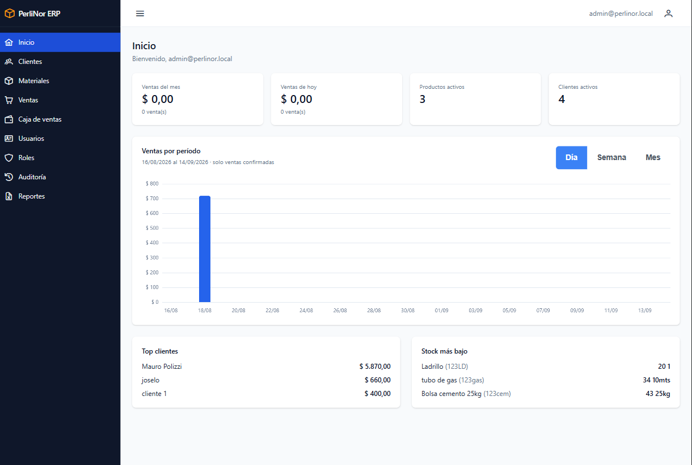
  <figcaption>Pantalla de inicio del sistema, con el menú de navegación a la izquierda.</figcaption>
</figure>

## Para qué sirve

El sistema te permite:

- **Consultar y mantener el catálogo de materiales**, con su precio y su stock.
- **Registrar los ingresos de stock** cuando entra mercadería.
- **Administrar los clientes** de la fábrica.
- **Registrar las ventas**, que descuentan el stock automáticamente.
- **Anular una venta** si se registró por error, reponiendo el stock.
- **Consultar la caja de ventas**, que se alimenta sola con cada operación.
- **Ver indicadores de gestión**: cuánto se vendió, quiénes son los principales clientes, qué
  materiales están por agotarse.
- **Descargar reportes** para abrir en una planilla de cálculo.

## Qué hace el sistema por vos

Hay tres cosas que conviene tener claras desde el principio, porque son las que más cambian respecto
de trabajar con planillas.

**El stock se actualiza solo.** Cuando registrás una venta, el sistema descuenta los materiales
vendidos. No hay que ajustar nada a mano.

**La caja se alimenta sola.** Cada venta registra su ingreso en la caja de ventas. No se cargan
movimientos manualmente.

**Nada se borra.** Cuando das de baja un cliente o un material, el sistema lo desactiva pero conserva
toda su información y su historial. Una venta vieja siempre se puede consultar, aunque el cliente ya
no esté activo.

## Los módulos

| Módulo | Para qué sirve |
|---|---|
| **Inicio** | Indicadores de gestión y evolución de las ventas |
| **Clientes** | Alta, consulta, modificación y baja de clientes |
| **Materiales** | Catálogo de materiales, precios y movimientos de stock |
| **Ventas** | Registro, consulta y anulación de ventas |
| **Caja de ventas** | Saldo y movimientos de dinero por ventas |
| **Reportes** | Descarga de información en planilla de cálculo |
| **Usuarios** | Altas y modificaciones de las cuentas de acceso |
| **Roles** | Consulta de qué puede hacer cada rol |
| **Auditoría** | Registro de quién hizo qué y cuándo |

## Qué vas a ver según tu rol

El sistema le muestra a cada persona solamente lo que corresponde a su área. Por eso, **el menú no es
igual para todos**.

| Tu rol | Módulos que ves |
|---|---|
| **Administración** | Todos |
| **Ventas** | Inicio, Clientes, Materiales, Ventas |
| **Stock** | Inicio, Materiales |
| **Producción** | Inicio, Materiales |
| **Finanzas** | Inicio, Clientes, Materiales, Ventas, Caja de ventas, Reportes |

Si necesitás acceder a un módulo que no ves en tu menú, hablá con la persona a cargo de la
administración del sistema: es ella quien asigna los roles.

## Cómo está organizado este manual

Los capítulos siguen el orden en que vas a usar el sistema. Los capítulos 2 y 3 explican cómo entrar.
El capítulo 4 te muestra cómo moverte por la pantalla, y conviene leerlo aunque tengas experiencia
con otros sistemas: hay un par de comportamientos que se explican una sola vez, ahí.

Del capítulo 5 al 11 está cada módulo, con sus procedimientos paso a paso. El capítulo 12 reúne las
dudas más frecuentes y qué hacer ante los problemas más comunes.

Al final hay un glosario con los términos que usa el sistema.

# Requisitos y acceso

## Qué necesitás

| Requisito | Detalle |
|---|---|
| Una computadora con navegador | Chrome, Edge o Firefox, actualizados |
| Conexión a la red donde está publicado el sistema | — |
| Tu usuario y contraseña | Te los entrega la persona a cargo de la administración |

No hay nada que instalar ni configurar.

## Cómo entrar

**Paso 1.** Abrí el navegador e ingresá la dirección del sistema. Vas a ver la pantalla de acceso.

<figure class="media">
  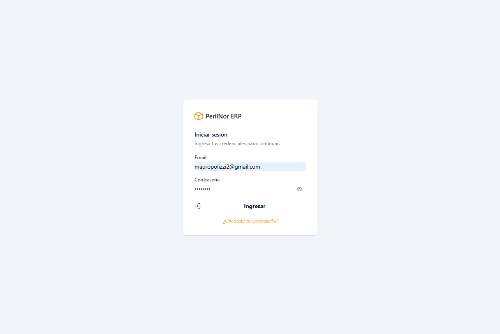
  <figcaption>Pantalla de acceso al sistema.</figcaption>
</figure>

**Paso 2.** Escribí tu email y tu contraseña.

**Paso 3.** Hacé clic en **Ingresar**.

Si los datos son correctos, entrás directamente a la pantalla de **Inicio**, con tu menú ya armado
según tu rol.

## Si no podés entrar

<figure class="media">
  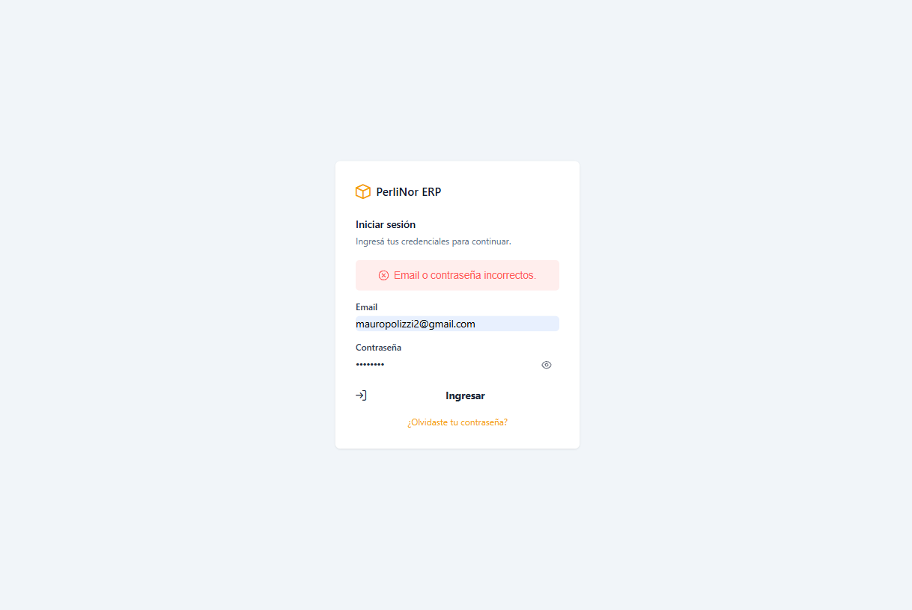
  <figcaption>Mensaje que aparece cuando el email o la contraseña no son correctos.</figcaption>
</figure>

| Mensaje | Qué significa | Qué hacer |
|---|---|---|
| «Email o contraseña incorrectos.» | Los datos no coinciden con ninguna cuenta activa | Revisá que el email esté bien escrito y volvé a intentar. Si no lo resolvés, usá **¿Olvidaste tu contraseña?** (capítulo 3) |
| «No se pudo iniciar sesión. Intentá nuevamente.» | El sistema no pudo responder | Esperá unos segundos y reintentá. Si persiste, avisá a la administración |

> **Por qué el mensaje no dice cuál de los dos datos está mal.** Es a propósito. Si el sistema
> avisara «ese email no existe», cualquiera podría averiguar qué direcciones están registradas. El
> mensaje es el mismo en los dos casos, por seguridad.

Si el email es correcto y la contraseña también, pero igual no entrás, puede que tu cuenta haya sido
dada de baja. En ese caso, consultá con la administración.

## Sobre tu sesión

Una vez que entrás, **el sistema mantiene tu sesión abierta**. Podés cerrar la pestaña y volver más
tarde sin tener que escribir de nuevo tu contraseña, o recargar la página sin perder nada.

La sesión se renueva sola mientras la uses. Si pasás varios días sin entrar, te va a pedir la
contraseña otra vez.

## Cómo salir

Hacé clic en el ícono de usuario, arriba a la derecha, y elegí **Cerrar sesión**.

Conviene cerrar sesión si compartís la computadora con otras personas.

## Tu contraseña

Estas son las reglas que aplica el sistema:

- La contraseña debe tener **al menos 8 caracteres**.
- Si la olvidás, la podés recuperar vos mismo desde la pantalla de acceso (capítulo 3).
- Si necesitás cambiarla sin haberla olvidado, usá también **¿Olvidaste tu contraseña?**: el
  procedimiento es el mismo.

> **Importante.** Si cambiás tu contraseña, las sesiones que ya estén abiertas en otros equipos
> siguen funcionando durante unos días. Si sospechás que alguien accedió a tu cuenta, además de
> cambiar la contraseña avisá a la administración.

# Recuperación de contraseña

Si olvidaste tu contraseña, la podés recuperar vos mismo. No hace falta que intervenga la
administración.

El procedimiento tiene dos partes: primero pedís un enlace por correo, después elegís la contraseña
nueva.

## Parte 1 — Pedir el enlace

**Paso 1.** En la pantalla de acceso, hacé clic en **¿Olvidaste tu contraseña?**

**Paso 2.** Escribí tu email y hacé clic en **Enviar**.

<figure class="media">
  
  <figcaption>Formulario de solicitud del enlace de recuperación.</figcaption>
</figure>

**Paso 3.** Vas a ver este aviso:

<figure class="media">
  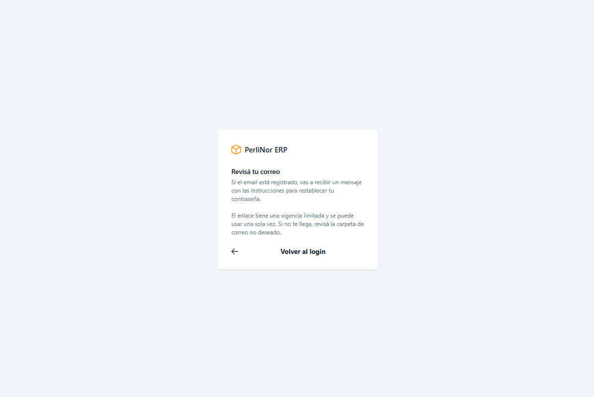
  <figcaption>Aviso que confirma que la solicitud fue procesada.</figcaption>
</figure>

> «Si el email está registrado, vas a recibir un mensaje con las instrucciones para restablecer tu
> contraseña.»

> **Por qué dice «si el email está registrado».** El sistema muestra siempre el mismo aviso, exista o
> no la dirección que escribiste. Es una medida de seguridad: impide que alguien use esta pantalla
> para averiguar qué direcciones tienen cuenta.
>
> **No significa que haya fallado.** Si tu email es correcto, el mensaje ya salió.

**Paso 4.** Revisá tu casilla de correo. Si no lo ves en unos minutos, fijate en la carpeta de correo
no deseado.

## Parte 2 — Elegir la contraseña nueva

**Paso 5.** Abrí el mensaje y hacé clic en el enlace.

**Paso 6.** Escribí la contraseña nueva dos veces: una en **Contraseña** y otra en **Repetir
contraseña**.

<figure class="media">
  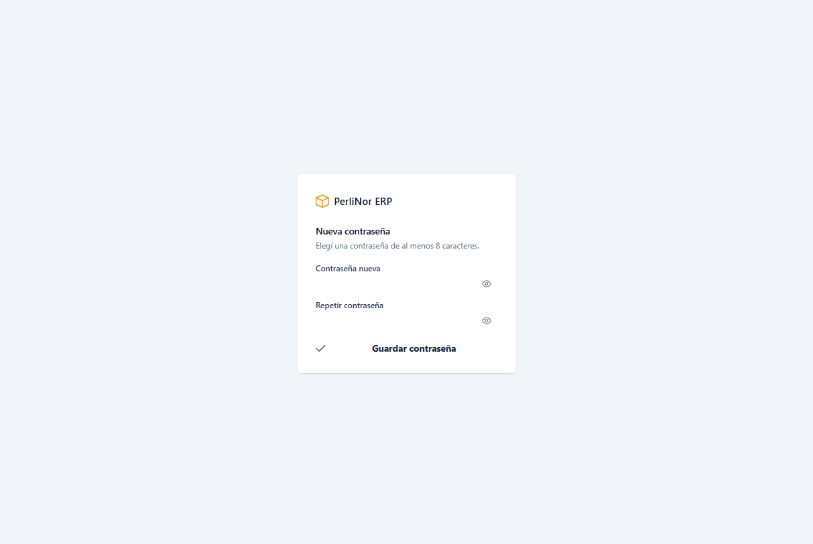
  <figcaption>Formulario para definir la contraseña nueva.</figcaption>
</figure>

La contraseña debe tener **al menos 8 caracteres**, y las dos tienen que coincidir. Si no, el botón
no se habilita.

**Paso 7.** Hacé clic en **Guardar**. Vas a ver el aviso «Tu contraseña fue actualizada. Ya podés
iniciar sesión.»

**Paso 8.** Volvé a la pantalla de acceso e ingresá con tu contraseña nueva.

## El enlace tiene límites

<blockquote class="aviso">
<p><strong>Tres cosas que conviene saber sobre el enlace:</strong></p>
<ul>
<li><strong>Dura 30 minutos.</strong> Pasado ese tiempo deja de servir y hay que pedir uno nuevo.</li>
<li><strong>Se usa una sola vez.</strong> Una vez que cambiaste la contraseña, ese enlace ya no funciona.</li>
<li><strong>Solo vale el último.</strong> Si pediste el enlace varias veces, únicamente el más reciente sirve.</li>
</ul>
</blockquote>

Si el enlace ya venció o ya lo usaste, vas a ver esta pantalla:

<figure class="media">
  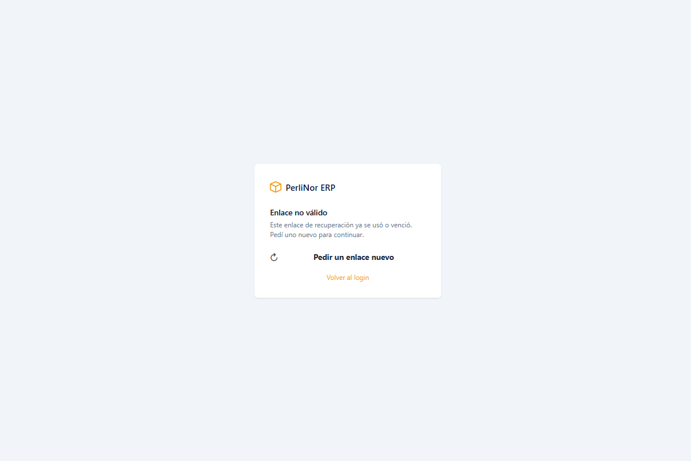
  <figcaption>Pantalla que aparece cuando el enlace venció, ya fue usado o no es válido.</figcaption>
</figure>

No es un problema: volvé a la pantalla de acceso y pedí un enlace nuevo.

## Si hiciste muchos intentos

Si pedís el enlace muchas veces seguidas, el sistema te va a frenar con este mensaje:

> «Hiciste demasiados intentos. Esperá unos minutos y volvé a probar.»

Es una protección contra el uso automatizado. Esperá unos minutos y volvé a intentar.

## Preguntas frecuentes de este capítulo

| Duda | Respuesta |
|---|---|
| No me llegó el mensaje | Revisá correo no deseado. Verificá que el email que escribiste sea el de tu cuenta. Si no, consultá con la administración |
| Quiero cambiar la contraseña sin haberla olvidado | Usá el mismo procedimiento: **¿Olvidaste tu contraseña?** |
| ¿Alguien más puede ver mi contraseña nueva? | No. El sistema no guarda la contraseña tal como la escribís, y nadie —tampoco la administración— puede consultarla |
| Cambié la contraseña, ¿se cierran las sesiones abiertas en otros equipos? | No de inmediato. Siguen funcionando durante unos días. Si te preocupa, avisá a la administración |

# Recorrido por la interfaz

Todas las pantallas del sistema funcionan igual. Este capítulo explica esa mecánica común una sola
vez, para no repetirla en cada módulo.

**Conviene leerlo completo**, aunque tengas experiencia con otros sistemas: hay dos comportamientos
que sorprenden la primera vez y se explican acá.

## Las zonas de la pantalla

<figure>
  <div class="anotada">
    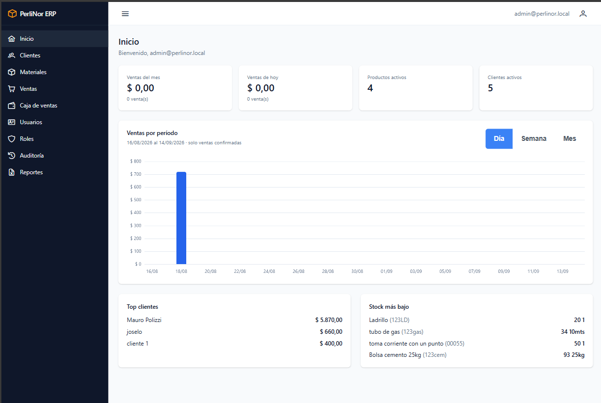
    <!-- Coordenadas ajustadas sobre la captura real (1223 × 821). -->
    <span class="marca" style="left:9%;  top:24%">1</span>
    <span class="marca" style="left:57%; top:3%">2</span>
    <span class="marca" style="left:74%; top:13%">3</span>
  </div>
  <figcaption>Zonas de la pantalla: (1) menú lateral, (2) barra superior, (3) área de contenido.</figcaption>
</figure>

**1 — Menú lateral.** Los módulos a los que tenés acceso. El que estás viendo queda resaltado. Con el
botón de la barra superior podés contraerlo para ganar espacio.

**2 — Barra superior.** A la izquierda, el botón que contrae el menú. A la derecha, tu email y el
ícono de usuario, donde está la opción **Cerrar sesión**.

**3 — Área de contenido.** La pantalla en la que estás trabajando.

## Los listados

Casi todos los módulos empiezan con un listado. Todos tienen la misma estructura.

<figure>
  <div class="anotada">
    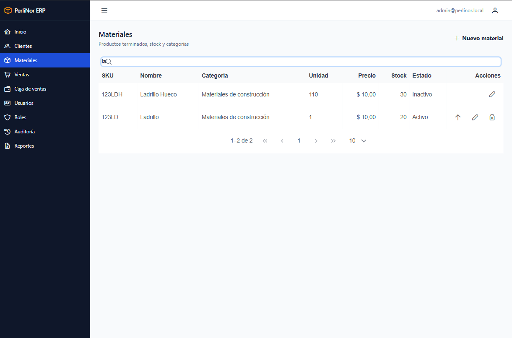
    <!-- Coordenadas ajustadas sobre la captura real (1221 × 806). -->
    <span class="marca" style="left:33%; top:18%">1</span>
    <span class="marca" style="left:53%; top:22%">2</span>
    <span class="marca" style="left:93%; top:28%">3</span>
    <span class="marca" style="left:58%; top:42%">4</span>
  </div>
  <figcaption>Elementos de un listado: (1) buscador, (2) columnas, (3) acciones por fila, (4) paginador.</figcaption>
</figure>

**1 — Buscador.** Escribís y los resultados se filtran solos, sin apretar ningún botón.

**2 — Columnas.** La información de cada registro.

**3 — Acciones.** Los botones al final de cada fila: editar, dar de baja, ver detalle. Según el
módulo y tu rol, vas a ver unos u otros.

**4 — Paginador.** Si hay muchos resultados, se muestran de a páginas.

### Dos comportamientos que conviene conocer

<blockquote class="aviso">
<p><strong>1. En Clientes, Materiales y Usuarios el listado arranca vacío, a propósito.</strong></p>
<p>Cuando entrás a uno de esos módulos no vas a ver ningún registro, sino el mensaje
«Ingresá al menos 2 caracteres para buscar.»</p>
<p><strong>No es un error ni significa que no haya datos.</strong> Son catálogos que pueden tener
muchos registros, y traerlos todos no sirve de nada cuando estás buscando uno en particular.
Escribí dos letras en el buscador y los resultados aparecen.</p>
</blockquote>

<blockquote class="aviso">
<p><strong>2. En Ventas, Caja de ventas y Auditoría el listado arranca mostrando el día de hoy.</strong></p>
<p>Estos tres módulos sí muestran información al entrar, pero acotada al día en curso, que es lo que
se necesita en el trabajo diario.</p>
<p>Si buscás algo de otra fecha, <strong>ampliá el rango</strong> con los campos <strong>Desde</strong>
y <strong>Hasta</strong>. El botón <strong>Restablecer</strong> vuelve al día de hoy.</p>
</blockquote>

## Los avisos

Cuando hacés una operación, el sistema te confirma el resultado con un aviso que aparece arriba a la
derecha y desaparece solo a los pocos segundos.

<figure class="media">
  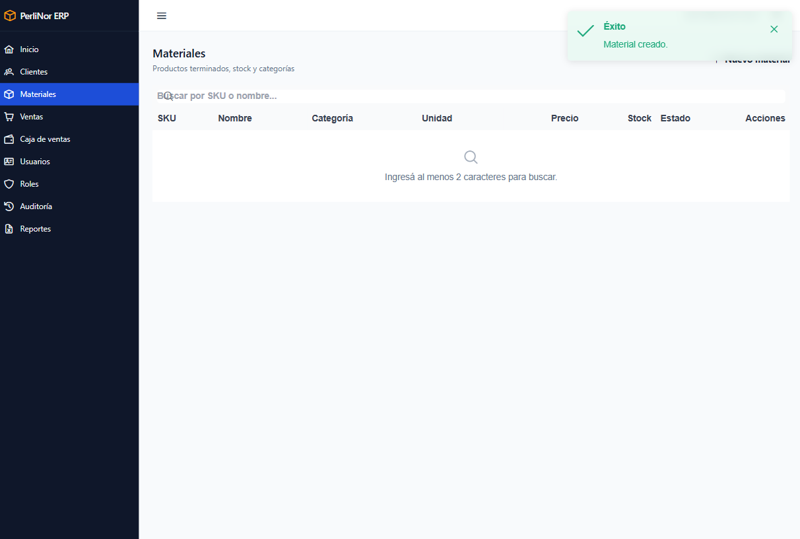
  <figcaption>Aviso de confirmación tras una operación exitosa.</figcaption>
</figure>

| Color | Significado |
|---|---|
| Verde | La operación se completó |
| Rojo | Algo falló. El texto explica qué |
| Azul | Información, sin que nada haya fallado |

Los avisos en rojo son los importantes: **leelos antes de que desaparezcan**. Explican por qué no se
pudo hacer lo que pediste.

## Las confirmaciones

Antes de una operación que no se puede deshacer —dar de baja algo, anular una venta—, el sistema te
pide confirmación.

<figure class="media">
  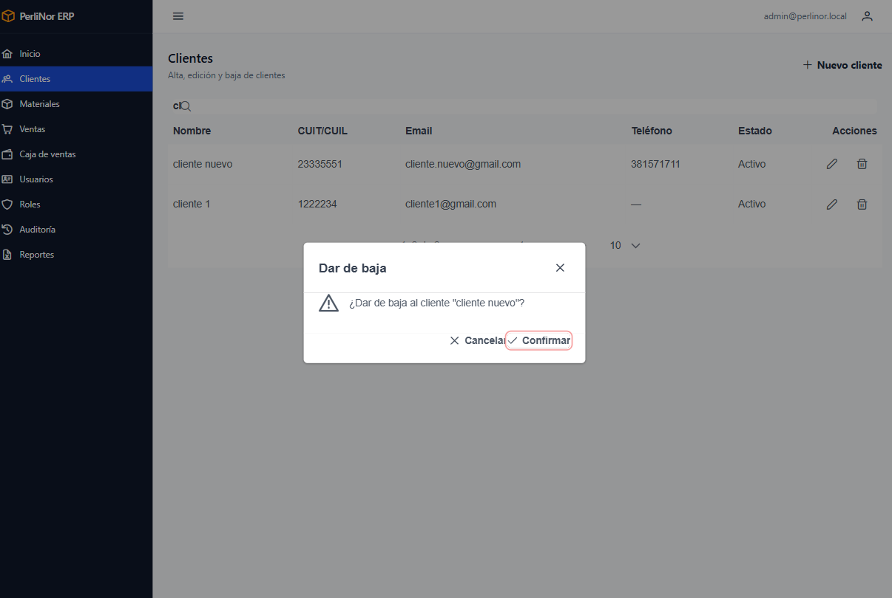
  <figcaption>Diálogo de confirmación previo a una operación irreversible.</figcaption>
</figure>

El texto te dice **qué va a pasar**, no solo qué vas a hacer. Cuando anulás una venta, por ejemplo, te
avisa que se va a reponer el stock. Leelo antes de aceptar.

## Los formularios

**Los campos obligatorios** se marcan y no te dejan guardar si están vacíos.

**Los errores aparecen debajo del campo**, en rojo, apenas salís de él. No hace falta enviar el
formulario para enterarte.

**Mientras se guarda**, el botón se deshabilita y muestra que está trabajando. Evita que guardes dos
veces por error.

**Si algo falla al guardar**, aparece un aviso rojo y el formulario **se queda como estaba**, con todo
lo que cargaste. No perdés el trabajo: corregís lo que haga falta y volvés a intentar.

## Cómo se muestran los datos

| Dato | Formato | Ejemplo |
|---|---|---|
| Importes | Pesos, con punto de miles y coma decimal | `$ 1.234.567,89` |
| Cantidades | Coma decimal | `1.250,500` |
| Fechas | Día/mes/año | `13/09/2026` |
| Fecha y hora | Día/mes/año y hora | `13/09/2026 14:30` |
| Dato ausente | Un guion | `—` |

Un guion no es un error: significa que ese dato no se cargó o no corresponde.

# Pantalla de inicio

Es la primera pantalla que ves al entrar. Reúne los indicadores de gestión de la fábrica.

**Todos los roles tienen acceso.**

<figure>
  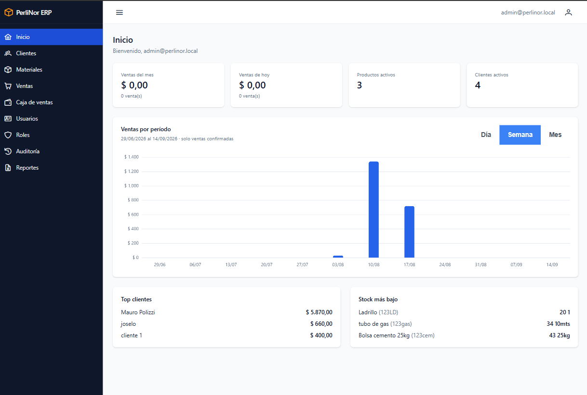
  <figcaption>Pantalla de inicio con los indicadores de gestión.</figcaption>
</figure>

## Los indicadores

### Ventas del mes

Total vendido y cantidad de ventas desde el día 1 del mes en curso hasta hoy.

### Ventas de hoy

Total vendido y cantidad de ventas del día de hoy.

### Productos activos

Cuántos materiales hay en el catálogo. No cuenta los que están dados de baja.

### Clientes activos

Cuántos clientes tenés cargados. No cuenta los dados de baja.

<blockquote class="aviso">
<p><strong>Las ventas anuladas no se cuentan en ningún indicador.</strong></p>
<p>Si anulás una venta, los totales se ajustan: esa venta deja de figurar. Lo mismo vale para el
gráfico, la caja y los reportes. Los indicadores muestran siempre las ventas que están vigentes.</p>
</blockquote>

## Top clientes

Los cinco clientes que más compraron, con el total acumulado de cada uno. Se calcula sobre todas las
ventas confirmadas, sin límite de fecha.

## Stock más bajo

Los cinco materiales con **menos stock** del catálogo, con su cantidad disponible.

> **Atención con este panel.** Muestra los cinco materiales con menor stock, comparados entre sí. **No
> son materiales por debajo de un mínimo configurado**: el sistema no maneja un stock mínimo por
> material.
>
> Si tu catálogo está bien abastecido, igual vas a ver cinco materiales acá. Son los que tienen menos,
> no necesariamente los que faltan.

## Ventas por período

El gráfico muestra cómo vienen las ventas a lo largo del tiempo.

<figure>
  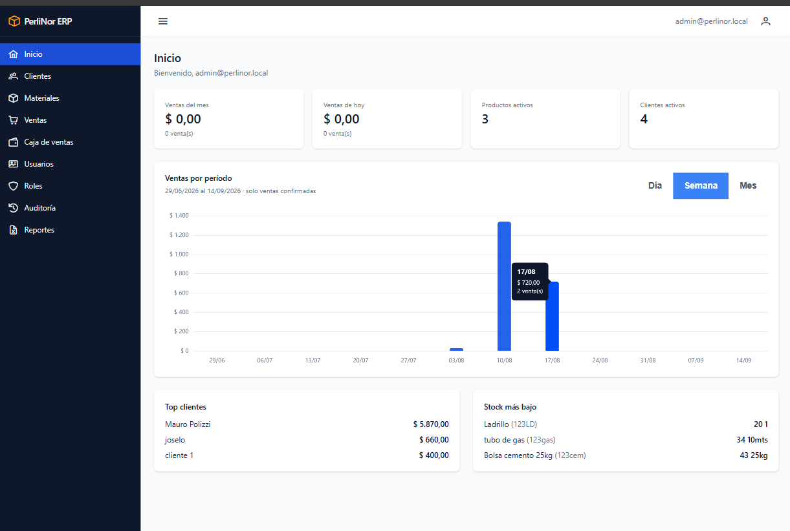
  <figcaption>Panel <em>Ventas por período</em>. Al apoyar el puntero sobre una barra se muestra el importe y la cantidad de ventas de ese intervalo.</figcaption>
</figure>

### Cambiar el período

Arriba del gráfico hay tres botones:

| Botón | Qué muestra |
|---|---|
| **Día** | Los últimos 30 días, una barra por día |
| **Semana** | Las últimas 12 semanas, una barra por semana |
| **Mes** | Los últimos 12 meses, una barra por mes |

Al cambiar de período, solo se recarga el gráfico. Los demás indicadores quedan como están.

### Cómo leerlo

**Apoyá el puntero sobre una barra** para ver el total vendido y la cantidad de ventas de ese período.

**Las barras en cero también aparecen.** Si un día no hubo ventas, vas a ver el espacio vacío. Es
intencional: si se omitieran, el gráfico uniría dos días con ventas y parecería que hubo actividad
continua cuando no la hubo.

Si no hubo ninguna venta en todo el período, el gráfico muestra «Sin ventas confirmadas en el
período.» en lugar de barras planas.

## Qué hacer con esta información

| Si ves… | Puede significar… |
|---|---|
| Ventas de hoy en cero, avanzada la jornada | Hay ventas sin registrar |
| Un material con stock muy bajo en el panel | Conviene reponerlo antes de que se agote y bloquee una venta |
| El gráfico con una caída sostenida | Vale la pena revisar el período en el listado de Ventas o descargar el reporte |
| Un cliente que subió al panel de principales | Puede justificar una condición comercial distinta |

# Clientes

Acá se administra el padrón de clientes de la fábrica. Todo cliente al que le vendas tiene que estar
cargado.

**Acceden:** Administración y Ventas. Finanzas puede consultarlo.

## Buscar un cliente

El listado **arranca vacío a propósito**: escribí al menos dos letras en el buscador para ver
resultados.

<figure>
  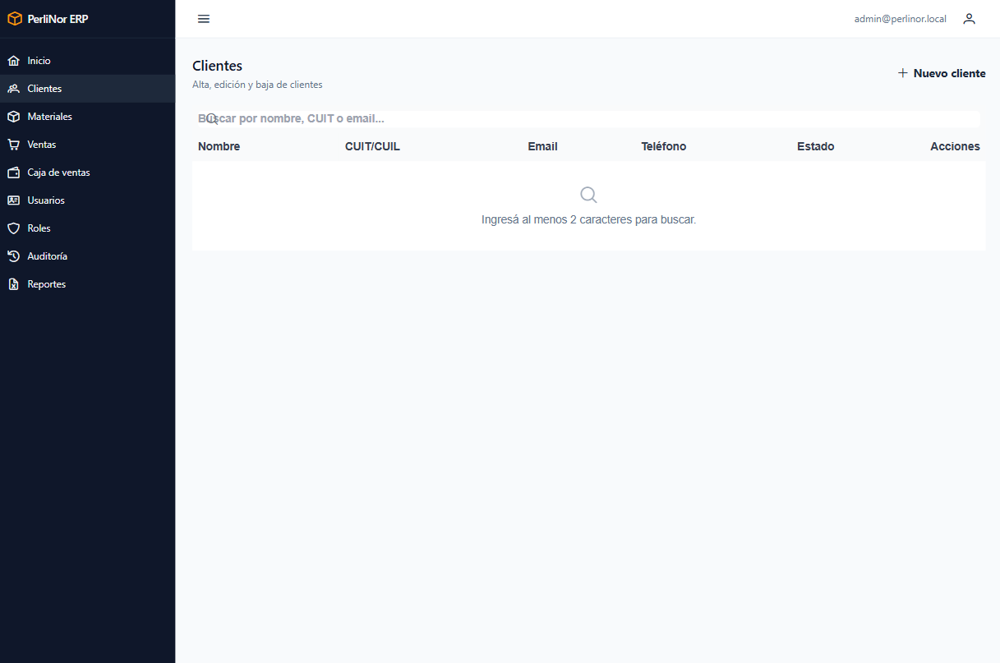
  <figcaption>Estado inicial del listado de Clientes. El mensaje indica que hay que buscar para ver resultados.</figcaption>
</figure>

Podés buscar por **nombre, CUIT o email**, y no hace falta escribir el dato completo: con una parte
alcanza. Tampoco importan las mayúsculas.

<figure>
  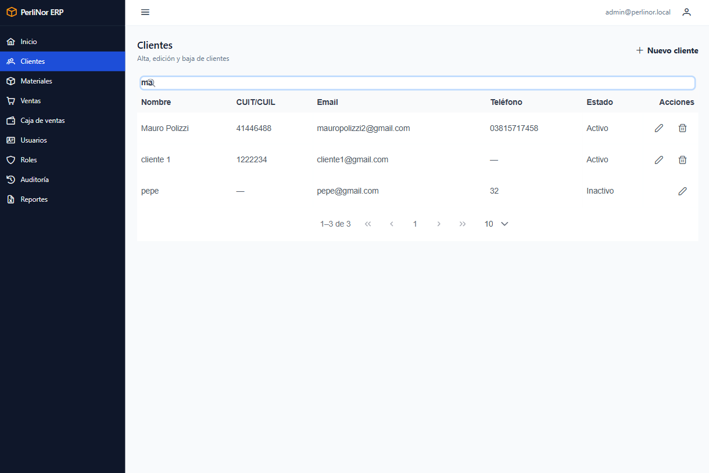
  <figcaption>Listado de Clientes con resultados de una búsqueda.</figcaption>
</figure>

## Dar de alta un cliente

**Paso 1.** Hacé clic en **Nuevo cliente**.

**Paso 2.** Completá los datos.

<figure class="media">
  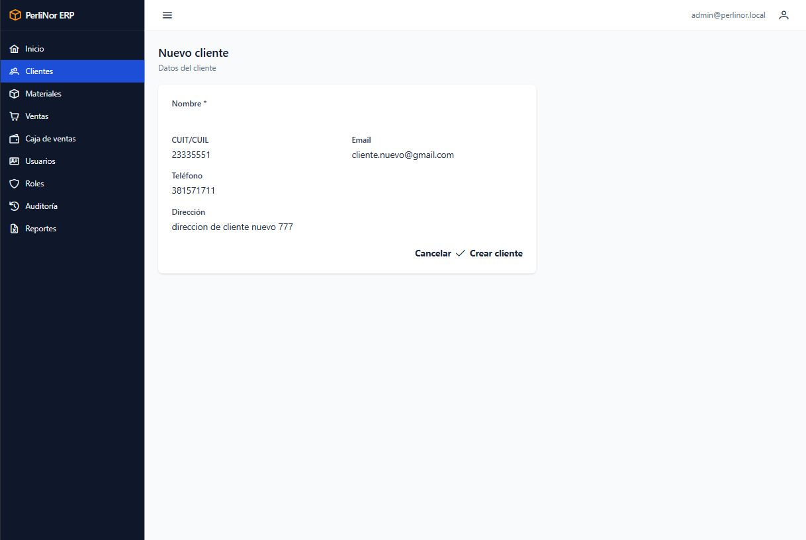
  <figcaption>Formulario de alta de cliente.</figcaption>
</figure>

| Campo | ¿Obligatorio? | Detalle |
|---|---|---|
| **Nombre** | **Sí** | Razón social o nombre. Mínimo 2 caracteres |
| CUIT / Documento | No | |
| Email | No | Si lo cargás, tiene que ser una dirección válida |
| Teléfono | No | |
| Dirección | No | |

**Paso 3.** Hacé clic en **Guardar**. Vas a ver el aviso «Cliente creado.»

> **Solo el nombre es obligatorio.** Podés dar de alta un cliente con el nombre nada más y completar
> el resto después. Conviene cargar el CUIT desde el principio, porque es el dato que aparece en el
> reporte de ventas.

> **El sistema no controla CUIT repetidos.** Si cargás dos veces el mismo cliente con distinto
> nombre, se van a crear dos fichas. Buscá antes de dar de alta.

## Modificar un cliente

**Paso 1.** Buscalo en el listado.

**Paso 2.** Hacé clic en el botón de editar de su fila.

**Paso 3.** Modificá lo que necesites y hacé clic en **Guardar**. Vas a ver «Cliente actualizado.»

Podés modificar todos los campos, incluido el nombre. **Las ventas ya registradas no se alteran**:
siguen apuntando a la misma ficha.

## Dar de baja un cliente

Se usa cuando un cliente deja de operar con la fábrica.

**Paso 1.** Buscalo en el listado.

**Paso 2.** Hacé clic en el botón de baja de su fila.

**Paso 3.** Confirmá en el diálogo.

<figure class="media">
  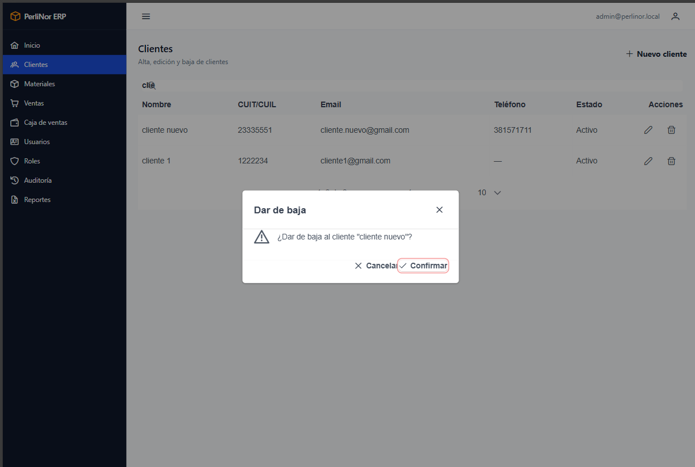
  <figcaption>Confirmación previa a dar de baja un cliente.</figcaption>
</figure>

Vas a ver el aviso «Cliente dado de baja.»

<blockquote class="aviso">
<p><strong>Dar de baja no borra nada.</strong></p>
<p>El cliente se desactiva, pero su ficha y todas sus ventas se conservan. El historial queda
intacto y los reportes de períodos anteriores siguen siendo correctos.</p>
<p>Lo único que cambia es que <strong>ya no vas a poder registrarle ventas nuevas</strong> ni te va a
aparecer en el selector de clientes al cargar una venta.</p>
</blockquote>

Si diste de baja un cliente por error, comunicate con la administración: la reactivación no se hace
desde esta pantalla.

## Mensajes que podés ver

| Mensaje | Qué significa |
|---|---|
| «Cliente creado.» | El alta se completó |
| «Cliente actualizado.» | Los cambios se guardaron |
| «Cliente dado de baja.» | El cliente quedó desactivado |
| «No se encontraron clientes para esa búsqueda.» | No hay coincidencias. Probá con menos letras o con otro dato |
| «Ingresá al menos 2 caracteres para buscar.» | Estado inicial del listado. Escribí en el buscador |

## Preguntas frecuentes de este capítulo

| Duda | Respuesta |
|---|---|
| Cargué mal el nombre de un cliente | Editalo. El cambio se refleja en todas sus ventas, que siguen siendo la misma operación |
| Un cliente no aparece al cargar una venta | Puede estar dado de baja. Buscalo en el listado para verificarlo |
| ¿Puedo eliminar un cliente definitivamente? | No. El sistema no borra datos, para no perder el historial de ventas |

# Materiales y stock

Acá se administra el catálogo de materiales que la fábrica vende, con su precio y su stock.

**Acceden:** Administración, Stock y Producción. Ventas y Finanzas pueden consultarlo.

## Buscar un material

El listado **arranca vacío a propósito**: escribí al menos dos letras para ver resultados. Podés
buscar por **SKU o por nombre**.

<figure>
  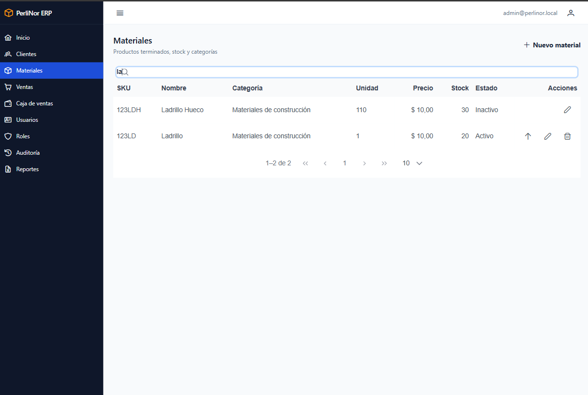
  <figcaption>Listado de Materiales. Las columnas Precio y Stock muestran los datos que más se consultan.</figcaption>
</figure>

| Columna | Qué muestra |
|---|---|
| **SKU** | Código del material. Es único |
| **Nombre** | Denominación |
| **Categoría** | Clasificación |
| **Unidad** | Cómo se cuenta: unidad, bolsa, m³ |
| **Precio** | Precio de venta vigente |
| **Stock** | Cantidad disponible |
| **Estado** | Activo o Inactivo |

## Dar de alta un material

**Paso 1.** Hacé clic en **Nuevo material**.

**Paso 2.** Completá los datos.

<figure class="media">
  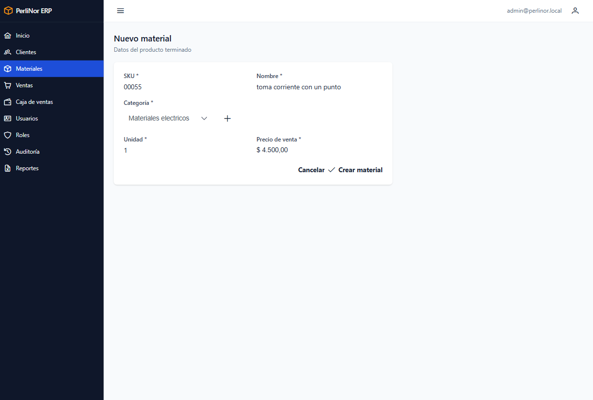
  <figcaption>Formulario de alta de material.</figcaption>
</figure>

| Campo | ¿Obligatorio? | Detalle |
|---|---|---|
| **SKU** | **Sí** | Código único. No puede repetirse |
| **Nombre** | **Sí** | Mínimo 2 caracteres |
| **Categoría** | **Sí** | Se elige de la lista. Si falta, la podés crear acá mismo |
| **Unidad** | **Sí** | Unidad de medida: `u`, `bolsa`, `m3` |
| **Precio** | **Sí** | Precio de venta. Puede ser 0 y corregirse después |

**Paso 3.** Hacé clic en **Guardar**. Vas a ver «Material creado.»

<blockquote class="aviso">
<p><strong>El material nace con stock 0.</strong></p>
<p>El formulario de alta no tiene campo de stock, y es a propósito: el stock <strong>solo</strong> se
modifica con movimientos, para que siempre quede registrado de dónde salió cada cambio.</p>
<p>Después de dar de alta el material, cargale el stock inicial con un <strong>Ingreso</strong>
(más abajo en este capítulo).</p>
</blockquote>

### Crear una categoría sin salir del formulario

Si la categoría que necesitás no está en la lista, hacé clic en el botón de agregar que está al lado
del selector.

<figure class="media">
  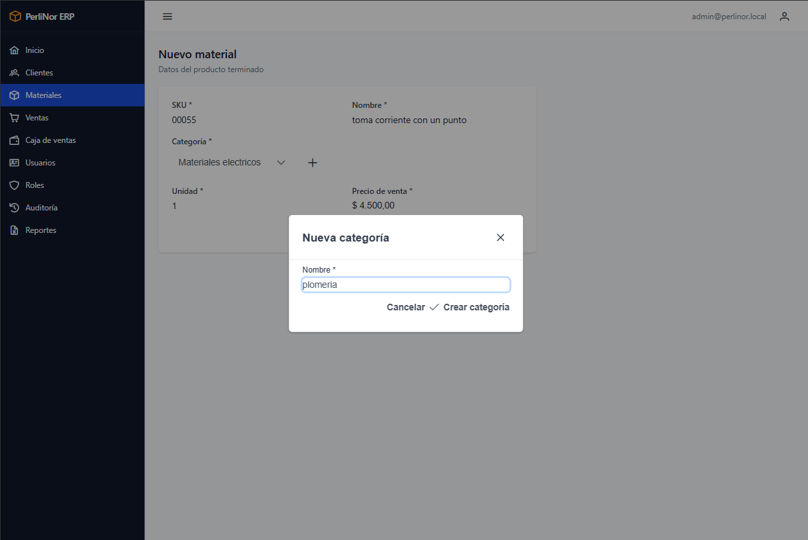
  <figcaption>Diálogo de alta rápida de categoría, sobre el formulario de material.</figcaption>
</figure>

Escribí el nombre y hacé clic en **Guardar**. La categoría queda creada y **seleccionada** en el
formulario. No perdés lo que ya habías cargado.

## Modificar un material

**Paso 1.** Buscalo y hacé clic en el botón de editar.

**Paso 2.** Modificá lo que necesites y guardá. Vas a ver «Material actualizado.»

Podés cambiar el SKU, el nombre, la categoría, la unidad y el precio. **No podés cambiar el stock
desde acá.**

<blockquote class="aviso">
<p><strong>Cambiar el precio no altera las ventas ya registradas.</strong></p>
<p>Cada venta guarda el precio que el material tenía <strong>en el momento de registrarse</strong>.
Si hoy actualizás la lista de precios, las ventas de ayer conservan el precio de ayer.</p>
<p>Es lo que permite que los reportes de meses cerrados den siempre el mismo resultado.</p>
</blockquote>

## Registrar un movimiento de stock

Es el procedimiento con el que entra mercadería al sistema, y también con el que se corrigen
diferencias.

**Paso 1.** Buscá el material y hacé clic en el botón de stock de su fila.

**Paso 2.** Elegí el tipo de movimiento: **Ingreso** o **Ajuste**.

<figure class="media">
  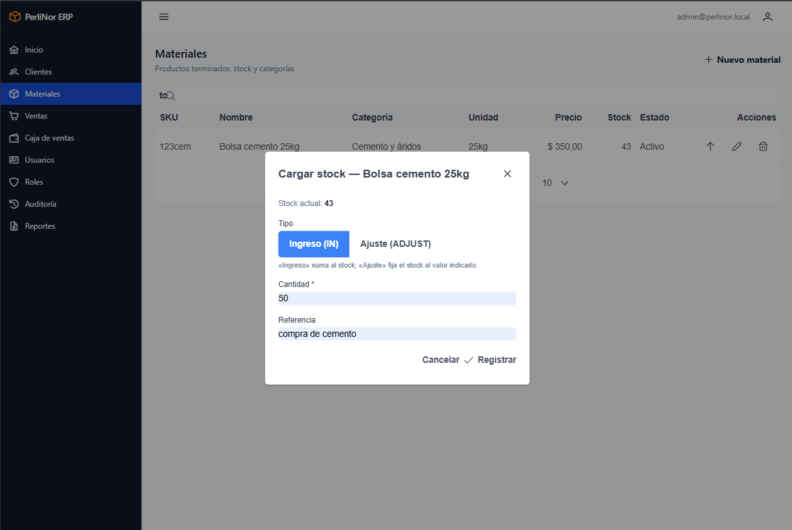
  <figcaption>Diálogo de movimiento de stock. El selector define si la cantidad se suma o reemplaza el stock actual.</figcaption>
</figure>

**Paso 3.** Escribí la cantidad.

**Paso 4.** Opcionalmente, completá **Referencia** con el motivo: «Recepción de producción»,
«Recuento del 13/09», el número de remito.

**Paso 5.** Hacé clic en **Guardar**. Vas a ver «Movimiento de stock registrado.»

<figure>
  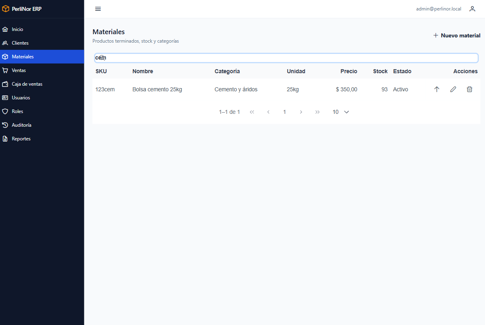
  <figcaption>El listado refleja el stock actualizado inmediatamente después del movimiento.</figcaption>
</figure>

### Ingreso y Ajuste no son lo mismo

<blockquote class="aviso">
<p><strong>Esta es la distinción más importante del capítulo. Leela con atención.</strong></p>
<table>
<tr><th>Tipo</th><th>Qué hace</th><th>Cuándo se usa</th></tr>
<tr><td><strong>Ingreso</strong></td><td><strong>SUMA</strong> la cantidad al stock actual</td><td>Entró mercadería</td></tr>
<tr><td><strong>Ajuste</strong></td><td><strong>REEMPLAZA</strong> el stock por la cantidad indicada</td><td>Corrección tras un recuento físico</td></tr>
</table>
<p><strong>Ejemplo.</strong> Un material tiene <strong>200 unidades</strong> y cargás la cantidad
<strong>50</strong>:</p>
<ul>
<li>Con <strong>Ingreso</strong>, el stock pasa a <strong>250</strong>. (200 + 50)</li>
<li>Con <strong>Ajuste</strong>, el stock pasa a <strong>50</strong>. (queda en 50)</li>
</ul>
<p>Elegir mal el tipo modifica el inventario sin que nada avise. Si te equivocaste, corregilo con un
<strong>Ajuste</strong> al valor correcto y dejá el motivo en la Referencia.</p>
</blockquote>

### Las salidas no se cargan a mano

En el diálogo no hay opción de salida, y es intencional: **el stock baja únicamente cuando se registra
una venta**.

Así se garantiza que toda salida de mercadería tenga una venta detrás. Si necesitás descontar stock
por rotura o pérdida, usá un **Ajuste** al valor real y aclaralo en la Referencia.

## Dar de baja un material

Se usa cuando un material deja de fabricarse o venderse.

**Paso 1.** Buscalo y hacé clic en el botón de baja.

**Paso 2.** Confirmá. Vas a ver «Material dado de baja.»

Igual que con los clientes, **el material no se borra**: se desactiva. Su historial de movimientos y
las ventas donde figura se conservan. Deja de aparecer al cargar una venta.

## Mensajes que podés ver

| Mensaje | Qué significa | Qué hacer |
|---|---|---|
| «Material creado.» | El alta se completó | — |
| «Material actualizado.» | Los cambios se guardaron | — |
| «Movimiento de stock registrado.» | El stock se actualizó | Verificá el valor en la columna Stock |
| «Material dado de baja.» | Quedó desactivado | — |
| «El SKU ya fue registrado» | Ese código ya lo tiene otro material | Buscá el SKU en el listado: puede que el material ya exista |
| «La categoría indicada no existe» | La categoría fue dada de baja | Elegí otra o creá una nueva |
| «No se encontraron materiales para esa búsqueda.» | Sin coincidencias | Probá con menos letras o con el nombre en vez del SKU |

## Preguntas frecuentes de este capítulo

| Duda | Respuesta |
|---|---|
| Di de alta el material pero el stock quedó en 0 | Es lo esperado. Cargale el stock inicial con un **Ingreso** |
| Me equivoqué de tipo de movimiento | Corregí con un **Ajuste** al valor correcto y dejá el motivo en la Referencia |
| Necesito descontar stock por rotura | Usá un **Ajuste** al valor real. Las salidas por venta las genera el sistema |
| El material no aparece al cargar una venta | Puede estar dado de baja, o tener stock 0 |
| ¿Puedo ver el historial de movimientos? | Sí, el sistema lo conserva. Consultá con la administración cómo acceder |

# Ventas

Es el módulo central del sistema. Acá se registran las ventas, se consultan y, si hace falta, se
anulan.

**Acceden:** Administración y Ventas. Finanzas puede consultarlo.

## Antes de registrar una venta

Necesitás que ya existan:

- El **cliente**, dado de alta y activo (capítulo 6).
- Los **materiales**, dados de alta y **con stock suficiente** (capítulo 7).

Si falta alguno, cargalo primero.

## Registrar una venta

**Paso 1.** En el menú, entrá a **Ventas** y hacé clic en **Nueva venta**.

<figure>
  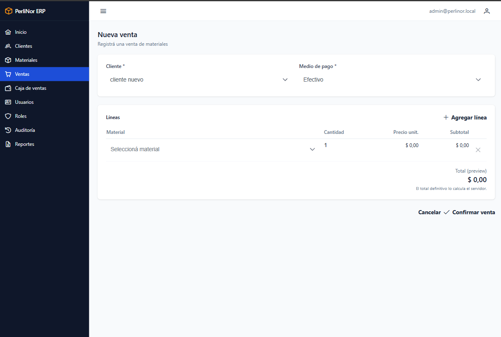
  <figcaption>Formulario de registro de venta, al abrirse.</figcaption>
</figure>

**Paso 2.** Elegí el **cliente** de la lista. Aparecen solamente los clientes activos.

**Paso 3.** Elegí el **medio de pago**: Efectivo, Transferencia, Tarjeta, Cheque o Cuenta corriente.

**Paso 4.** Cargá la primera línea: elegí el **material** y escribí la **cantidad**.

El precio unitario y el total de la línea **se calculan solos**, con el precio que el material tiene
cargado. No se escriben a mano.

**Paso 5.** Si la venta tiene más de un material, hacé clic en **Agregar línea** y repetí. Con el
botón de quitar sacás una línea que cargaste de más.

<figure>
  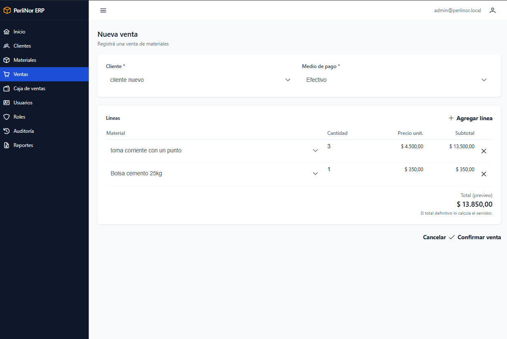
  <figcaption>Formulario con dos líneas cargadas. El subtotal y el total se actualizan a medida que se agregan materiales.</figcaption>
</figure>

**Paso 6.** Revisá el **total** al pie.

**Paso 7.** Hacé clic en **Registrar**.

Si todo está bien, el sistema te lleva directo al **detalle de la venta**, ya confirmada.

### Qué hace el sistema al registrar

En un solo paso, y de forma indivisible:

1. Confirma la venta con su detalle.
2. **Descuenta el stock** de cada material vendido.
3. **Registra el ingreso en la caja de ventas.**
4. Deja constancia de quién la registró.

<blockquote class="aviso">
<p><strong>O se hace todo, o no se hace nada.</strong></p>
<p>Si algo falla —por ejemplo, no alcanza el stock—, <strong>la venta no se registra y el stock queda
exactamente como estaba</strong>. Nunca vas a tener una venta a medias, ni stock descontado sin venta.</p>
</blockquote>

### El precio queda congelado

El precio que se guarda en la venta es el que el material tenía **en ese momento**. Si mañana cambia
la lista de precios, esta venta conserva el precio de hoy.

## Si no alcanza el stock

Es el error más frecuente del módulo.

<figure>
  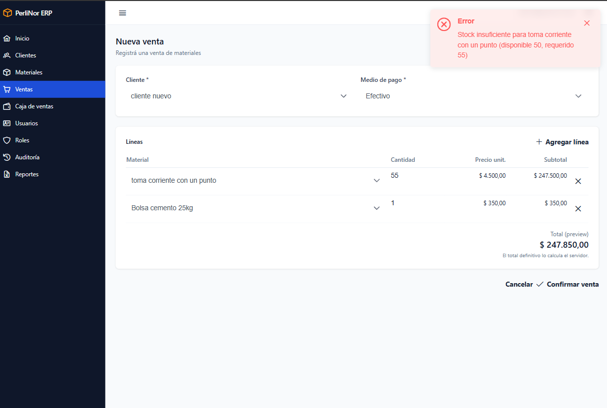
  <figcaption>Aviso de stock insuficiente. Indica el material, la cantidad disponible y la requerida.</figcaption>
</figure>

> «Stock insuficiente para *Vigueta pretensada 3,00 m* (disponible 8, requerido 20)»

**Qué pasó:** pediste más de lo que hay. El aviso te dice el material, cuánto hay y cuánto pediste.

**Qué NO pasó:** la venta no se registró y **el stock no se tocó**. El formulario queda como estaba,
con todo lo que cargaste.

**Qué hacer**, según el caso:

| Situación | Qué hacer |
|---|---|
| Te equivocaste en la cantidad | Corregila y volvé a intentar |
| Hay mercadería que no se cargó al sistema | Andá a **Materiales**, registrá el **Ingreso**, y volvé |
| Realmente no hay stock | Sacá esa línea o reducí la cantidad a lo disponible |

> **Si cargaste el mismo material en dos líneas**, el sistema suma las dos cantidades para verificar
> el stock. Dos líneas de 60 unidades necesitan 120 disponibles, no 60.

## Otros errores al registrar

| Mensaje | Qué significa | Qué hacer |
|---|---|---|
| «La venta debe tener al menos un ítem» | No cargaste ninguna línea | Agregá al menos un material con su cantidad |
| «El cliente no existe o está inactivo» | El cliente fue dado de baja mientras cargabas | Elegí otro cliente o pedí que lo reactiven |
| «Producto inexistente o inactivo» | Un material fue dado de baja mientras cargabas | Sacá esa línea y elegí otro material |
| «No hay una caja de ventas configurada.» | Falta una configuración del sistema | Avisá a la administración. No es un problema de la venta |

## Ver el detalle de una venta

En el listado, hacé clic en la fila.

<figure>
  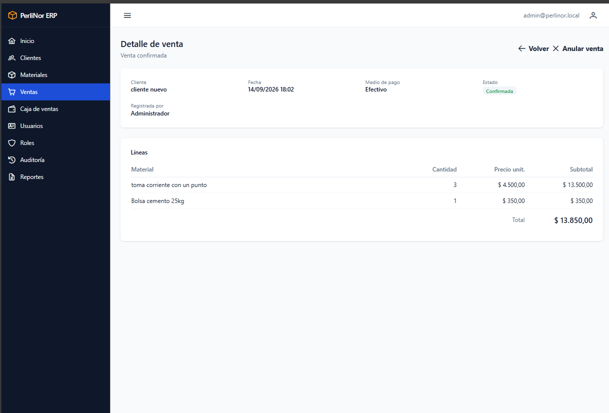
  <figcaption>Detalle de una venta confirmada, con su cabecera y sus líneas.</figcaption>
</figure>

Vas a ver el cliente, la fecha y hora, el medio de pago, el vendedor, el estado, cada línea con su
cantidad y precio, y los totales.

Si el vendedor aparece como «—», la venta se registró antes de que el sistema guardara ese dato.

## Consultar ventas

<figure>
  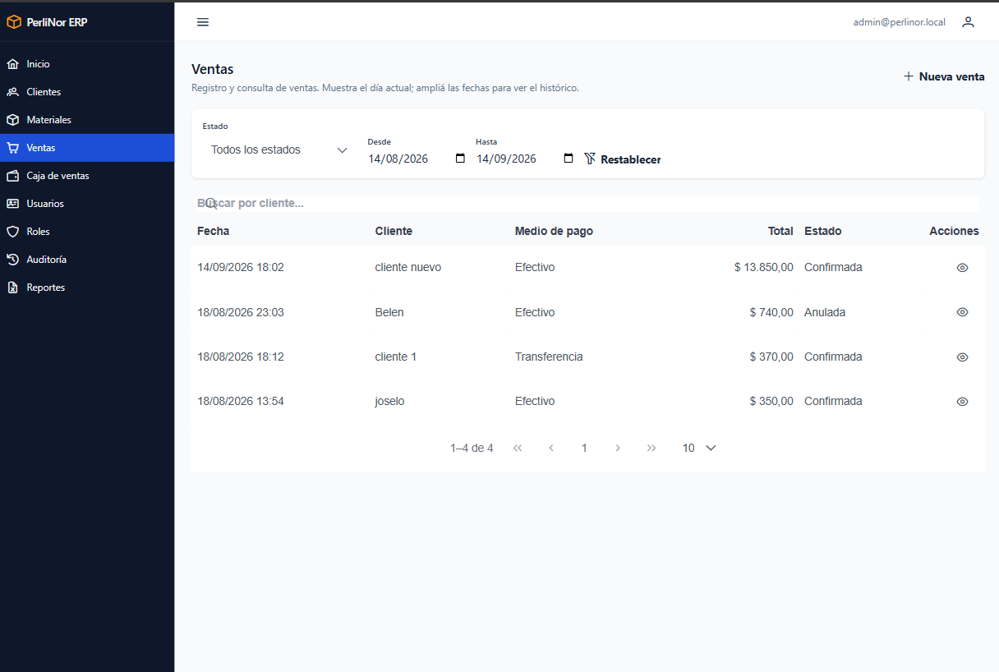
  <figcaption>Listado de Ventas con sus filtros: rango de fechas, estado y buscador por cliente.</figcaption>
</figure>

El listado **arranca mostrando las ventas de hoy**.

| Filtro | Para qué sirve |
|---|---|
| **Desde** / **Hasta** | Rango de fechas. Ampliá para ver otros períodos |
| **Estado** | Todas, Confirmadas o Anuladas |
| **Buscador** | Busca por nombre de cliente. Con una parte del nombre alcanza |
| **Restablecer** | Vuelve al día de hoy, sin filtro de estado |

Las ventas se muestran de la más reciente a la más antigua.

> **Si no encontrás una venta**, lo más probable es que sea de otra fecha. Ampliá el rango con
> **Desde** y **Hasta**.

## Anular una venta

Se usa cuando una venta se registró por error.

**Paso 1.** Abrí el detalle de la venta.

**Paso 2.** Hacé clic en **Anular**.

**Paso 3.** Leé la confirmación y aceptá.

<figure class="media">
  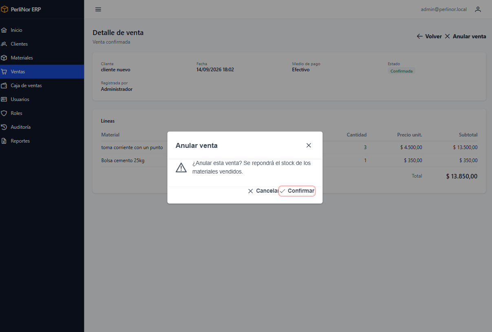
  <figcaption>Confirmación previa a anular una venta.</figcaption>
</figure>

Vas a ver el aviso «Venta anulada. Stock repuesto.»

<figure>
  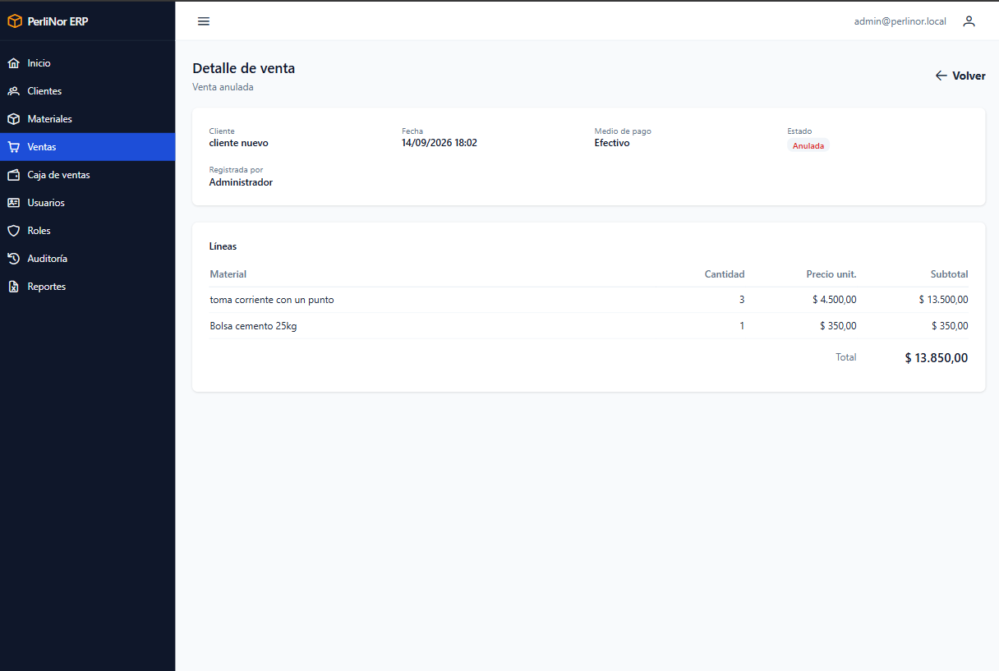
  <figcaption>Detalle de una venta anulada. El estado cambió y el botón Anular ya no está disponible.</figcaption>
</figure>

### Qué hace el sistema al anular

1. Marca la venta como **Anulada**.
2. **Repone el stock** de todos los materiales vendidos.
3. **Revierte el ingreso en la caja**, con un movimiento negativo.

<blockquote class="aviso">
<p><strong>La anulación no se puede deshacer.</strong></p>
<p>Una venta anulada queda anulada. Si la operación era correcta, hay que <strong>registrarla de
nuevo</strong>.</p>
<p>La venta anulada no se borra: queda en el listado con estado Anulada, para que el historial
muestre lo que pasó.</p>
</blockquote>

### Qué deja de contar una venta anulada

A partir de la anulación, esa venta **no se computa** en:

- Los indicadores de la pantalla de inicio.
- El gráfico de evolución de ventas.
- El saldo de la caja de ventas.
- El reporte de ventas por período.

Sigue apareciendo en el listado de Ventas, con su estado, y en la Auditoría.

### Si no podés anular

| Mensaje | Qué significa |
|---|---|
| «Solo se pueden anular ventas confirmadas» | La venta ya estaba anulada |
| «La venta ya no está confirmada» | Otra persona la anuló al mismo tiempo. Recargá la pantalla |

## Preguntas frecuentes de este capítulo

| Duda | Respuesta |
|---|---|
| ¿Puedo modificar una venta registrada? | No. Si tiene un error, anulala y registrala de nuevo |
| ¿Puedo cambiarle el precio a una línea? | No. El precio sale del material. Si está mal, corregilo en **Materiales** y registrá la venta de nuevo |
| Registré dos veces la misma venta | Anulá una de las dos. El stock se repone solo |
| ¿La venta a Cuenta corriente suma a la caja? | Sí. Todas las ventas registran su ingreso, cualquiera sea el medio de pago |
| No encuentro una venta de la semana pasada | Ampliá el rango de fechas: el listado arranca en el día de hoy |
| ¿Puedo dejar una venta a medio cargar y seguir después? | No. La venta se registra completa o no se registra |

# Caja de ventas

Muestra el dinero que ingresó por las ventas de la fábrica.

**Acceden:** Administración y Finanzas.

## La caja se alimenta sola

<blockquote class="aviso">
<p><strong>Acá no se cargan movimientos.</strong></p>
<p>Todos los movimientos los genera el sistema:</p>
<ul>
<li>Cada <strong>venta registrada</strong> genera un ingreso por su importe total.</li>
<li>Cada <strong>venta anulada</strong> genera un movimiento negativo que revierte el ingreso.</li>
</ul>
<p>Esta pantalla es de consulta: no tiene botones de alta ni de edición.</p>
</blockquote>

## Qué vas a ver

<figure>
  
  <figcaption>Caja de ventas: el saldo acumulado arriba y el listado de movimientos del día debajo.</figcaption>
</figure>

**Arriba, el saldo.** El total acumulado de la caja.

**Abajo, los movimientos**, con fecha y hora, descripción e importe. El listado **arranca mostrando
los del día de hoy**.

## El saldo no cambia con el filtro

<blockquote class="aviso">
<p><strong>Esto es lo que más confunde de esta pantalla, así que conviene tenerlo claro.</strong></p>
<p>El <strong>saldo</strong> de arriba es el <strong>acumulado total de la caja</strong>, desde
siempre. <strong>No cambia</strong> cuando filtrás por fecha.</p>
<p>El filtro afecta <strong>solamente al listado</strong> de abajo.</p>
<p>Es decir: si filtrás una semana en la que hubo $500.000 de ventas, el listado va a mostrar esos
movimientos, pero el saldo va a seguir mostrando el acumulado completo. <strong>No es un error.</strong></p>
</blockquote>

## Filtrar los movimientos

| Filtro | Para qué sirve |
|---|---|
| **Desde** / **Hasta** | Acota el listado a un rango de fechas |
| **Restablecer** | Vuelve a los movimientos del día de hoy |

Si no hay movimientos en el rango elegido, vas a ver «No hubo movimientos de caja en el período
seleccionado.»

## Cómo leer los movimientos

| Importe | Qué significa |
|---|---|
| **Positivo** | Ingreso por una venta |
| **Negativo** | Reversión por una venta anulada |

<figure>
  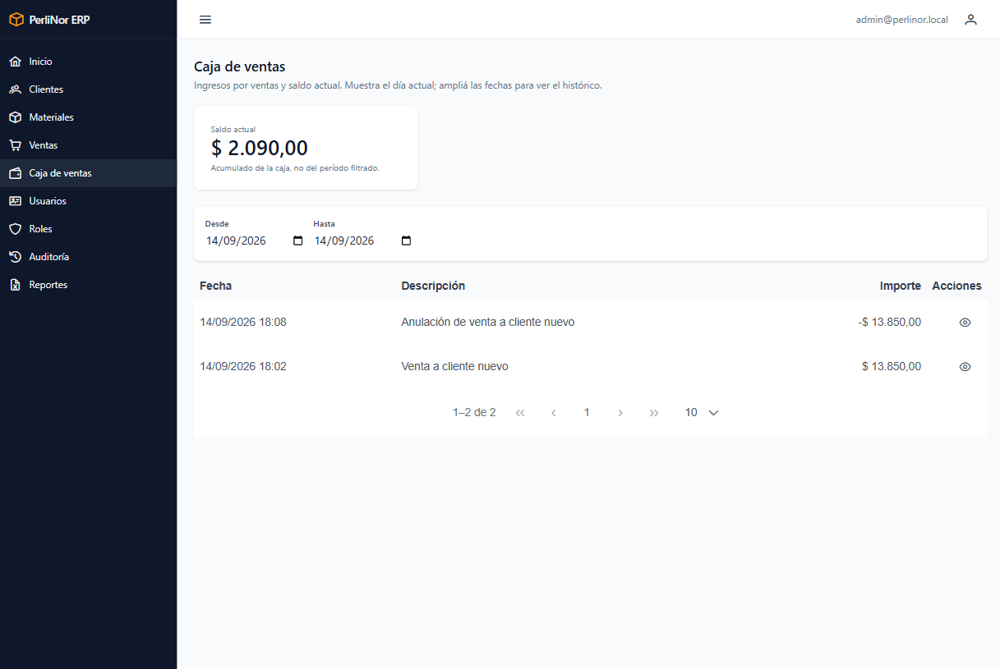
  <figcaption>Movimiento negativo generado por la anulación de una venta.</figcaption>
</figure>

La descripción te dice de qué se trata: «Venta a *cliente*» para los ingresos, «Anulación de venta a
*cliente*» para las reversiones.

> **Las anulaciones dejan dos movimientos, no cero.** Cuando se anula una venta, el ingreso original
> **se conserva** y se agrega uno negativo por el mismo importe. La suma de los dos es cero, pero
> ambos quedan a la vista.
>
> Es a propósito: así el historial muestra que hubo una venta y que después se anuló. Si el ingreso
> se borrara, esa operación desaparecería del registro sin dejar rastro.

## Ir a la venta de un movimiento

Los movimientos que vienen de una venta te permiten abrirla: hacé clic en el movimiento y el sistema
te lleva a su detalle. Sirve para saber qué se vendió, a quién y quién la registró.

## Preguntas frecuentes de este capítulo

| Duda | Respuesta |
|---|---|
| El saldo no coincide con la suma de lo que veo | El saldo es el acumulado total; el listado está filtrado por fecha. Es lo esperado |
| ¿Puedo cargar un movimiento a mano? | No. Los genera el sistema con cada venta y cada anulación |
| ¿Puedo corregir un movimiento? | No directamente. Si la venta estaba mal, anulala: la caja se ajusta sola |
| Una venta en cuenta corriente aparece como ingreso | Sí. El sistema registra todas las ventas en la caja, cualquiera sea el medio de pago |
| ¿Esta caja incluye los pagos a proveedores? | No. Solo refleja ingresos por ventas y sus reversiones |

# Reportes

Permite descargar la información de ventas en un archivo de planilla de cálculo, para analizarla
fuera del sistema.

**Acceden:** Administración y Finanzas.

## Qué necesitás saber antes

Para aprovechar el reporte conviene manejar lo básico de una planilla de cálculo: abrir un archivo,
ordenar y filtrar columnas. Si sabés usar tablas dinámicas, mejor: el reporte está pensado para eso.

## Descargar el reporte de ventas

**Paso 1.** En el menú, entrá a **Reportes**.

<figure>
  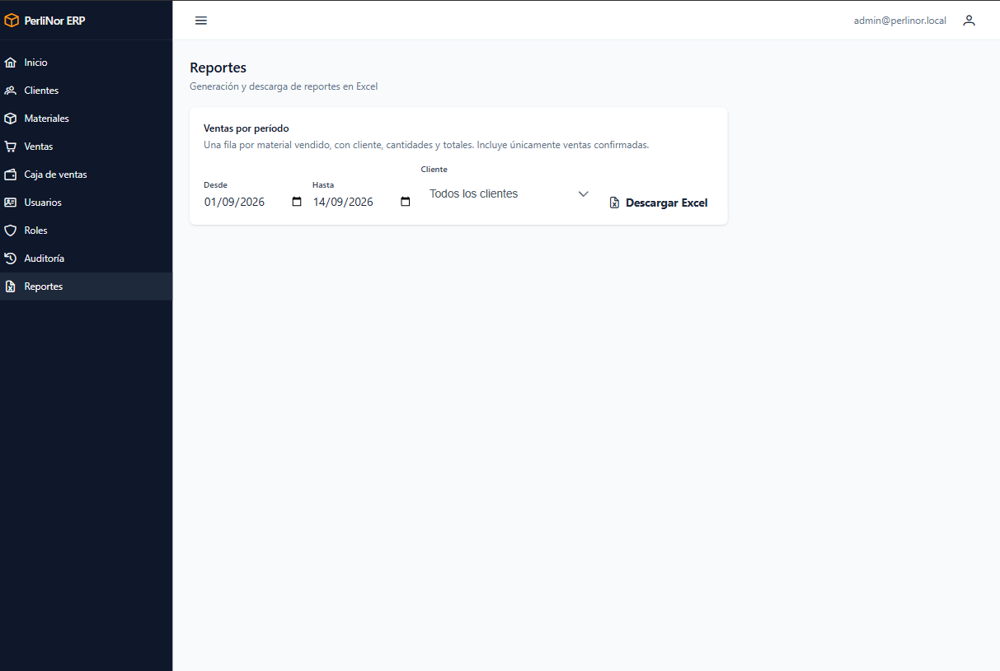
  <figcaption>Pantalla de Reportes. El período viene precargado con el mes en curso.</figcaption>
</figure>

**Paso 2.** Revisá el **período**. Viene precargado desde el día 1 del mes hasta hoy. Cambialo si
necesitás otro rango.

**Paso 3.** Si querés el reporte de un cliente puntual, elegilo en **Cliente**. Si lo dejás en «Todos
los clientes», salen todas las ventas del período.

**Paso 4.** Hacé clic en **Descargar**.

El archivo se descarga como cualquier archivo del navegador. Vas a ver un aviso con la cantidad de
líneas: «Reporte generado con 184 línea(s) de venta.»

## Qué contiene el archivo

<figure>
  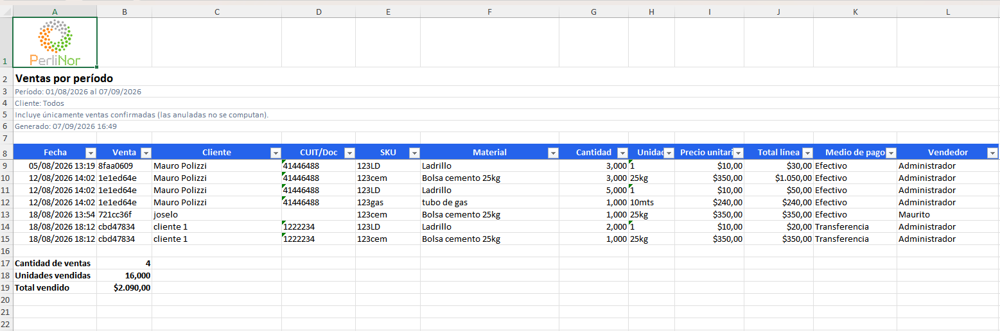
  <figcaption>Reporte generado, abierto en una planilla de cálculo: encabezado con el período aplicado, tabla con filtro automático y bloque de totales al pie.</figcaption>
</figure>

**Arriba**, el logo, el título y las líneas de contexto: el período, el cliente filtrado, la
aclaración de que solo incluye ventas confirmadas, y la fecha y hora de generación.

**En el medio**, la tabla:

| Columna | Qué muestra |
|---|---|
| Fecha | Fecha y hora de la venta |
| Venta | Identificador abreviado |
| Cliente | Nombre del cliente |
| CUIT/Doc | Identificación tributaria |
| SKU | Código del material |
| Material | Nombre del material |
| Cantidad | Unidades vendidas en esa línea |
| Unidad | Unidad de medida |
| Precio unitario | Precio al momento de la venta |
| Total línea | Importe de la línea |
| Medio de pago | En español |
| Vendedor | Quién registró la venta |

**Abajo**, los totales: cantidad de ventas, unidades vendidas y total vendido.

## Una fila por línea, no por venta

<blockquote class="aviso">
<p><strong>Cada fila es una línea de venta, no una venta.</strong></p>
<p>Una venta con tres materiales distintos ocupa <strong>tres filas</strong>, que repiten el cliente,
la fecha y el número de venta.</p>
<p>Por eso <strong>«Cantidad de ventas» no coincide con la cantidad de filas</strong>: cuenta ventas
distintas, no líneas.</p>
<p>Es a propósito. Con este nivel de detalle podés armar el corte que necesites —por cliente, por
material, por mes, por vendedor— con una tabla dinámica, sin pedir un reporte nuevo.</p>
</blockquote>

## Solo ventas confirmadas

El reporte **no incluye las ventas anuladas**. El encabezado del archivo lo aclara, para que quien lo
reciba no tenga que suponerlo.

Es el mismo criterio de los indicadores y de la caja: una venta anulada devolvió el stock y revirtió
el dinero, así que no corresponde computarla.

## La planilla viene lista para trabajar

**El encabezado queda fijo**: al bajar por la tabla, los títulos de columna siguen visibles.

**Las columnas tienen filtro automático**: podés ordenar y filtrar desde los títulos.

**Los números son números**, no texto. Se pueden sumar y usar en tablas dinámicas sin conversiones.

## Mensajes que podés ver

| Mensaje | Qué significa | Qué hacer |
|---|---|---|
| «Reporte generado con N línea(s) de venta.» | La descarga se completó | Abrí el archivo |
| «No hay ventas confirmadas en el período. El archivo se descargó sin datos.» | No hubo ventas en ese rango | El archivo se descarga igual, con encabezado y sin filas. Ampliá el período |
| «El reporte supera las 20.000 filas. Achicá el rango de fechas.» | El período es demasiado amplio | Reducí el rango, o filtrá por un cliente |
| «La fecha "desde" no puede ser posterior a "hasta".» | El rango está invertido | Corregí las fechas |

## Preguntas frecuentes de este capítulo

| Duda | Respuesta |
|---|---|
| ¿Puedo exportar a PDF? | No. El único formato es planilla de cálculo |
| ¿El reporte incluye las ventas anuladas? | No |
| ¿Por qué hay más filas que ventas? | Cada fila es una línea de venta. Una venta con varios materiales ocupa varias filas |
| Necesito el total por cliente | Descargá el reporte y armá una tabla dinámica agrupando por Cliente |
| ¿Puedo pedir otro reporte? | Hoy hay uno solo. El sistema está preparado para incorporar otros |
| ¿Dónde quedó el archivo? | En la carpeta de descargas de tu navegador |

# Administración: usuarios, roles y auditoría

Los tres módulos de este capítulo son exclusivos del rol **Administración**.

## Usuarios

Acá se administran las cuentas de acceso al sistema.

> **Usuario no es lo mismo que empleado.** Un usuario es una cuenta para entrar al sistema. La
> fábrica tiene más empleados que usuarios: solo tienen cuenta quienes necesitan operar el sistema.

### Buscar un usuario

El listado **arranca vacío**: escribí al menos dos letras. Podés buscar por **nombre o email**.

<figure>
  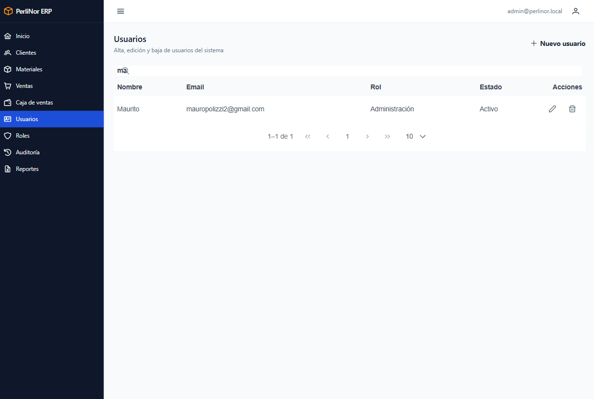
  <figcaption>Listado de Usuarios con resultados de una búsqueda.</figcaption>
</figure>

### Dar de alta un usuario

**Paso 1.** Hacé clic en **Nuevo usuario**.

**Paso 2.** Completá los datos.

<figure class="media">
  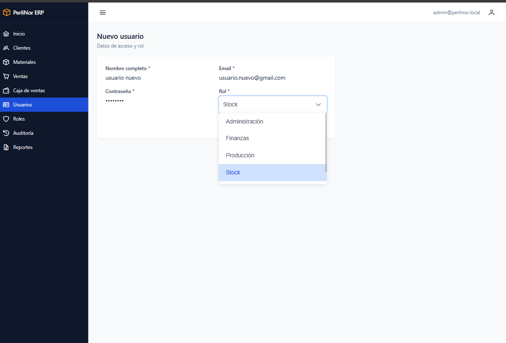
  <figcaption>Formulario de alta de usuario, con el selector de rol desplegado.</figcaption>
</figure>

| Campo | ¿Obligatorio? | Detalle |
|---|---|---|
| **Nombre completo** | **Sí** | Nombre que se muestra en el sistema |
| **Email** | **Sí** | Con el que va a entrar. No puede repetirse |
| **Contraseña** | **Sí** | Mínimo 8 caracteres |
| **Rol** | **Sí** | Define qué va a poder hacer |

**Paso 3.** Guardá. Vas a ver «Usuario creado.»

**Paso 4.** Entregale al usuario su email y su contraseña, y pedile que la cambie en el primer
ingreso (capítulo 3).

<blockquote class="aviso">
<p><strong>El rol define todo lo que la persona puede hacer.</strong></p>
<p>Elegilo con cuidado: determina qué módulos ve en el menú y qué operaciones puede realizar.
El alcance de cada rol está en el capítulo 1.</p>
</blockquote>

### Modificar un usuario

<figure class="media">
  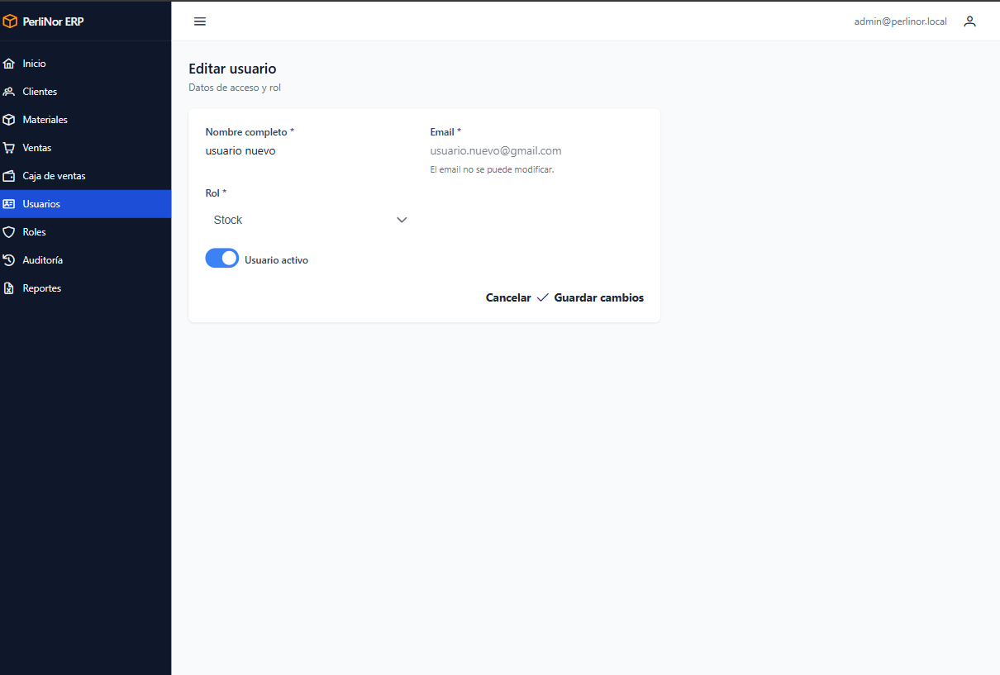
  <figcaption>Formulario de edición. El email aparece en gris porque no se puede modificar.</figcaption>
</figure>

Podés cambiar el **nombre** y el **rol**.

**El email no se puede modificar.** Aparece en gris, deshabilitado. Si alguien necesita otro email,
hay que dar de alta una cuenta nueva y dar de baja la anterior.

**La contraseña no se cambia desde acá.** Ni siquiera Administración puede verla o modificarla: cada
persona la cambia con el procedimiento del capítulo 3.

### Dar de baja un usuario

**Paso 1.** Buscalo y hacé clic en el botón de baja.

**Paso 2.** Confirmá. Vas a ver «Usuario dado de baja.»

A partir de ese momento **no puede entrar al sistema**. Todo lo que hizo se conserva: las ventas que
registró siguen mostrando su nombre, y sus operaciones siguen en la auditoría.

### Mensajes que podés ver

| Mensaje | Qué significa |
|---|---|
| «Usuario creado.» · «Usuario actualizado.» · «Usuario dado de baja.» | La operación se completó |
| «El email ya está registrado» | Ya existe una cuenta con ese email, activa o dada de baja |

## Roles

Es una pantalla de **consulta**: muestra los cinco roles y qué permisos tiene cada uno.

<figure>
  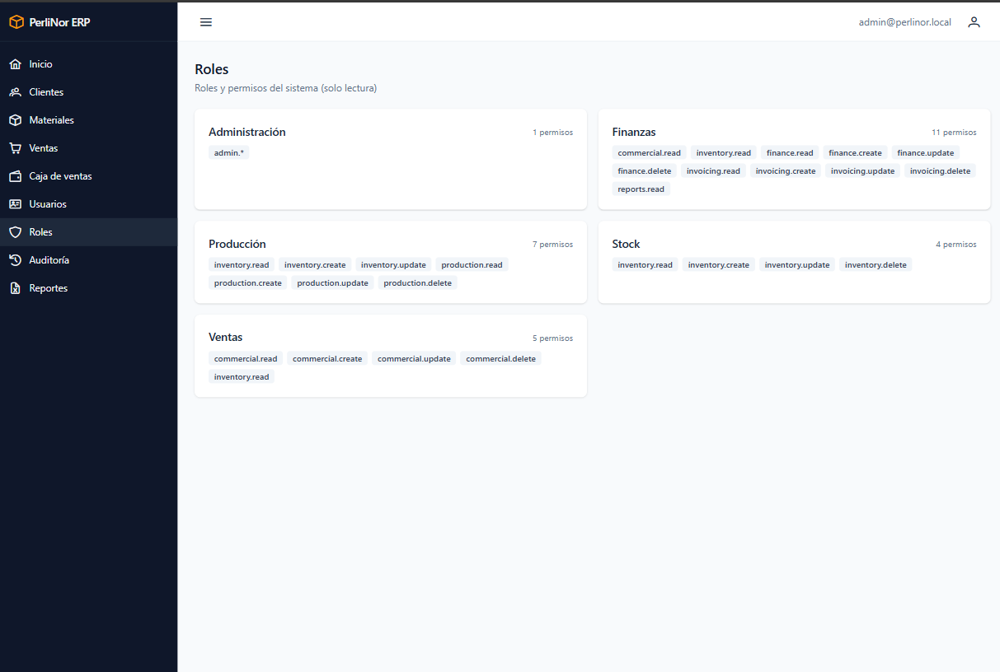
  <figcaption>Pantalla de Roles: cada rol con la lista de permisos que agrupa.</figcaption>
</figure>

> **Los roles no se modifican desde el sistema.** Están definidos y no se pueden editar, ni crear
> roles nuevos. Lo que sí podés hacer es **cambiarle el rol a un usuario** desde el módulo de
> Usuarios.

Los permisos se nombran con el formato `módulo.acción`. Por ejemplo, `commercial.create` significa
«puede crear en el módulo comercial».

Algunos roles tienen permisos de módulos que todavía no están disponibles, como Producción. Están
previstos para cuando esos módulos se incorporen.

## Auditoría

Registra **quién hizo qué y cuándo** en las operaciones importantes del sistema.

<figure>
  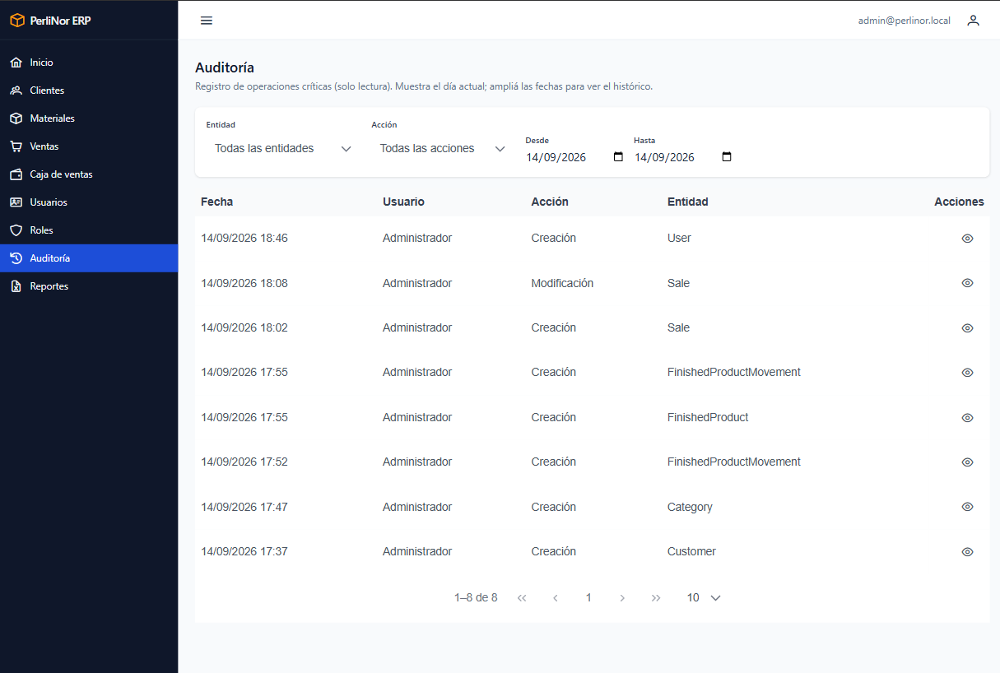
  <figcaption>Listado de Auditoría con sus filtros: entidad, acción y rango de fechas.</figcaption>
</figure>

El listado **arranca mostrando el día de hoy**.

### Filtros

| Filtro | Para qué sirve |
|---|---|
| **Entidad** | Sobre qué se operó: Venta, Cliente, Material, Usuario |
| **Acción** | Creación, Modificación o Baja |
| **Desde** / **Hasta** | Rango de fechas |

### Ver el detalle

Hacé clic en una fila para ver qué cambió exactamente.

<figure>
  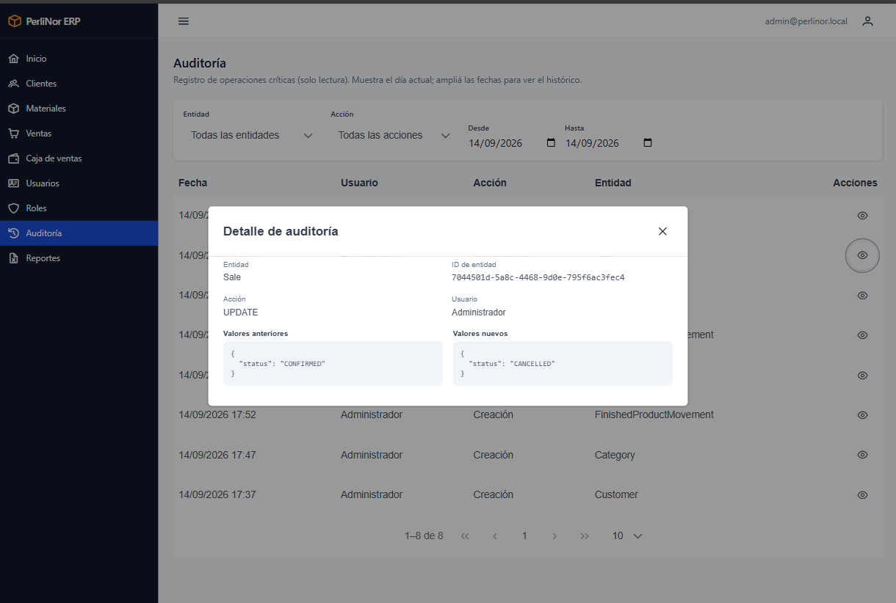
  <figcaption>Detalle de un registro de auditoría, con los valores anterior y posterior.</figcaption>
</figure>

El detalle muestra el **valor anterior** y el **valor posterior**. En una creación solo hay valor
posterior; en una baja, solo anterior.

> Los valores se muestran en el formato técnico en que el sistema los guarda. No es el más cómodo de
> leer, pero permite ver con precisión qué campo cambió y de qué a qué.

### Para qué sirve

| Situación | Cómo ayuda |
|---|---|
| Un precio cambió y nadie sabe quién | Filtrá por entidad Material y acción Modificación |
| Un cliente aparece dado de baja | Filtrá por entidad Cliente y acción Baja |
| Hay que reconstruir qué pasó un día | Poné el rango en esa fecha y mirá todo el movimiento |

### Qué se registra y qué no

**Se registra:** creación, modificación y baja de clientes, materiales, usuarios, categorías, ventas
y movimientos de stock. También los cambios de contraseña, sin guardar la contraseña.

**No se registra:** las consultas. Que alguien vea un listado o descargue un reporte no deja
registro.

## Preguntas frecuentes de este capítulo

| Duda | Respuesta |
|---|---|
| Necesito cambiarle el email a un usuario | No se puede. Creá una cuenta nueva y dá de baja la anterior |
| Un usuario olvidó su contraseña | Que use **¿Olvidaste tu contraseña?** en la pantalla de acceso. Vos no podés cambiársela |
| Necesito un rol con otros permisos | Los roles son fijos. Elegí el más parecido, o consultá por una modificación del sistema |
| Di de baja un usuario por error | Editalo y volvé a marcarlo como activo |
| ¿Se puede borrar un registro de auditoría? | No. La auditoría es de solo lectura |

# Preguntas frecuentes y solución de problemas

Reúne las dudas que aparecen con más frecuencia. Si tu situación no está acá, consultá el capítulo
del módulo correspondiente.

## Acceso

| Situación | Qué hacer |
|---|---|
| **No puedo entrar: dice «Email o contraseña incorrectos»** | Revisá que el email esté bien escrito y que no haya quedado activada la tecla de mayúsculas. Si no lo resolvés, usá **¿Olvidaste tu contraseña?** |
| **Olvidé la contraseña** | Desde la pantalla de acceso, **¿Olvidaste tu contraseña?** El procedimiento completo está en el capítulo 3 |
| **No me llegó el mail de recuperación** | Revisá correo no deseado. Verificá que el email sea el de tu cuenta. El sistema muestra el mismo aviso exista o no la dirección, así que el aviso no confirma que haya llegado |
| **El enlace del mail no funciona** | Dura 30 minutos y se usa una sola vez. Pedí uno nuevo |
| **Me pidió iniciar sesión de nuevo** | La sesión se renueva sola mientras usás el sistema. Si pasás varios días sin entrar, vuelve a pedir la contraseña |
| **Entré pero no veo un módulo** | El menú muestra solo lo habilitado para tu rol. Consultá con la administración |

## Listados y búsquedas

| Situación | Qué hacer |
|---|---|
| **El listado aparece vacío** | En **Clientes**, **Materiales** y **Usuarios** es a propósito: escribí al menos 2 letras en el buscador |
| **No encuentro un registro que sé que existe** | Probá con menos letras, o buscá por otro dato. En Clientes podés buscar por nombre, CUIT o email; en Materiales, por SKU o nombre |
| **No encuentro una venta de otra fecha** | **Ventas**, **Caja de ventas** y **Auditoría** arrancan mostrando el día de hoy. Ampliá el rango con **Desde** y **Hasta** |
| **Filtré y ahora no veo nada** | Usá **Restablecer** para volver a los valores iniciales |

## Ventas

| Situación | Qué hacer |
|---|---|
| **«Stock insuficiente»** | La venta **no se registró** y el stock quedó como estaba. Corregí la cantidad, o cargá el stock faltante desde **Materiales** con un **Ingreso** |
| **Un material no aparece al cargar la venta** | Puede estar dado de baja. Verificalo en **Materiales** |
| **Un cliente no aparece en la lista** | Puede estar dado de baja. Verificalo en **Clientes** |
| **Registré una venta con un error** | No se puede modificar. Anulala y registrala de nuevo |
| **Registré dos veces la misma venta** | Anulá una. El stock se repone solo |
| **El precio de la venta no es el que esperaba** | El precio sale del material al momento de registrar. Corregilo en **Materiales** y volvé a registrar |
| **«No hay una caja de ventas configurada»** | Es una configuración del sistema, no un problema de tu venta. Avisá a la administración |

## Stock

| Situación | Qué hacer |
|---|---|
| **El stock quedó mal después de un movimiento** | Probablemente se eligió **Ajuste** cuando correspondía **Ingreso**, o al revés. Ingreso **suma**; Ajuste **reemplaza**. Corregí con un **Ajuste** al valor correcto |
| **Necesito descontar stock por rotura o pérdida** | Usá un **Ajuste** al valor real y aclaralo en **Referencia**. Las salidas por venta las genera el sistema |
| **Di de alta un material y quedó con stock 0** | Es lo esperado. Cargale el stock con un **Ingreso** |
| **Un material figura en «Stock más bajo» pero tiene stock** | Ese panel muestra los cinco materiales con **menos** stock, comparados entre sí. No es una alerta de faltante |

## Caja y reportes

| Situación | Qué hacer |
|---|---|
| **El saldo no coincide con los movimientos que veo** | El saldo es el **acumulado total**; el listado está filtrado por fecha. Es lo esperado |
| **Una venta anulada sigue en la caja** | Se conservan los dos movimientos: el ingreso y su reversión negativa. La suma es cero |
| **El reporte tiene más filas que ventas** | Cada fila es una **línea de venta**. Una venta con tres materiales ocupa tres filas |
| **«El reporte supera las 20.000 filas»** | Achicá el rango de fechas, o filtrá por un cliente |
| **El reporte salió vacío** | No hubo ventas confirmadas en ese período. El archivo se descarga igual, con encabezado |

## Bajas

| Situación | Qué hacer |
|---|---|
| **Di de baja algo por error** | Nada se borra. Para usuarios, editalo y marcalo como activo. Para clientes y materiales, consultá con la administración |
| **¿Puedo eliminar algo definitivamente?** | No. El sistema conserva todo para no perder el historial |
| **Un cliente dado de baja aparece en una venta vieja** | Es correcto. Las ventas anteriores conservan su información |

## Problemas generales

| Situación | Qué hacer |
|---|---|
| **La pantalla quedó en blanco o no responde** | Recargá la página. Tu sesión se conserva |
| **Un aviso rojo desapareció antes de que lo leyera** | Repetí la operación: si el problema persiste, el aviso vuelve a aparecer |
| **«Ocurrió un error inesperado» o «Error interno del servidor»** | Anotá qué estabas haciendo y avisá a la administración. Estos errores quedan registrados del lado del sistema |
| **Los datos que veo parecen desactualizados** | Recargá la página |
| **El sistema no carga** | Verificá tu conexión. Si otras páginas funcionan, avisá a la administración |

## Cuándo avisar a la administración

Resolvé por tu cuenta: contraseñas olvidadas, búsquedas sin resultado, errores de carga, ventas mal
registradas.

Avisá a la administración cuando:

- Necesites acceso a un módulo que no ves.
- Haya que reactivar un cliente o un material dado de baja.
- Aparezca «No hay una caja de ventas configurada».
- Se repitan errores internos del servidor.
- Sospeches que alguien accedió a tu cuenta.

<h1 class="sin-numero">Glosario</h1>

Términos que usa el sistema, explicados en lenguaje corriente.

| Término | Qué significa |
|---|---|
| **Ajuste** | Movimiento de stock que **reemplaza** la cantidad disponible por el valor que indicás. Se usa para corregir después de un recuento |
| **Anular** | Revertir una venta registrada por error. Repone el stock y descuenta el importe de la caja. No se puede deshacer |
| **Auditoría** | Registro de quién hizo qué operación y cuándo |
| **Caja de ventas** | Registro del dinero ingresado por ventas. Se alimenta sola |
| **Categoría** | Agrupación de materiales, para clasificarlos |
| **Confirmada** | Estado de una venta vigente. Descontó stock y sumó a la caja |
| **CUIT / Doc** | Identificación tributaria del cliente |
| **Dar de baja** | Desactivar un cliente, material o usuario. **No lo borra**: conserva su información y su historial |
| **Entidad** | En la pantalla de Auditoría, sobre qué se hizo la operación: una Venta, un Cliente, un Material, un Usuario |
| **Filtro** | Condición para acotar un listado: un rango de fechas, un estado, un cliente |
| **Indicador** | Cada uno de los números de la pantalla de inicio: ventas del mes, ventas de hoy, materiales activos, clientes activos |
| **Ingreso** | Movimiento de stock que **suma** la cantidad al stock actual. Se usa cuando entra mercadería |
| **Línea de venta** | Cada material dentro de una venta, con su cantidad y su precio |
| **Material** | Producto que fabrica y vende la empresa |
| **Medio de pago** | Cómo se pagó la venta: Efectivo, Transferencia, Tarjeta, Cheque o Cuenta corriente |
| **Movimiento de caja** | Cada entrada o salida de dinero de la caja. Positivo es ingreso; negativo, reversión de una anulación |
| **Movimiento de stock** | Cada cambio en la cantidad disponible de un material, con su motivo |
| **Permiso** | Autorización para una acción concreta. Los permisos se agrupan en roles |
| **Reporte** | Archivo de planilla de cálculo con información exportada del sistema |
| **Rol** | Función dentro de la empresa que determina qué puede hacer un usuario. Hay cinco: Administración, Ventas, Producción, Stock y Finanzas |
| **Saldo** | Dinero acumulado en la caja de ventas. No cambia al filtrar el listado por fecha |
| **Sesión** | Período durante el cual el sistema te mantiene identificado, sin volver a pedirte la contraseña |
| **SKU** | Código único que identifica a cada material |
| **Stock** | Cantidad disponible de un material |
| **Subtotal** | Suma de las líneas de una venta, antes de impuestos |
| **Total** | Importe final de la venta |
| **Unidad** | Cómo se cuenta un material: unidad, bolsa, metro cúbico |
| **Usuario** | Cuenta con la que una persona entra al sistema. No todos los empleados tienen usuario |
| **Vendedor** | Usuario que registró una venta |

## Tres distinciones que conviene no confundir

| No es lo mismo | Diferencia |
|---|---|
| **Ingreso** y **Ajuste** | Ingreso **suma** al stock; Ajuste lo **reemplaza**. Ver capítulo 7 |
| **Dar de baja** y **Anular** | La baja desactiva una ficha (cliente, material, usuario); la anulación revierte una venta |
| **Empleado** y **Usuario** | El empleado trabaja en la empresa; el usuario es una cuenta del sistema. No todo empleado tiene cuenta |
